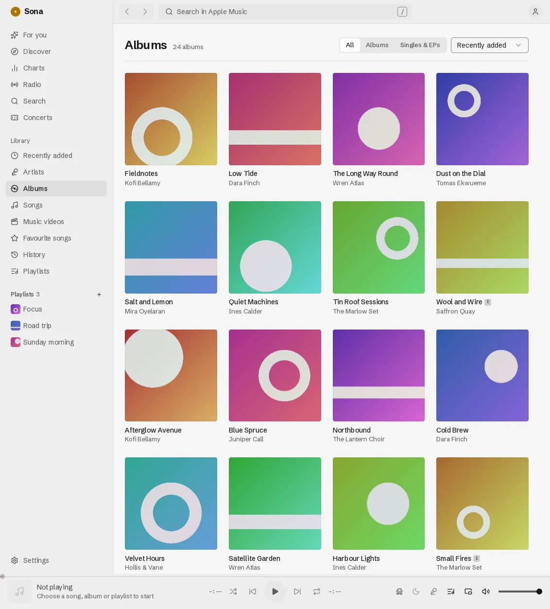

### Sona

A native Apple Music client for Linux, macOS and Windows.

[Download](https://github.com/coredev-uk/sona-go/releases) •
[Documentation](https://sona.coredev.uk) •
[Release notes](https://github.com/coredev-uk/sona-go/releases/latest)

 

<picture>
  <source media="(prefers-color-scheme: dark)" srcset="site/src/assets/home-dark.webp">
  
</picture>

## Contributing

Report bugs with the [bug report form](https://github.com/coredev-uk/sona-go/issues/new?template=bug_report.yml)
and request features with the [feature request form](https://github.com/coredev-uk/sona-go/issues/new?template=feature_request.yml).
Ask questions and share ideas in [Discussions](https://github.com/coredev-uk/sona-go/discussions).
To change the code, read [CONTRIBUTING.md](CONTRIBUTING.md).

## Licence

Sona is licensed under the GNU Affero General Public License v3.0 only
([LICENSE](LICENSE)). It is not affiliated with Apple or Google.
