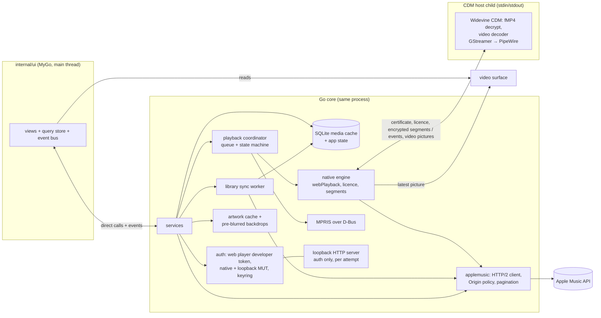
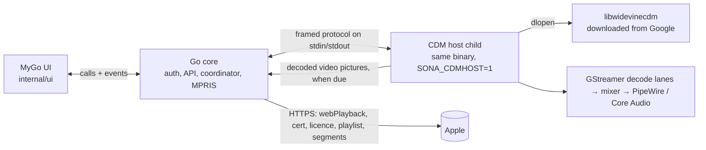

# Sona Architecture

How Sona is built and why. The working rules live in `AGENTS.md` and `CONTRIBUTING.md`; the module contracts in `internal/services/doc.go` and `docs/ui-architecture.md`; authentication in `docs/auth.md`; the Apple endpoints and features Sona covers in `docs/apple-music-reference.md`; the visual direction in `docs/design.md`; the threat model in `docs/security-review.md`.

## 1. Product scope

Sona is a desktop Apple Music client written in Go, with its interface drawn natively by MyGo. It starts instantly from a local cache and treats Linux as the primary platform rather than a port.

Goals:

- Fast: a cold start renders cached library data before any network call; no UI jank on large libraries.
- Functional: reliable sign-in, catalogue and library browsing, full-track playback, media keys and desktop integration.
- Linux-first: MyGo on GTK3, Wayland-native, PipeWire audio, D-Bus MPRIS, XDG paths, Secret Service credentials. macOS and Windows sit behind the same seams (§9).
- Go owns all Apple Music networking, credentials, sync, caching and platform integration. The UI renders state; it never holds tokens or talks to Apple directly.

The Apple Music web app is a reference for functionality only (`docs/apple-music-reference.md`): Sona matches Apple in capability, and every page is designed fresh under `docs/design.md`.

Non-goals:

- Decrypting protected media by any means other than the Widevine CDM's own APIs: `Decrypt` for audio, and for music video pictures only its own video decoder (`DecryptAndDecodeFrame`, §4.2). Sona hosts Google's CDM, downloaded from Google (§4.3); it never extracts keys, never uses reimplemented CDMs, and never lets decrypted audio or the video bitstream leave the CDM host process (decoded pictures leave it for display only, in memory).
- Shipping Apple private keys, user tokens or a Widevine CDM binary in the repository, the binary or the packages; redistributing or patching the CDM.
- Deliberately not built: HD and 4K music videos (Apple licenses a software CDM for SD only: `docs/apple-music-reference.md` §4.5), uploaded videos and music movies, social graph changes (follow and unfollow need a request signature the web token cannot produce), taste onboarding, report a concern, account and billing pages (web-only).

## 2. Stack

- Go 1.27.3 and MyGo v0.8.3 (`github.com/egoist/mygo/ui`): one Go process draws the whole interface on the GPU, over GTK3 on Linux, AppKit on macOS and Win32 on Windows. The UI is Go (`internal/ui`): a component kit themed with the `docs/design.md` tokens, a query store that fetches on goroutines and publishes with `Window.Update`, and the services' events on one bus; the layout is `docs/ui-architecture.md`.
- SQLite through `github.com/mattn/go-sqlite3` (FTS5 via the `sqlite_fts5` build tag) with a libSQL-compatible schema, goose migrations and sqlc queries.
- `github.com/zalando/go-keyring` (Secret Service, Keychain, Credential Manager), `github.com/godbus/dbus/v5`, `golang.org/x/sync`. Artwork is decoded with the standard library's `image/jpeg` and `image/png` only and resized in `internal/artwork`, so no TIFF, BMP or WebP decoder is linked.
- cgo: GStreamer 1.x (`gstreamer-1.0`, `gstreamer-app-1.0`; also the motion artwork decoder), `dlopen` for the CDM through a C++ shim. MyGo itself loads GTK3, Pango and the GL libraries by soname (purego) and needs no cgo.
- Development environment: devenv (Nix), described in `CONTRIBUTING.md`.

Why Go + MyGo: Go gives a simple concurrent backend (sync workers, HTTP/2 client, D-Bus, cgo for the CDM and GStreamer) with fast builds, and MyGo lets the same process draw the interface on the GPU with no web engine: no IPC, no generated bindings, the services called directly. The hard Linux problem, DRM playback, is solved independently of the UI toolkit (§4).

## 3. Process model



- **UI (`internal/ui`, MyGo)**: runs in the main process, on the main thread, and calls the services directly, subscribing to their events. It holds no credentials and makes no requests to `*.apple.com`; artwork, motion and a playing music video's picture come from `artwork.Cache`, `motion.Cache` and the video surface in memory.
- **Go core**: start-up, configuration (XDG directories), `log/slog` logging with token redaction; the developer-token and Music User Token lifecycle; the only Apple Music HTTP client; the SQLite cache; the library sync worker; the playback coordinator; MPRIS, single instance and `music://`/`itms://` handling; the desktop shell (main window, mini player, tray); desktop integrations (notifications, sleep inhibitor, Discord presence, scrobbling); the artwork cache.
- **CDM host child**: the same executable re-executed with `SONA_CDMHOST=1` (`cdmhost.ChildMain()` runs first in `main`). It loads the downloaded Widevine CDM, decrypts, decodes and plays, and makes no network requests. Decrypted audio never leaves it; a music video's decoded pictures go to the parent for display (§4.2).

### Go core responsibilities in detail

- **Apple client** (`internal/applemusic`): the `Origin: https://music.apple.com` header policy, storefront and language (content GETs carry `l=` with the user's language, the Language setting else the system's, when the storefront offers it: `ContentLanguage`; caches key on it), pagination, backoff on 429 and 5xx, `singleflight` for duplicate requests.
- **Start-up gate**: the shared HTTP client holds every request until the UI calls `SystemService.FirstPaint` (with a fallback timer); the CDM download and the playback host start after it too.
- **Desktop shell** (`internal/ui/app`, `services/desktop.go`): the main window opens at its remembered size and maximised state on the start page, or on the page it was last on when Settings → General → Open on says so (the route is read from settings, so the cold start still reads SQLite and settings only). Closing the window keeps Sona playing in the background with its tray icon (Settings → General; without a tray it quits). The tray (libayatana-appindicator3 on Linux, a menu bar item on macOS) shows the current song, the transport, private listening, Show Sona, the mini player and Quit. The mini player is a second, fixed-size, always-on-top window shown in the main window's place. `--hidden` (the autostart's "Start in the tray") starts with no window, when there is a tray. MPRIS `Raise`, the tray and a second launch bring the window forward; Apple Music links (`music://`, `itms://`, music.apple.com) open their page. The title bar is the system's inset buttons on macOS and, on stacking Linux desktops and Windows, a hidden title bar under Sona's top bar with MyGo's buttons in the desktop's layout (`internal/windowchrome` decides; `CONTRIBUTING.md`, "Title bar and window controls"). Autostart is an opt-in XDG entry.
- **Integrations** (`services/integrations.go`, after first paint): one track-change notification replaced per track over `org.freedesktop.Notifications`; a logind `sleep` inhibitor (portal `Inhibit` fallback) held only while playing; opt-in Discord presence over the local IPC socket with Apple's public artwork URL, never `/art/` or tokens; Last.fm and ListenBrainz scrobbling (`internal/scrobble`).
- **Artwork** (`internal/artwork`): the only code that fetches or resizes artwork. A template (Apple's `{w}x{h}` URL) is addressed by the hash of its text; an artwork key at a size is derived from the nearest cached source at the exact box, and `backdrop.jpg` from the 64 px source. Downloads send `Accept: image/jpeg,image/png;q=0.9,*/*;q=0.8`: Apple's generated covers (`gen/`) are drawn on a CDN miss by an origin that answers 406 to an `Accept` without `*/*`. A library playlist Apple rendered no cover for gets a mosaic: `library.FillCovers` reads each such playlist's tracks from SQLite (one statement per 500 playlists), takes the first four distinct artwork templates in track order and `artwork.Mosaic` turns them into the playlist's template. One distinct artwork, or two or three, gives the first one as it is; four or more give a template `mosaic:<t1> <t2> <t3> <t4>`, whose source the cache composes from the four tiles' own sources (a 2×2 grid of centred squares, edge to edge, JPEG, cached as `src-<n>x<n>.jpg` of the mosaic's key like any fetched source). Because a mosaic is just a template with its own key, every size, the backdrop and the dominant colours follow with no other code, the surfaces need no special case, and a change in the chosen four is a new key (the old one is evicted with the least recently used). A tile that cannot be fetched fails the whole cover (answered 502, never cached) and is tried again on the next request. Sign-out removes every mosaic with the user's other artwork (`Cache.RemoveMosaics`). A user's choice for a library playlist beats both (`playlist_covers`, migrations 00010 and 00011; the web API cannot set a cover, so the choice is local and per computer): `library.FillCovers` reads the choices first, in the same pass, and a playlist with one gets its template (`none` gives ""). Apple's generated cover (`…/gen/1200x1200AM.PDCXS1n.jpg?c1…c4&t=<name>&signature…`) becomes a `{w}x{h}` template in `applemusic.Artwork.Template`, since its CDN fills any size. Its design, `PDCXS11` to `PDCXS19`, is the one chosen in Apple's apps and is outside the signature, so a `preset` choice stores a design (`artwork.Patterns`) and `artwork.WithPattern` puts it into the playlist's current generated URL at read time: Apple draws it, with the playlist's colours and current name, and a playlist Apple generates no cover for keeps its automatic one. `cover:<32 hex>` is an image the user chose from a file (`artwork.SaveCover` crops the centre square, scales to at most 1024 px and stores a JPEG in `<data>/covers/`, which is user data and never evicted with the cache; sign-out and a playlist's removal delete the files, and sign-out also removes every cached generated cover in any design, which carry playlist names, `Cache.RemovePatterns`).
- **Private mode** (`internal/privatemode`): while on, plays reported to Apple carry `private-enabled`, and nothing is scrobbled, shown on Discord or written to local history. It is on for `SONA_PRIVATE=1`, in development builds, or from the saved setting.
- **Concerts** (`internal/places`, `ConcertsService`, after first paint): the Concerts page, the artist pages' "Upcoming concerts" and Home's concerts shelf list Apple's concert data (Shazam's events, through amp-api with the web player token; the user's own artists need the MUT). Apple asks for a place as a 4-character geohash; Sona has no location service and does not use MapKit, so the user picks a city from Sona's own list (about 600, with coordinates, searched on the computer), or keeps their storefront's main city. The choice is a setting (`concerts.city`, kept out of settings exports); only the geohash of its area goes to Apple, in the concerts requests alone, never in the personal recommendations. Lists are cached in `discover_cache` (3 hours, per area, filters and day; the one with the user's artists is personal and wiped on sign-out) and served stale when Apple can't be reached; ticket links are Apple's, https only, opened in the browser.
- **Updates** (`internal/update`, `internal/services/updates.go`): unless turned off (`updates.check`), one anonymous `GET` after the first paint (fixed User-Agent, no cookies, no identifiers); development builds never check.
  - **macOS (Apple silicon) and Windows (x64):** the request is `releases/latest/download/update-<target>.json` (`darwin-arm64`, `windows-amd64`), MyGo's manifest format (version, notes, date, archive URL and size, Ed25519 signature of the archive's SHA-256), written by `cmd/releasesign` in the publish job. "Install and restart" has `internal/update.Source` download the gzip-tar archive and check its size and signature against the public key embedded at build (`internal/update/update.pub`); only then does MyGo's `mygo.Updater` (fed through `SetSource`, and given the same key and feed with `-X` at link time) swap the app in and relaunch. A build without a key, or an install Sona can't write to, reports updates as off (`UpdateStatus.Disabled`: `unsigned`, `not_writable`) and only links the release. Settings → General → Test versions makes the check read the newest tag including prereleases.
  - **Rollback guard:** before swapping, Sona keeps the running version (`Sona.app.previous` beside the bundle, `previous\` in the Windows folder; files are hard-linked where the volume allows) and writes `update-pending` in the state folder. The new version clears it at its first paint. A start that finds it already counted 3 times (`update.MaxStarts`) restores the previous version, starts it, and reports the restore in the Diagnostics bundle.
  - **Linux:** the check compares the latest GitHub release (the API) with `VERSION` and says a version is out; .deb, .rpm, Arch, Flatpak and Nix update through their package managers, and the AppImage through AppImageUpdate.
- **Lyrics** (`internal/lyrics`, `LyricsService`, after first paint, only when lyrics are shown): Go asks every source switched on in Settings → Playback → Lyrics, in parallel with a 10 s timeout each, and keeps the result with the finest timing (word, then line, then plain text; the order breaks ties). Requests leave Sona only for these hosts: Apple Music's `amp-api.music.apple.com` (`syllable-lyrics`, then `lyrics`, through `applemusic.Client`); Musixmatch's `apic-appmobile.musixmatch.com` (an anonymous user token from its `token.get`, kept in the keyring or the 0600 `credentials-musixmatch` file and never logged, then `macro.subtitles.get` and `crowd.track.translations.get`); `lrclib.net` (`/api/get`, then `/api/search`); and `music.163.com` (NetEase, off by default: `/api/search/get`, `/api/song/lyric`). Each sends the song's title, artist, album, length and ISRC, nothing about the account, and a `Sona/<version>` User-Agent. Each source is paced (one request per second to Musixmatch, 250 ms to LRCLIB, 500 ms to NetEase) and backs off after a rate limit (what it asked, or 1 minute doubling to an hour) or from its second failure in a row (15 s doubling). Every answer, lyrics or "none", is cached in SQLite (`lyrics_cache`: 30 days, "none" 3 days), so changing the sources' order costs no request; a failed source falls back to its expired entry. The cache is catalogue data: kept on sign-out, emptied by Settings → Storage. There is no Sona server in between.
- **Local broadcasters' station profile** (`internal/tunein`, while a station Apple serves through TuneIn plays): the parent reads `https://opml.radiotime.com/Describe.ashx?id=s…&render=json` for the station's description, genre, location and website, and for its song when the stream names none (§4.2 "Local broadcasters"). The one host outside Apple's, the stations' own streams and the other services above; the station ID comes from Apple's own play URL, there is no search, no cookie or credential, and the UI and the CDM child never talk to it. Details and risks: `docs/security-review.md`.
- **Apple's translations** (`internal/i18n/applestrings`, `TranslationsService`, after first paint): Sona's UI text in other languages comes first from Apple Music's own web strings, never committed or bundled. For the locales the UI asks for (the account's storefront language, the system languages) Go fetches music.apple.com's `/us/home` page, the index script it names and that locale's string bundle (plain `GET`s with a browser User-Agent, no credentials, redirects only within music.apple.com), converts the strings mapped in `apple-keys.json` and caches them in `<cache>/strings`. It asks Apple at most once a day whether a new release changed the bundles; offline, the cache serves.
- **Go's own text** (`internal/i18n/l10n`): what Go shows outside the UI packages (the tray menu, the mini player's title, notification buttons, file chooser titles and filters, the sleep inhibitor's reason, the command line's help, manual page, completions, output and errors) is a typed `l10n.Message` in Go's own gettext catalogue, shown through a `*l10n.Printer` for the Language setting, else the system's languages (the command line reads the setting from `settings.json`); the tray and the mini player's title follow a change at once. `cmd/i18ntool extract` writes the English catalogue `locales/en.po` from the source and a test fails when it is stale; translations are `locales/<tag>.po`, embedded. Services send the UI codes, never text, and keeps English where programs read the text (MPRIS errors, JSON output), in logs and in the diagnostics bundle.
- **Diagnostics and crashes** (`internal/diag`): fatal crashes go to a crash file in the state directory and are logged at the next start; service goroutines start through `Env.Go`, which recovers and logs panics. The bug-report bundle (OS, desktop, account state, settings, crash files, recent log lines) is scrubbed of tokens, e-mail addresses and the home path.
- **Settings export and import** (`config.Export`/`ParseExport`): Go asks for the file through the platform's file chooser (xdg-desktop-portal on Linux) and reads or writes it itself. The document leaves out what belongs to one computer or session (volume, diagnostics, scrobbling accounts, window, autostart, last route, output device, the sidebar's open folders) and never holds secrets. Import rejects anything that isn't an export, a newer version or a wrongly typed value, and applies the rest through `Store.Update` so values are normalised and observers run.

## 4. Playback and DRM

### 4.1 Why Sona hosts the CDM

Stock browser engines Sona could embed have no usable Widevine CDM: WebKitGTK as distributions build it compiles EME out, and the one Widevine path WebKit has (RDK's Thunder/OpenCDM) does not take Chrome's `libwidevinecdm`. Open reimplementations of the CDM need an extracted device key, which is circumvention and a non-goal. Sona's UI has no web engine at all, so the CDM lives only in the host child.

So Sona plays Apple Music the way MusicKit does in Chrome, with Go in Chrome's place:



Precedent: [vibez](https://github.com/simonepelosi/vibez) (MIT, Go TUI) hosts the CDM the same way, in process. The approach depends on the CDM host ABI staying stable and on Apple's licence server continuing to accept Sona's host. If it regresses, 30-second previews (unencrypted) still play.

### 4.2 Parent and child

- **Parent (`internal/playback/native`, implements `playback.Engine`)**: all HTTP. `POST …/MZPlay.woa/wa/webPlayback {salableAdamId}` → asset `28:ctrp256` or `32:ctrp64` per Settings → Audio quality (a change applies from the next item; the other bitrate is the fallback); the Widevine service certificate (`…/wa/widevineCert`, cached per process); the licence (`…/wa/acquireWebPlaybackLicense`, with Apple's `stkn` slot token for renewals); the HLS media playlist, `EXT-X-MAP` init and byte-range segments with bounded read-ahead and retry on 5xx and 429. It sends the certificate, licences and raw encrypted segment bytes to the child.
- **Child (`internal/playback/cdmhost`)**: loads the CDM through a C++ shim (`internal/playback/widevine`, Chromium CDM API header vendored from chromium/cdm, BSD-3), parses fMP4 (`internal/playback/fmp4`: `tenc`, `senc`/`saiz`/`saio`, subsamples), decrypts each sample with the CDM's `Decrypt` (CENC AES-CTR), and pushes clear AAC into GStreamer (`internal/playback/gst`). Two decode lanes (`appsrc ! avdec_aac ! audioconvert ! audioresample ! appsink`, each its own pipeline) feed a mixer that writes one continuous 44.1 kHz float stream to the output pipeline (`appsrc ! tail (equaliser, volume) ! pipewiresink`, `osxaudiosink` on macOS).
- **Gapless and crossfade**: each track's lane segment trims the AAC encoder's priming (2112 samples; Apple's init segments carry no `elst` or iTunSMPB, and the playlist duration counts the priming but not the end padding) and its padding, so a track queued with `Host.Next` joins the current one sample-exact, or with an equal-power crossfade (Settings → Playback, 1–12 s, never between consecutive tracks of the same album).
- **Output resilience**: the output is rebuilt in place (no reload, position kept) when the device changes or the sink fails. pipewiresink's "all buffers have been removed" error, raised when PipeWire relinks the stream, is not fatal, so the output reconnects in place; the old sink closes in the background. On macOS osxaudiosink stays on the device it opened, so the child watches Core Audio (the default output device and the device list, `gst/devices_darwin.c`) and rebuilds the output when the device it should play to changes: the default it follows (headphones plugged in, AirPods connected), or the chosen device (a Core Audio UID) going away, which plays to the default until it is back. A watchdog rebuilds the output if it stands still for 3 s with audio queued or runs ahead of real time. An output that has never played is held in READY rather than PAUSED, because pipewiresink 1.6 deadlocks its PipeWire loop when it prerolls without rendering.
- **Library uploads (`i.` IDs)**: webPlayback returns a plain unencrypted file (MP3, AAC or ALAC). The parent downloads it into memory and streams the bytes to the child (`LoadFile`/`FeedFile`/`EndOfFile`; the child still makes no requests), which plays it through `gst.FilePipeline`: a random-access byte source over the bytes received (`filehead.c`; a read past them waits, so an MP4 whose `moov` sits at the end plays once it has arrived) `! decodebin !` the shared output tail. Because of the same pipewiresink deadlock, decoded audio is held back from the sink until the first Play, a Pause or Close waits for the first render, and a stream that ends with nothing rendered gets 10 ms of silence first.
- **Local broadcasters (`ra.` stations with `hasDrm: false`: Capital, KISS, TuneIn's stations)**: the engine looks the station up for its play parameters and asks `/v1/play/assets` without DRM, which answers one clear URL on the broadcaster's servers and no key server, so there is no licence. The parent plays that stream (`internal/playback/broadcast`: HLS of MPEG-TS or packed AAC segments, a PLS or M3U playlist, or a Shoutcast/Icecast stream; reconnects and stall detection) and feeds its elementary audio (ADTS AAC or MP3 frames) to the child as a live file (`LoadFile` with size `gst.Live`: no length, no seeking, bytes dropped once decoded, at most 8 MiB held). What the stream names as on air (ICY `StreamTitle`, ID3 tags, `EXTINF` titles) is stamped with the stream time it applies from, counted from the audio frames, and becomes `Status.OnAir` once playback reaches it: the player bar's live line and the MPRIS title show it. Pause lets the stream go; Resume joins it live again. Nothing is reported as play activity (Apple's web player doesn't play these at all). **What is on air:** an ICY `StreamTitle` "Artist - Title" is split at its first " - " (`OnAir.Artist`, `OnAir.Title`; any other line stays the title), and once a song with both is on air the engine looks it up in the Apple Music catalog (`SearchSongs`, the same `applemusic.Client`; a search reports nothing as a play) and uses the artwork of the first hit whose title (ignoring case, punctuation and a bracketed suffix) and artist both match (`OnAir.Art`, a template served through the artwork cache like any Apple cover; remembered per song, never retried for a miss). **TuneIn:** for a station Apple serves through TuneIn, the play URL is TuneIn's PLS and its `ti_ad_params` name the station (`aw_0_1st.stationId=s…`, `tunein.StationID`); the parent then reads `opml.radiotime.com/Describe.ashx?id=s…&render=json` (`internal/tunein`) once for the station's description, genre, location and website (`Status.Info`, Now Playing) and, while the stream itself has named nothing on air, again every 30 s for the song TuneIn lists (only stations that feed TuneIn one have it; most do not), at the stream's own priority: the stream's song always wins and ends the polling. A station TuneIn does not know is not asked again; failures back off 30 s, doubling to 10 min. No other station is looked up at TuneIn (no search, no guess), and the playback host and the UI never contact it. None of this is a listen: the queue item is the station, the song on air is metadata only, so nothing reaches Apple's play activity, the history or the scrobblers (which never scrobble live radio, `internal/scrobble/track.go`), and Discord and notifications keep naming the station. TuneIn is not suppressed by private mode (it is a metadata read, like the stream request itself), and runs only while such a station plays (so after the first paint), through the engine's own HTTP client.
- **Music videos (`mv.<id>` queue items)**: a video is a track whose audio is the video's audio rendition, fetched, licensed, decrypted with `Decrypt` and played exactly like a song, plus its video rendition. The parent fetches the master playlist (its URL names the account and is never logged), picks the best SD H.264 variant a software CDM may play (`hls.SelectVideo`; HD needs HDCP and this CDM's decoder has no HEVC, `docs/apple-music-reference.md` §4.5), licenses the video key in its own session (Apple's video keys are `SW_SECURE_DECODE`, which `Decrypt` refuses) and sends the encrypted fragments with `LoadVideo`/`FeedVideo`. The child rewrites each sample to Annex B (`internal/playback/avc`, encrypted bytes left in place), decrypts and decodes it with the CDM's own video decoder (`DecryptAndDecodeFrame`, I420 out) a few pictures ahead, and sends each picture to the parent when the audio being heard reaches it (20 ms early for the trip to the screen), so the picture follows the audio clock through pauses, seeks and output changes. The parent drops pictures that are not valid I420 of at most 1920×1920 and keeps only the latest on a `video.Surface`, in memory; the UI reads the latest one from the surface and draws it at its next frame (`docs/ui-architecture.md`, "Music videos"). **Decision:** the maintainer allowed the CDM's video decoder in the sandboxed child and decoded pictures leaving it for display, in memory only, because a child-owned window can't follow the page on Wayland; the hard lines stay: no key extraction, no reimplemented or patched CDM, no bundling, no network requests from the child, never the bitstream or audio out of the child, nothing on disk. Videos are never joined gaplessly to their neighbours, never reported to Apple as plays, never written to local history and never start AutoPlay.
- **Realtime priority**: the thread that exchanges buffers with PipeWire's graph (pipewiresink's `pipewire-main-loop`, or a `data-loop.N`) needs realtime scheduling to meet the graph's deadline under CPU load, and PipeWire's own module-rt would ask RTKit for it over D-Bus, which the sandboxed child has none of. So once an output plays, the child reports the threads libpipewire created (it marks each `SCHED_RESET_ON_FORK`; nothing else in the child does) over the pipe, and the parent asks for them (`cdmhost/realtime_linux.go`): it skips any thread outside `/proc/<child>/task` (the child shares the parent's PID namespace, so its thread IDs are valid there), lowers the child's `RLIMIT_RTTIME` (soft and hard) to RTKit's `RTTimeUSecMax`, and calls RTKit's `MakeThreadRealtimeWithPID` on the system bus at PipeWire's client priority (83) capped by `MaxRealtimePriority` (RTKit's default 20); in Flatpak, or without RTKit, the Realtime portal (`org.freedesktop.portal.Realtime`, same methods). Refused, it asks for a raised nice level (`MakeThreadHighPriorityWithPID`, `MinNiceLevel`). At most 8 threads per child, each asked for once. Failure is not fatal and Diagnostics → Audio priority shows the outcome (granted, raised, denied or unavailable, and why); macOS asks nothing (Core Audio runs its own I/O thread at realtime priority) and reports it unsupported.
- **Licence renewal**: Apple's licences expire after 15 minutes; the CDM asks for a renewal 13 minutes after a licence is installed, and the engine posts it to `acquireWebPlaybackLicense` with `X-Apple-Renewal: true` and the `stkn` slot token.
- **Lifecycle**: the child starts lazily on the first Play or Preload, shuts down after the idle timeout (Settings, default 5 minutes) while idle or paused, and is respawned transparently after a crash, resuming at the last position.

### 4.3 CDM download

`internal/playback/cdm` downloads the CDM after first paint from Google's servers, as Firefox's GMP updater does: version and SHA-512 from Mozilla's pinned Firefox GMP manifest, CRX3 signatures by the Widevine component key and Google's publisher key verified. It installs into `<data>/widevine/<version>/<platform>/` behind an atomic `current.json` that records each library's SHA-256, checks daily for updates, load-checks a new version in a sandboxed probe child that loads only the CDM, re-downloads a library that no longer matches its recorded hash, and rolls back after 3 failed host starts. Browser, system and user-supplied copies are never used; the CDM is never bundled, redistributed or patched. Linux on arm64 has no CDM in the manifest, so playback there reports `unsupported_platform`. Diagnostics (`cdmhost.Probe`) reports the CDM path, version, CDM and host interfaces, GStreamer version, decoder, sink, the child's sandbox and the AAC bitrate playing.

### 4.4 Sandbox

On Linux (`cdmhost/sandbox_linux.go`, `sandbox_fs_linux.go`) the child starts in its own user, network and mount namespace. Its first stage replaces `/run`, `/tmp`, `/var/tmp` and `$XDG_RUNTIME_DIR` with empty tmpfs (binding back only the audio socket and the program's own files), makes the home directory read-only and hides Sona's config and state, `~/.ssh`, `~/.gnupg` and the keyrings; it then applies Landlock (no writes outside `/dev` and the private `/tmp`, no TCP or UDP, `connect()` only to the audio socket, abstract sockets and signals scoped) and re-executes itself, so the second stage has no capabilities. The second stage installs a seccomp filter: sockets only for `AF_UNIX`; ptrace, `process_vm_*`, `pidfd_getfd`, io_uring, bpf, perf events, keyrings, namespace changes and mounts refused. The child checks that inet and netlink sockets are refused and refuses to load the CDM without the seccomp filter. Where unprivileged user namespaces are disabled (Flatpak, Ubuntu's AppArmor restriction) it runs with Landlock and seccomp only, and Diagnostics shows why.

On macOS the child runs under `sandbox-exec` with Sona's profile (no network, no writes outside the temporary folders, Sona's folder and the keychain out of reach); without it, Diagnostics says "Not sandboxed" and why. Details and residual risks: `docs/security-review.md`.

### 4.5 Stream facts

- **Widevine stream (`28:ctrp256`)**: HLS v7 with `#EXT-X-KEY:METHOD=ISO-23001-7,URI="data:;base64,…"` (the KID; Sona wraps it in a Widevine PSSH), CENC AES-CTR, the init segment by `EXT-X-MAP` byte range, fragmented MP4 AAC. The CDM decrypts and GStreamer decodes.
- **FairPlay streams (`cbcp` flavours)**: `METHOD=SAMPLE-AES` with `skd://` key URIs. Not usable by Sona.
- **Local broadcasters' streams**: clear. Global's are HLS of MPEG-TS (ADTS AAC, no in-stream metadata); Bauer's HLS of packed HE-AAC with an ID3 tag per segment and the same in `EXTINF` (`title="…",artist="…"`, with the artist in the title and the song in the artist, which Sona swaps back when the metadata links Planet Radio's listen API); TuneIn's a PLS of the station ident, a pre-roll advert and an Icecast MP3 stream with ICY metadata. Details: `docs/apple-music-reference.md` §5.1.
- **Music videos**: Widevine HLS (`cbcs`, separate video and audio renditions). A software CDM gets usable keys for SD video only (≤864×486), at level `SW_SECURE_DECODE`, which only the CDM's own video decoder may use; HD needs HDCP (`output-restricted`), 4K is refused. Sona plays the SD H.264 variant through that decoder (§4.2, `docs/apple-music-reference.md` §4.5).
- **Lossless, Hi-Res and Atmos**: shown as badges. Apple's licence server refuses the ALAC key to the desktop CDM (`go run ./cmd/playspike -probe-lossless <song>` re-checks it), so these do not play on this path.

### 4.6 Engine contract

- `playback.Engine` (`internal/playback/playback.go`): `Play(ctx, id, start)`, `Preload(ctx, id)`, `Pause`, `Resume`, `Seek`, `SetVolume`, `Stop`, `Status()`, `Events()`, `Close`. Event kinds `state`, `item`, `error`, `auth`; no 1 Hz time events: `Status.Position` is exact at `UpdatedAt` and callers extrapolate.
- The coordinator (`internal/playback/coordinator`) owns the queue, stations and AutoPlay; the engine plays one item. `Preload` may run concurrently with other calls and never interrupts playback; `Status()` never blocks; a 401 or 403 matches `applemusic.ErrUnauthorized` and also emits `auth`.
- **Controls that apply** (`coordinator.Snapshot.Controls`, `services.PlaybackState.controls`): the one place that says which controls fit what plays, derived by the coordinator per snapshot and read by every surface (the player bar, the mini player, queue, shortcuts and palette, the tray, notification buttons, `sona next`/`prev`, MPRIS). A live radio stream (`Item.Live`: a station with no length) has no previous or next item, no timeline, nothing to shuffle or repeat, no AutoPlay and no queue to add to: only pause and the volume stay. A station of songs (`PlayStation`, not AutoPlay's) is endless: `next` and `seek` stay, `previous` only restarts the song (a no-op in its first `RestartThreshold`), and `shuffle`, `repeat`, `autoPlay` and `queue` are off. The table is in `docs/design.md`. The coordinator refuses `Next`, `Previous` and `Seek` on a live item with `ErrLiveStation` (code `live_station`), the service refuses `PlayNext`, `Append` and `Insert` on either kind (`ErrLiveStation` or `ErrStation`, code `station`; `Snapshot.Refusal` picks), and the surfaces show the controls off before anyone gets that far. **MPRIS** reports it: on any station `Shuffle` reads false and `LoopStatus` None (the modes come back with the next song) and a client that writes either gets a D-Bus error; on a live station `CanGoNext`, `CanGoPrevious` and `CanSeek` are false as well (`Next`, `Previous`, `Seek` and `SetPosition` are then ignored by the server's own `Can*` gating) and `Stop` only pauses; on a station of songs `CanGoPrevious` is true as a restart. The tray's Previous and Next are greyed on a live station and the track notification has no Next button there.
- AutoPlay is fetched ahead: once the network opens after the first paint, while signed in (the AutoPlay station needs the Music User Token) and reaching Apple (`Coordinator.SetOnline`), the coordinator creates the AutoPlay station 2 s after the user's queue settles and appends its first batch after the user's songs, so the queue shows it from the start. One station per container: it is created again only when the user's last song comes from another album or playlist (edits within it keep the station), never once an AutoPlay song plays, and a failed fetch waits `RefillRetry` before the next. Offline, AutoPlay starts when the user's queue is about to end. AutoPlay slots always follow the user's and don't move (`Move` refuses them and keeps the user's songs before them; `MoveNext` and `MoveToEnd` are `Move` to just after the current song and to the end of the user's songs, read under the coordinator's lock, and leave the history and the current song alone); turning AutoPlay off or repeat on removes them (AutoPlay runs only with repeat off).
- Implemented by `internal/playback/native` over `internal/playback/cdmhost` on Linux and macOS, and by `playback.Unsupported` elsewhere.
- Plays are reported to Apple's play-activity service the way MusicKit JS does (`internal/playback/activity`), so they appear in Apple's Recently Played.

## 5. Authentication

Summary; the full design is `docs/auth.md`.

- **Developer token**: the web player token. Go extracts it from `music.apple.com`'s JavaScript bundle and refetches it on expiry or 401. Every API request carries `Origin: https://music.apple.com`; without it Apple returns 401.
- **Music User Token, primary**: native in-app sign-in (`internal/auth/appleid`). Sona's own form collects the Apple Account, password and two-factor code; Go speaks the protocol Apple's sign-in widget uses (SRP-6a, hashcash, 2FA) and exchanges the session for a MUT as `authorize.music.apple.com` does. No browser. Passwords and codes are never stored or logged.
- **Fallbacks**: Apple's redirect flow through a single-use loopback server in the system browser (passkeys, security keys, an existing browser session), and manual token paste.
- MusicKit popups and webview header rewriting are rejected: Sona has no web view to host them.
- Tokens live in the system keyring with an explicit, user-visible 0600 file fallback (`internal/auth/store`); never in the database, logs or settings.

## 6. Module layout

```text
Taskfile.yml build/          packaging per OS: Linux (nfpm, AppImage, Flatpak, the release container; desktop file dev.coredev.Sona), macOS (`bundle.sh`: Sona.app, .dmg), Windows (`package.sh`: .zip, installer); embeds the app icons
cmd/
  sona/                      the app (bin/sona)
    main.go                  app entry (cdmhost.ChildMain first): start-up steps, the core, then mygo.App.WhenReady -> ui/app.New and App.Run; version injected from VERSION
    build_dev.go build_production.go devMode: the `dev` build tag (development builds start private, offer the inspector with SONA_INSPECTOR=1)
    platform_<os>.go         per-OS integrations behind services.Platform (§9)
    engine_cdm.go engine_other.go the playback engine per OS
  devloop/ uigallery/        the `dev` script's rebuild-and-restart loop; the component gallery it can run
  uiprobe/ releasesign/      UI performance tables from outside (automation socket); signs the update manifests
  playspike/                 DRM path regression check (licence, full track, seek, gap, crash, PSS, probes)
  authspike/                 native (-native) or loopback sign-in + MUT validation
  cdmfetch/                  downloads and verifies the CDM by hand
  typecheck/                 cross-platform type-check (darwin from Linux)
  pathcase/                  fails on tracked paths that differ only by case
  i18ntool/                  extracts the catalogue; maps Sona's messages to Apple's string keys; converts Apple's translations for review
internal/
  config/ logging/           per-OS paths + settings JSON; slog with token redaction
  auth/                      Manager state machine, native sign-in
    devtoken/ appleid/ mut/ store/   web player token; SRP + 2FA; loopback flow; keyring + 0600 fallback
  applemusic/                the only Apple client: catalogue, library, lyrics, ratings, webPlayback, licence
  db/{migrations,queries,dbq}/       mattn/go-sqlite3 + goose + sqlc (dbq generated)
  library/ catalog/          sync worker + SQLite reads; read-through catalogue cache
  lyrics/                    lyrics providers (Apple, Musixmatch, LRCLIB, NetEase), ranking, SQLite cache
  artwork/ motion/           artwork disk cache, variants, pre-blurred backdrops; motion artwork cache
  playback/                  Engine contract
    native/ cdmhost/ widevine/ cdm/  engine (parent); CDM host child; C++ CDM shim; CDM download
    video/ avc/              music video pictures for the UI's video surface; H.264 to Annex B
    fmp4/ hls/ gst/          fMP4 + CENC parsing; HLS playlists; GStreamer lanes, mixer and output
    coordinator/ activity/   queue and state machine; Apple play-activity reports
    equalizer/ soundcheck/   EQ bands and presets; Sound Check gain
  mpris/ nowplaying/ app/    MPRIS server; macOS and Windows media keys and Now Playing (MyGo's NowPlaying); single instance, `sona <command>`, Apple Music URLs, autostart, file chooser
  windowchrome/              title bar policy
  desktop/{notify,inhibit}/ power/   notifications, suspend inhibitor; on-battery monitor
  discord/ scrobble/         Discord presence; Last.fm and ListenBrainz
  privatemode/ update/ diag/ private listening; release check; crash capture and diagnostics bundle
  i18n/applestrings/ i18n/po/ Apple's translations: bundle parsing, ICU conversion, runtime cache; PO catalogues
  i18n/l10n/{,extract/}      Go's own message catalogue and Printer; its extractor (go/parser, tools only)
  services/                  services, DTOs, events, start-up gate (contract: doc.go)
  ui/                        MyGo UI (docs/ui-architecture.md)
    app/                     New(Options): the Env, the main window (sidebar, top bar, page column, slots), router, shortcut dispatcher, window-state memory, tray, services.Windows; modules.go lists the features
    module/ store/ theme/    the feature contract; event bus, cached queries, playback mirror; tokens, icons, fonts
    kit/ i18n/               components; T/TC/ErrorText over locales/
    features/<name>/         one package per feature (album, artist, library, player, miniplayer, settings, onboarding, updates…)
docs/                        contributor docs (see the top of this file)
devenv.nix devenv.yaml devenv.lock   development environment
```

A feature is a Go service (`internal/services/<feature>.go` + `<feature>_dto.go` + one `registry.go` line) and a UI package (`internal/ui/features/<name>` + one `internal/ui/app/modules.go` line). Services return UI-shaped DTOs: durations in milliseconds, artwork as `/art/…` cache paths the UI resolves through `artwork.Cache` without HTTP (plus backdrop and dominant colours), IDs as strings, and errors as `services.Error` with a code the UI words.

## 7. Data and sync

SQLite, libSQL-compatible, migrations in `internal/db/migrations` numbered densely and applied strictly in order.

- `artists`, `albums`, `tracks`, `playlists`, `playlist_tracks`: Apple catalogue and library IDs stored separately, `artwork_template` (the raw `{w}x{h}` URL), `updated_at`.
- `library_items`, `playback_history`, `favorites` (mirrors `/v1/me/ratings`), `pins`.
- `sync_state`: domain, offset or cursor, total, last success, last full run, last error.
- `search_fts`: FTS5 over titles, artists and albums. `recent_searches`: searched terms and opened results (user data, wiped on sign-out). `release_reminders`: pre-release albums to notify about on release day, or at the next start after it (user data, wiped on sign-out).
- `accounts`: storefront, its default and supported content languages, restricted flag, when the MUT was obtained and last validated. Never tokens.
- A catalogue response cache (key, fetched at, expiry). Sign-out runs `db.WipeUserData`, which keeps only catalogue rows and that cache, and removes the artwork only user data references.

Sync (`internal/library`):

- A full sync reads `meta.total` with `limit=1`, then fetches offset pages of 100 in parallel.
- Start-up and post-edit syncs are incremental (`library.Incremental`): songs and albums newest-added first (`sort=-dateAdded`) up to the first stored item, the artist count, the playlist list (tracks and folders only for playlists whose `lastModifiedDate` moved), and ratings only for items stored since the last ratings run, the domains in parallel. A domain whose local count then differs from Apple's runs fully at once.
- A full run (removals, metadata edits, ratings changed elsewhere) happens on "Sync now" and every 72 hours (`library.FullSyncEvery`).
- Library albums carry no `isSingle` or `isCompilation`, and their `trackCount` is the number of tracks in the library. The albums walk therefore includes each catalog album with `isSingle` only (`include=catalog&fields[albums]=isSingle`), and `albums.is_single` is stored for every library album by `library.IsSingleRelease`: the catalog album's flag, else Apple's name suffix " - Single" or " - EP" (English only, hence the flag first; Apple's catalog does not flag EPs, the suffix does). That is the one rule behind Library → Albums' type filter (`library.AlbumType`: all, standard albums, singles and EPs) and the library artist page's Singles and EPs shelf. An album with neither is a standard album. Compilations are not offered: `isCompilation` exists only for albums with a catalog album.
- Library songs carry no `dateAdded`; their "date added" order is Apple's `sort=-dateAdded` rank. Apple has no "list my ratings" call, so sync checks ratings per library ID in batches of 100.

Storage maintenance (`StorageService`): after first paint it prunes the catalogue cache every 6 hours and, when idle, runs `PRAGMA optimize` and a VACUUM when enough of the file is free, once a day. The artwork cache lives under the platform cache directory (`$XDG_CACHE_HOME/sona/art` on Linux) with a size limit in Settings.

## 8. Performance

- **Cold start**: the window shows the shell immediately and the first queries hit SQLite only. The network and the CDM host start after the first paint. The stored token is read from the keyring in the background (`auth.Manager.Start`, `docs/auth.md` §5), so a slow or silent keyring holds sign-in, never the window. Target: an interactive shell in under 500 ms on a warm cache. The `startup: first paint` log line is the measure (CONTRIBUTING.md, "Measuring UI performance").
- **Drawing**: MyGo paints on the GPU. No layout, text shaping or image work per frame: build values once, invalidate narrowly, keep long lists in virtualised `Scroll`s. `MYGO_FRAME_STATS` and the inspector show where a slow frame went (CONTRIBUTING.md, "Measuring UI performance").
- **Artwork**: decoded off the main thread at the exact size shown (from the Go cache's variants) and kept as bitmaps; never resampled per frame. Covers load in parallel (16 downloads over HTTP/2, a decode per CPU), those on screen first, the next rows of a long list and shelf prefetched, and those that left the screen called off, downloads included. The decoded covers are bounded by weight as well as count (96 MiB of pixels and kept JPEG, least recently asked for dropped first), because a cover decoded but not yet drawn twice keeps its CPU pixels.
- **Effects budget**: backdrops are pre-blurred in Go (tiny blurred JPEGs plus a scrim), never blurred live behind scrolling content. A "reduce effects" setting gives solid surfaces.
- **Network**: one shared `http.Client` (HTTP/2 keep-alive), `singleflight` for duplicate requests, bounded parallel paging.
- **Playback**: the CDM host starts lazily, the next item is preloaded about 15 s before the end, and the host shuts down after the idle timeout (one child start and licence, under a second, on the next play). Progress is computed from state and timestamps, not streamed time events. Indicative figures: parent 20–25 MiB plus the CDM host around 110 MiB PSS while playing (most of it the CDM library); play to audio about 0.85 s cold, seek about 80 ms, a preloaded track change about 70 ms.
- **Motion artwork**: headers and the now-playing cover play while on screen, cover tiles only while hovered or focused (one at a time), so a page of tiles at rest decodes nothing. Decoding is GStreamer's (`internal/ui/media`, hardware decoders where its plugins exist, except NVIDIA's NVDEC, whose CUDA context maps about 70 MB for a 486 px loop; libav decodes with two threads, not one per core; MyGo has no H.264 decoder; Windows has none yet, so `Capabilities().MotionArtwork` is false there and covers show their stills). Videos pause when covered, when the window is hidden, and under reduce-effects, reduced motion or battery power. The power source comes from UPower's devices, not its OnBattery (`internal/power`): an online AC adapter means mains; peripherals' batteries never count.
- **Motion artwork and Apple's Album Motion Guidelines** (help.apple.com/itc/albummotionguide). Apple's two deliverables are "Album Page Motion 3x4" (2048×2732, for iPhone and Android, with a safe area under the phone's own text and gradients) and "Album Page Motion 1x1" (3840×3840, for Mac, iPad and TV: the whole canvas is art). Sona is the second kind of client, so it plays only the square flavours (`applemusic.EditorialVideo.Square`: `motionDetailSquare`, `motionSquareVideo1x1`, an artist's `motionArtistSquare1x1`) and never the 3:4 ones, which it would have to crop into its square covers and so cut their safe area. The rendition is the smallest of Apple's H.264 ladder (360, 486, 768, 960, 1080 px wide) at least as wide as the picture is drawn: the cache's buckets are 360 (tiles up to 180 DIPs at 2x), 480 (headers), 720 (album covers) and 960 (the now-playing cover), under a 4 Mbit/s cap. Continuity with the still: the still shows until the first frame is decoded (`OpenMotion` decodes it before the cover sees the player), the video then fades in over it from frame 0 in the same box, size, crop and radius, and the player loops from the file's own frames, decoding the next pass while the last frames show (measured on macOS 2026-11-06 with Apple's 1080p album loops: a rewind and its first frame take about 6 ms against a 33 ms frame, so the loop shows no gap, black frame or fade to the still; not measured with libav on Linux `[INFERENCE]`). Reduce effects, reduced motion, the Motion artwork setting and battery power stop playback (the still stays), as Apple warns about flashing.
- **Memory**: measured per process (CONTRIBUTING.md, "Measuring memory"; Settings → Diagnostics → Copy diagnostics has a Memory section for the app and the playback host, which are two rows in Activity Monitor). The playback host is mostly the Widevine CDM: a 60 MiB anonymous mapping directly behind the CDM library's data segment (its zero-fill section) is written through almost in full (about 118 MiB PSS for the host with the CDM, against 40 for a preview, which loads none), and Sona does not patch or trim Google's CDM; the host exits after the idle timeout. In the app, Go's heap is a fraction: the rest is the renderer (on Linux 50 MB of Mesa, plus a GL texture for every image drawn until MyGo's renderer sweeps it, which it does every 120 frames, so an idle window keeps them (measured: 790 MB held 20 s after scrolling a 739-album grid back to the top at 2x); on macOS Metal frees every image texture after 2 s idle and keeps three window-sized frames while animating), GTK, GStreamer and the cover and motion caches above. The Linux figures do not carry over to macOS; what does is the Go heap, the bitmap caches, the GStreamer pipelines and the host.
- **Music videos**: the child decodes and paces; the UI draws the latest picture (I420 to RGBA in Go) only while the view is open and the window is drawn.

## 9. Platforms

Linux is the full platform. macOS and Windows build and run the UI, with every OS-specific part behind a seam (`cmd/sona/platform_<os>.go`, `services.Platform`, `engine_cdm.go`/`engine_other.go`) that reports itself unsupported where a platform lacks it (`errors.ErrUnsupported`, `PlatformService.Capabilities`); the UI hides or explains the control. Build-tag conventions and how to type-check and cross-build: `CONTRIBUTING.md`, "Platforms".

- **Linux**: everything above. Release packages are the `.deb`, `.rpm`, Arch package and AppImage (`release`, `build/linux/release`; `task package` packages the local build), plus the AUR `sona-bin` PKGBUILD (`build/linux/arch/update.sh`); Flatpak is documented in `docs/flatpak.md`. The desktop file claims `music`, `musics`, `itms` and `itmss`; Settings → General → **Open Apple Music links in Sona** makes Sona their default with `xdg-mime default dev.coredev.Sona.desktop x-scheme-handler/<scheme>` (read with `xdg-mime query default`; `app.XDGLinkHandler`), and says it can't where the desktop file isn't installed (an AppImage that isn't integrated, a source build) or inside a Flatpak.
- **macOS**: releases are an unsigned (ad-hoc signed, not notarised) `Sona.app` for Apple silicon with GStreamer bundled, in a `.dmg` (`build/darwin/bundle.sh`); source builds are a plain `bin/sona`. Both play through the same CDM host with the macOS CDM Google ships (`mac_arm64`, `mac_x64`) and Core Audio output, sandboxed with `sandbox-exec`. The app updates itself in place ("Updates", §3). Media keys and Now Playing work (`internal/nowplaying` over MyGo's `NowPlaying`: MPNowPlayingInfoCenter; Windows' SystemMediaTransportControls likewise). The desktop integrations are MyGo's too (`cmd/sona/integrations_darwin.go`): the sleep inhibitor (`Power.KeepAwake`, an IOPMAssertion), the power source for motion artwork (`Power.IsOnBattery`, read on a timer and after wake: `internal/power.Poller`) and the file chooser for the settings export and import (`Dialog`) work from a bare binary; track and reminder notifications (UNUserNotificationCenter: a title, a text and a click that opens Sona, no artwork and no Next button) and Start Sona when you log in (SMAppService; "Start in the tray" is read from the settings when macOS reports the launch as a login item) need the app bundle in a folder macOS lists, so a bare `bin/sona` reports them unavailable and says why (`Capabilities.NeedsAppBundle`). Apple Music links: `Sona.app` declares `music`, `musics`, `itms` and `itmss` (`Info.plist.in`), but macOS keeps Music.app as their handler until the user picks another app, so Settings → General → **Open Apple Music links in Sona** asks for it (`services.Platform.LinkHandler`: NSWorkspace's `URLForApplicationToOpenURL:` to read, `setDefaultApplicationAtURL:toOpenURLsWithScheme:completionHandler:` to set, `cmd/sona/linkhandler_darwin.go`; macOS may ask the user to confirm). A source build, and the development bundle (`devbundle.sh` removes the URL types), can't be chosen and the row says so. `https://music.apple.com` links belong to Apple's own apps and the browser and can't be claimed; copy one and use File → Open Link from Clipboard… (the menu bar), or `sona open`.
- **Windows**: releases are a portable `.zip` and a per-user installer for x64 (`build/windows/package.sh`), updating themselves like the Mac app. The UI, media keys and Now Playing run; playback reports unsupported (`playback.Unsupported`) and motion artwork shows stills.

Per-OS conventions: configuration paths (XDG; `~/Library/...`; `%APPDATA%`/`%LOCALAPPDATA%`), the keyring backend (Secret Service, Keychain, Credential Manager), the Discord IPC socket, the audio sink (`pipewiresink`, `osxaudiosink`) and the CDM library (`libwidevinecdm.so`, `.dylib`).

## 10. Testing approach

- **Go**: `httptest` fixtures for every Apple endpoint family (pagination, 401 retry, 429 and `Retry-After`, `singleflight`, map-format resolution); real-CDM tests (init, challenge, junk licence, timers) against a CDM downloaded into a test cache (`internal/playback/cdm/cdmtest`; they skip only when offline, and `SONA_CDM_REQUIRE=1` fails instead); fMP4 and HLS parsers with hand-built boxes; the coordinator (queue, stations, AutoPlay, preload, activity) against a fake `Engine` under `-race` and `testing/synctest`; the database and library against temporary files; MPRIS and single instance against a private `dbus-daemon`. All tests run under `go test -race` in `dbus-run-session`.
- **Timing**: CI runners are shared and run everything under `-race`, so tests wait for what they check (an event, a channel, a fake clock, `testing/synctest`), not for a sleep, and a performance test checks what makes the code slow rather than its wall time: the large-library test (`internal/library`) checks each UI query's statement count, the rows it reads and its plan (`EXPLAIN QUERY PLAN`: no table scanned once per row of another), while `BenchmarkSongsPage` and `BenchmarkSearch` measure the time.
- **DRM path regression**: `go run ./cmd/playspike` (licence, full track, seek, preloaded change, crash restart, PSS, `-activity`), in private mode, after CDM, playback or Apple changes.
- **Live contract tests** (`internal/applemusic/live_test.go`, opt-in: `SONA_LIVE=1` with `MUSIC_USER_TOKEN`): one real call per endpoint family asserting the decoded shapes Sona relies on; nothing is played. `.github/workflows/live.yml` runs them on a schedule and opens an issue on failure.
- **UI**: `ui.Tester` renders views headless (no window): behaviour (focus, keys, selection, drag slots) is asserted, and image snapshots land in `testdata/` for review; query and event logic is plain Go tests. Accessibility rules and how to check them: `docs/accessibility.md`.
- **Cross-platform**: every package, tests included, type-checks for `windows/amd64` and `darwin/arm64` (`go vet`, `go run ./cmd/typecheck`).
- **Packaging**: `task package` builds the `.deb`, `.rpm`, Arch package (nfpm; GTK3, the tray's `libayatana-appindicator3` and GStreamer as dependencies) and the AppImage of the local build. `build/linux/release/release.sh` builds them on Ubuntu 24.04 and smoke-tests them (`.deb` on Ubuntu, `.rpm` and the AppImage on Fedora, Arch package on Arch: `sona --version`, first paint under Xvfb, the GStreamer plugins, and no WebKitGTK or GTK4 linked). `build/darwin/smoke.sh` and `build/windows/smoke.sh` do the same for the macOS app and the Windows zip and installer.
- **Manual release checks**: `docs/release-checklist.md` (desktop matrix and results).
- **CI** (`.github/workflows/ci.yml`): Go vet and `go test -race` with real-CDM tests, the cross-platform type-checks and the path-case check; "UI tests (goldens)" (`go test ./internal/ui/...` on the CPU renderer, the golden images included, diffs uploaded on failure) and "E2E (headless sway)" (the probe build driven through MyGo's automation plugin on a synthetic fixture profile in a headless sway session, plus the AT-SPI landmark check; `e2e/`); releases come from release-please (`release-please.yml`): merging its release PR (opened by the bot-cecil App, so CI runs on it) bumps `VERSION` and `CHANGELOG.md`, tags `vX.Y.Z` and calls `release.yml`, which builds and smoke-tests the Linux packages, the macOS `.dmg` and the Windows installer and zip, signs the update manifests, attests provenance and publishes everything with one `SHA256SUMS` (`docs/release-checklist.md`, "Releasing").
