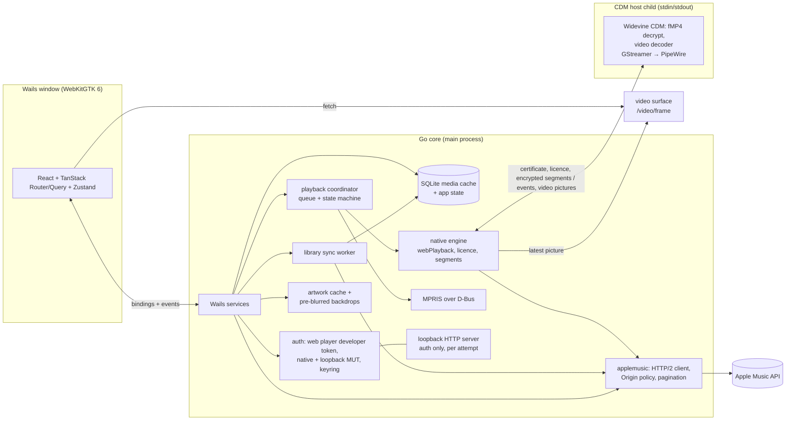
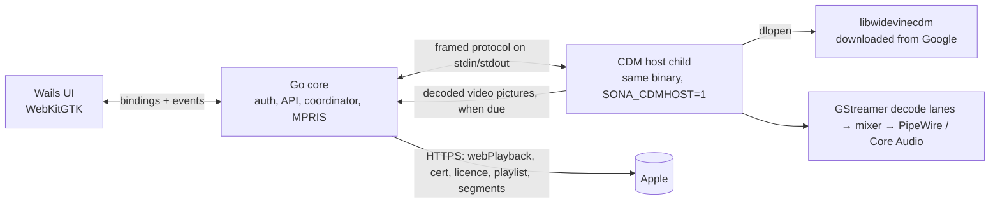

# Sona Architecture

How Sona is built and why. The working rules live in `AGENTS.md` and `CONTRIBUTING.md`; the module contracts in `internal/services/doc.go` and `docs/frontend-architecture.md`; authentication in `docs/auth.md`; the Apple endpoints and features Sona covers in `docs/apple-music-reference.md`; the visual direction in `docs/design.md`; the threat model in `docs/security-review.md`.

## 1. Product scope

Sona is a desktop Apple Music client written in Go with Wails v3 and a React frontend. It starts instantly from a local cache and treats Linux as the primary platform rather than a port.

Goals:

- Fast: a cold start renders cached library data before any network call; no UI jank on large libraries.
- Functional: reliable sign-in, catalogue and library browsing, full-track playback, media keys and desktop integration.
- Linux-first: GTK4 + WebKitGTK 6 shell, Wayland-native, PipeWire audio, D-Bus MPRIS, XDG paths, Secret Service credentials. macOS and Windows sit behind the same seams (§9).
- Go owns all Apple Music networking, credentials, sync, caching and platform integration. The frontend renders state; it never holds tokens or talks to Apple directly.

The Apple Music web app is a reference for functionality only (`docs/apple-music-reference.md`): Sona matches Apple in capability, and every page is designed fresh under `docs/design.md`.

Non-goals:

- Decrypting protected media by any means other than the Widevine CDM's own APIs: `Decrypt` for audio, and for music video pictures only its own video decoder (`DecryptAndDecodeFrame`, §4.2). Sona hosts Google's CDM, downloaded from Google (§4.3); it never extracts keys, never uses reimplemented CDMs, and never lets decrypted audio or the video bitstream leave the CDM host process (decoded pictures leave it for display only, in memory).
- Shipping Apple private keys, user tokens or a Widevine CDM binary in the repository, the binary or the packages; redistributing or patching the CDM.
- Deliberately not built: HD and 4K music videos (Apple licenses a software CDM for SD only: `docs/apple-music-reference.md` §4.5), uploaded videos and music movies, concerts, social graph changes (follow and unfollow need a request signature the web token cannot produce), taste onboarding, report a concern, account and billing pages (web-only).

## 2. Stack

- Go 1.26+, Wails v3.0.0 (GTK4 + WebKitGTK 6.0 on Linux, WKWebView on macOS, WebView2 on Windows). Wails generates TypeScript bindings from Go service methods and structs.
- React + TypeScript + Vite, `pnpm`; Tailwind + ShadCN themed with the `docs/design.md` tokens; TanStack Router (Zod for search params), TanStack Query over the generated bindings (invalidated by Go events), Zustand for UI and playback mirror state, TanStack Virtual; Lingui for translations.
- SQLite through `github.com/mattn/go-sqlite3` (FTS5 via the `sqlite_fts5` build tag) with a libSQL-compatible schema, goose migrations and sqlc queries.
- `github.com/zalando/go-keyring` (Secret Service, Keychain, Credential Manager), `github.com/godbus/dbus/v5`, `golang.org/x/sync`. Artwork is decoded with the standard library's `image/jpeg` and `image/png` only and resized in `internal/artwork`, so no TIFF, BMP or WebP decoder is linked.
- cgo: GStreamer 1.x (`gstreamer-1.0`, `gstreamer-app-1.0`), `webkitgtk-6.0` (version only), `dlopen` for the CDM through a C++ shim.
- Development environment: devenv (Nix), described in `CONTRIBUTING.md`.

Why Go + Wails: Go gives a simple concurrent backend (sync workers, HTTP/2 client, D-Bus, cgo for the CDM and GStreamer) with fast builds, and Wails v3 is stable with GTK4 + WebKitGTK 6 as its Linux default. The hard Linux problem, DRM playback, is solved independently of the UI toolkit (§4).

## 3. Process model



- **UI (WebKitGTK)**: renders from generated bindings and Go events. It holds no credentials and makes no requests to `*.apple.com`; artwork comes from Go-served `/art/` and `/motion/` URLs, and a playing music video's picture from `/video/frame`.
- **Go core**: start-up, configuration (XDG directories), `log/slog` logging with token redaction; the developer-token and Music User Token lifecycle; the only Apple Music HTTP client; the SQLite cache; the library sync worker; the playback coordinator; MPRIS, single instance and `music://`/`itms://` handling; the desktop shell (main window, mini player, tray); desktop integrations (notifications, sleep inhibitor, Discord presence, scrobbling); the artwork cache.
- **CDM host child**: the same executable re-executed with `SONA_CDMHOST=1` (`cdmhost.ChildMain()` runs first in `main`). It loads the downloaded Widevine CDM, decrypts, decodes and plays, and makes no network requests. Decrypted audio never leaves it; a music video's decoded pictures go to the parent for display (§4.2).

### Go core responsibilities in detail

- **Apple client** (`internal/applemusic`): the `Origin: https://music.apple.com` header policy, storefront and language (content GETs carry `l=` with the user's language, the Language setting else the system's, when the storefront offers it: `ContentLanguage`; caches key on it), pagination, backoff on 429 and 5xx, `singleflight` for duplicate requests.
- **Start-up gate**: the shared HTTP client holds every request until the frontend calls `SystemService.FirstPaint` (with a fallback timer); the CDM download and the playback host start after it too.
- **Desktop shell** (`internal/shell`, `services/desktop.go`): the main window opens at its remembered size and maximised state on the start page or, with "resume where I left off", the last route (passed in the window URL, so the cold start still reads settings only). Closing the window hides it and playback continues by default (`desktop.closeAction`); the tray, MPRIS `Raise` and a second launch bring it back. A StatusNotifierItem tray carries the current song and the transport controls. The mini player is a second, fixed-size, frameless, always-on-top window with its own document (`miniplayer.html`) mirroring playback from the same events. Autostart is an opt-in XDG entry, started with `--hidden` (tray only). `internal/windowchrome` decides who draws the title bar (`CONTRIBUTING.md`, "Title bar and window controls").
- **Integrations** (`services/integrations.go`, after first paint): one track-change notification replaced per track over `org.freedesktop.Notifications`; a logind `sleep` inhibitor (portal `Inhibit` fallback) held only while playing; opt-in Discord presence over the local IPC socket with Apple's public artwork URL, never `/art/` or tokens; Last.fm and ListenBrainz scrobbling (`internal/scrobble`).
- **Private mode** (`internal/privatemode`): while on, plays reported to Apple carry `private-enabled`, and nothing is scrobbled, shown on Discord or written to local history. It is on for `SONA_PRIVATE=1`, in development builds, or from the saved setting.
- **Updates** (`internal/update`): unless turned off, an anonymous `GET` of the latest GitHub release (fixed User-Agent, no cookies, no identifiers) compared with the build's `VERSION`; development builds never check.
- **Lyrics** (`internal/lyrics`, `LyricsService`, after first paint, only when lyrics are shown): Go asks every source switched on in Settings → Playback → Lyrics, in parallel with a 10 s timeout each, and keeps the result with the finest timing (word, then line, then plain text; the order breaks ties). Requests leave Sona only for these hosts: Apple Music's `amp-api.music.apple.com` (`syllable-lyrics`, then `lyrics`, through `applemusic.Client`); Musixmatch's `apic-appmobile.musixmatch.com` (an anonymous user token from its `token.get`, kept in the keyring or the 0600 `credentials-musixmatch` file and never logged, then `macro.subtitles.get` and `crowd.track.translations.get`); `lrclib.net` (`/api/get`, then `/api/search`); and `music.163.com` (NetEase, off by default: `/api/search/get`, `/api/song/lyric`). Each sends the song's title, artist, album, length and ISRC, nothing about the account, and a `Sona/<version>` User-Agent. Each source is paced (one request per second to Musixmatch, 250 ms to LRCLIB, 500 ms to NetEase) and backs off after a rate limit (what it asked, or 1 minute doubling to an hour) or from its second failure in a row (15 s doubling). Every answer, lyrics or "none", is cached in SQLite (`lyrics_cache`: 30 days, "none" 3 days), so changing the sources' order costs no request; a failed source falls back to its expired entry. The cache is catalogue data: kept on sign-out, emptied by Settings → Storage. There is no Sona server in between.
- **Apple's translations** (`internal/i18n/applestrings`, `TranslationsService`, after first paint): Sona's UI text in other languages comes first from Apple Music's own web strings, never committed or bundled. For the locales the UI asks for (the account's storefront language, the system languages) Go fetches music.apple.com's `/us/home` page, the index script it names and that locale's string bundle (plain `GET`s with a browser User-Agent, no credentials, redirects only within music.apple.com), converts the strings mapped in `apple-keys.json` and caches them in `<cache>/strings`. It asks Apple at most once a day whether a new release changed the bundles; offline, the cache serves.
- **Go's own text** (`internal/i18n/l10n`): what Go shows outside the web view (the tray menu, the mini player's title, notification buttons, file chooser titles and filters, the sleep inhibitor's reason, the command line's help, manual page, completions, output and errors) is a typed `l10n.Message` in Go's own gettext catalogue, shown through a `*l10n.Printer` for the Language setting, else the system's languages (the command line reads the setting from `settings.json`); the tray and the mini player's title follow a change at once. `cmd/i18ntool extract` writes the English catalogue `locales/en.po` from the source and a test fails when it is stale; translations are `locales/<tag>.po`, embedded. Go sends the web view codes, never text, and keeps English where programs read the text (MPRIS errors, JSON output), in logs and in the diagnostics bundle.
- **Diagnostics and crashes** (`internal/diag`): fatal crashes go to a crash file in the state directory and are logged at the next start; service goroutines start through `Env.Go`, which recovers and logs panics. The bug-report bundle (OS, desktop, account state, settings, crash files, recent log lines) is scrubbed of tokens, e-mail addresses and the home path.
- **Settings export and import** (`config.Export`/`ParseExport`): Go asks for the file through the platform's file chooser (xdg-desktop-portal on Linux) and reads or writes it itself, because Wails handles no WebKitGTK download signal. The document leaves out what belongs to one computer or session (volume, diagnostics, scrobbling accounts, window, autostart, last route, output device) and never holds secrets. Import rejects anything that isn't an export, a newer version or a wrongly typed value, and applies the rest through `Store.Update` so values are normalised and observers run.

## 4. Playback and DRM

### 4.1 Why Sona hosts the CDM

Stock WebKitGTK has no Widevine CDM, so the Wails window cannot play protected audio. In WebKitGTK as distributions build it, EME is compiled out (`ENABLE_ENCRYPTED_MEDIA` follows the experimental-features default, which is off), so `navigator.requestMediaKeySystemAccess` is undefined and no runtime setting brings it back. A build with EME enabled gives only ClearKey, which Apple does not use; WebKit's only Widevine path is RDK's Thunder/OpenCDM with Google's partner-licensed CE CDM, which Chrome's `libwidevinecdm` does not plug into. Open reimplementations of the CDM need an extracted device key, which is circumvention and a non-goal.

So Sona plays Apple Music the way MusicKit does in Chrome, with Go in Chrome's place:



Precedent: [vibez](https://github.com/simonepelosi/vibez) (MIT, Go TUI) hosts the CDM the same way, in process. The approach depends on the CDM host ABI staying stable and on Apple's licence server continuing to accept Sona's host. If it regresses, 30-second previews (unencrypted) still play.

### 4.2 Parent and child

- **Parent (`internal/playback/native`, implements `playback.Engine`)**: all HTTP. `POST …/MZPlay.woa/wa/webPlayback {salableAdamId}` → asset `28:ctrp256` or `32:ctrp64` per Settings → Audio quality (a change applies from the next item; the other bitrate is the fallback); the Widevine service certificate (`…/wa/widevineCert`, cached per process); the licence (`…/wa/acquireWebPlaybackLicense`, with Apple's `stkn` slot token for renewals); the HLS media playlist, `EXT-X-MAP` init and byte-range segments with bounded read-ahead and retry on 5xx and 429. It sends the certificate, licences and raw encrypted segment bytes to the child.
- **Child (`internal/playback/cdmhost`)**: loads the CDM through a C++ shim (`internal/playback/widevine`, Chromium CDM API header vendored from chromium/cdm, BSD-3), parses fMP4 (`internal/playback/fmp4`: `tenc`, `senc`/`saiz`/`saio`, subsamples), decrypts each sample with the CDM's `Decrypt` (CENC AES-CTR), and pushes clear AAC into GStreamer (`internal/playback/gst`). Two decode lanes (`appsrc ! avdec_aac ! audioconvert ! audioresample ! appsink`, each its own pipeline) feed a mixer that writes one continuous 44.1 kHz float stream to the output pipeline (`appsrc ! tail (equaliser, volume) ! pipewiresink`, `osxaudiosink` on macOS).
- **Gapless and crossfade**: each track's lane segment trims the AAC encoder's priming (2112 samples; Apple's init segments carry no `elst` or iTunSMPB, and the playlist duration counts the priming but not the end padding) and its padding, so a track queued with `Host.Next` joins the current one sample-exact, or with an equal-power crossfade (Settings → Playback, 1–12 s, never between consecutive tracks of the same album).
- **Output resilience**: the output is rebuilt in place (no reload, position kept) when the device changes or the sink fails. pipewiresink's "all buffers have been removed" error, raised when PipeWire relinks the stream, is not fatal, so the output reconnects in place; the old sink closes in the background. A watchdog rebuilds the output if it stands still for 3 s with audio queued or runs ahead of real time. An output that has never played is held in READY rather than PAUSED, because pipewiresink 1.6 deadlocks its PipeWire loop when it prerolls without rendering.
- **Library uploads (`i.` IDs)**: webPlayback returns a plain unencrypted file (MP3, AAC or ALAC). The parent downloads it into memory and streams the bytes to the child (`LoadFile`/`FeedFile`/`EndOfFile`; the child still makes no requests), which plays it through `gst.FilePipeline`: a random-access byte source over the bytes received (`filehead.c`; a read past them waits, so an MP4 whose `moov` sits at the end plays once it has arrived) `! decodebin !` the shared output tail. Because of the same pipewiresink deadlock, decoded audio is held back from the sink until the first Play, a Pause or Close waits for the first render, and a stream that ends with nothing rendered gets 10 ms of silence first.
- **Local broadcasters (`ra.` stations with `hasDrm: false`: Capital, KISS, TuneIn's stations)**: the engine looks the station up for its play parameters and asks `/v1/play/assets` without DRM, which answers one clear URL on the broadcaster's servers and no key server, so there is no licence. The parent plays that stream (`internal/playback/broadcast`: HLS of MPEG-TS or packed AAC segments, a PLS or M3U playlist, or a Shoutcast/Icecast stream; reconnects and stall detection) and feeds its elementary audio (ADTS AAC or MP3 frames) to the child as a live file (`LoadFile` with size `gst.Live`: no length, no seeking, bytes dropped once decoded, at most 8 MiB held). What the stream names as on air (ICY `StreamTitle`, ID3 tags, `EXTINF` titles) is stamped with the stream time it applies from, counted from the audio frames, and becomes `Status.OnAir` once playback reaches it: the player bar's live line and the MPRIS title show it. Pause lets the stream go; Resume joins it live again. Nothing is reported as play activity (Apple's web player doesn't play these at all).
- **Music videos (`mv.<id>` queue items)**: a video is a track whose audio is the video's audio rendition, fetched, licensed, decrypted with `Decrypt` and played exactly like a song, plus its video rendition. The parent fetches the master playlist (its URL names the account and is never logged), picks the best SD H.264 variant a software CDM may play (`hls.SelectVideo`; HD needs HDCP and this CDM's decoder has no HEVC, `docs/apple-music-reference.md` §4.5), licenses the video key in its own session (Apple's video keys are `SW_SECURE_DECODE`, which `Decrypt` refuses) and sends the encrypted fragments with `LoadVideo`/`FeedVideo`. The child rewrites each sample to Annex B (`internal/playback/avc`, encrypted bytes left in place), decrypts and decodes it with the CDM's own video decoder (`DecryptAndDecodeFrame`, I420 out) a few pictures ahead, and sends each picture to the parent when the audio being heard reaches it (20 ms early for the trip to the screen), so the picture follows the audio clock through pauses, seeks and output changes. The parent drops pictures that are not valid I420 of at most 1920×1920 and keeps only the latest on a `video.Surface`, in memory; the web view long-polls `/video/frame` for the next one and draws it with WebGL at its next animation frame (`docs/frontend-architecture.md`, "Music videos"). **Decision:** the maintainer allowed the CDM's video decoder in the sandboxed child and decoded pictures leaving it for display, in memory only, because a child-owned window can't follow the page on Wayland; the hard lines stay: no key extraction, no reimplemented or patched CDM, no bundling, no network requests from the child, never the bitstream or audio out of the child, nothing on disk. Videos are never joined gaplessly to their neighbours, never reported to Apple as plays, never written to local history and never start AutoPlay.
- **Realtime priority**: the thread that exchanges buffers with PipeWire's graph (pipewiresink's `pipewire-main-loop`, or a `data-loop.N`) needs realtime scheduling to meet the graph's deadline under CPU load, and PipeWire's own module-rt would ask RTKit for it over D-Bus, which the sandboxed child has none of. So once an output plays, the child reports the threads libpipewire created (it marks each `SCHED_RESET_ON_FORK`; nothing else in the child does) over the pipe, and the parent asks for them (`cdmhost/realtime_linux.go`): it skips any thread outside `/proc/<child>/task` (the child shares the parent's PID namespace, so its thread IDs are valid there), lowers the child's `RLIMIT_RTTIME` (soft and hard) to RTKit's `RTTimeUSecMax`, and calls RTKit's `MakeThreadRealtimeWithPID` on the system bus at PipeWire's client priority (83) capped by `MaxRealtimePriority` (RTKit's default 20); in Flatpak, or without RTKit, the Realtime portal (`org.freedesktop.portal.Realtime`, same methods). Refused, it asks for a raised nice level (`MakeThreadHighPriorityWithPID`, `MinNiceLevel`). At most 8 threads per child, each asked for once. Failure is not fatal and Diagnostics → Audio priority shows the outcome (granted, raised, denied or unavailable, and why); macOS asks nothing (Core Audio runs its own I/O thread at realtime priority) and reports it unsupported.
- **Licence renewal**: Apple's licences expire after 15 minutes; the CDM asks for a renewal 13 minutes after a licence is installed, and the engine posts it to `acquireWebPlaybackLicense` with `X-Apple-Renewal: true` and the `stkn` slot token.
- **Lifecycle**: the child starts lazily on the first Play or Preload, shuts down after the idle timeout (Settings, default 5 minutes) while idle or paused, and is respawned transparently after a crash, resuming at the last position.

### 4.3 CDM download

`internal/playback/cdm` downloads the CDM after first paint from Google's servers, as Firefox's GMP updater does: version and SHA-512 from Mozilla's pinned Firefox GMP manifest, CRX3 signatures by the Widevine component key and Google's publisher key verified. It installs into `<data>/widevine/<version>/<platform>/` behind an atomic `current.json` that records each library's SHA-256, checks daily for updates, load-checks a new version in a sandboxed probe child that loads only the CDM, re-downloads a library that no longer matches its recorded hash, and rolls back after 3 failed host starts. Browser, system and user-supplied copies are never used; the CDM is never bundled, redistributed or patched. Linux on arm64 has no CDM in the manifest, so playback there reports `unsupported_platform`. Diagnostics (`cdmhost.Probe`) reports the CDM path, version, CDM and host interfaces, GStreamer version, decoder, sink, the child's sandbox and the AAC bitrate playing.

### 4.4 Sandbox

On Linux (`cdmhost/sandbox_linux.go`, `sandbox_fs_linux.go`) the child starts in its own user, network and mount namespace. Its first stage replaces `/run`, `/tmp`, `/var/tmp` and `$XDG_RUNTIME_DIR` with empty tmpfs (binding back only the audio socket and the program's own files), makes the home directory read-only and hides Sona's config and state, `~/.ssh`, `~/.gnupg` and the keyrings; it then applies Landlock (no writes outside `/dev` and the private `/tmp`, no TCP or UDP, `connect()` only to the audio socket, abstract sockets and signals scoped) and re-executes itself, so the second stage has no capabilities. The second stage installs a seccomp filter: sockets only for `AF_UNIX`; ptrace, `process_vm_*`, `pidfd_getfd`, io_uring, bpf, perf events, keyrings, namespace changes and mounts refused. The child checks that inet and netlink sockets are refused and refuses to load the CDM without the seccomp filter. Where unprivileged user namespaces are disabled (Flatpak, Ubuntu's AppArmor restriction) it runs with Landlock and seccomp only, and Diagnostics shows why.

On macOS the child runs under `sandbox-exec` with Sona's profile (no network, no writes outside the temporary folders, Sona's folder and the keychain out of reach); without it, Diagnostics says "Not sandboxed" and why. Details and residual risks: `docs/security-review.md`.

### 4.5 Stream facts

- **Widevine stream (`28:ctrp256`)**: HLS v7 with `#EXT-X-KEY:METHOD=ISO-23001-7,URI="data:;base64,…"` (the KID; Sona wraps it in a Widevine PSSH), CENC AES-CTR, the init segment by `EXT-X-MAP` byte range, fragmented MP4 AAC. The CDM decrypts and GStreamer decodes.
- **FairPlay streams (`cbcp` flavours)**: `METHOD=SAMPLE-AES` with `skd://` key URIs. Not usable by Sona.
- **Local broadcasters' streams**: clear. Global's are HLS of MPEG-TS (ADTS AAC, no in-stream metadata); Bauer's HLS of packed HE-AAC with an ID3 tag per segment and the same in `EXTINF` (`title="…",artist="…"`, with the artist in the title and the song in the artist, which Sona swaps back when the metadata links Planet Radio's listen API); TuneIn's a PLS of the station ident, a pre-roll advert and an Icecast MP3 stream with ICY metadata. Details: `docs/apple-music-reference.md` §5.1.
- **Music videos**: Widevine HLS (`cbcs`, separate video and audio renditions). A software CDM gets usable keys for SD video only (≤864×486), at level `SW_SECURE_DECODE`, which only the CDM's own video decoder may use; HD needs HDCP (`output-restricted`), 4K is refused. Sona plays the SD H.264 variant through that decoder (§4.2, `docs/apple-music-reference.md` §4.5).
- **Lossless, Hi-Res and Atmos**: shown as badges. Apple's licence server refuses the ALAC key to the desktop CDM (`go run ./cmd/playspike -probe-lossless <song>` re-checks it), so these do not play on this path.

### 4.6 Engine contract

- `playback.Engine` (`internal/playback/playback.go`): `Play(ctx, id, start)`, `Preload(ctx, id)`, `Pause`, `Resume`, `Seek`, `SetVolume`, `Stop`, `Status()`, `Events()`, `Close`. Event kinds `state`, `item`, `error`, `auth`; no 1 Hz time events: `Status.Position` is exact at `UpdatedAt` and callers extrapolate.
- The coordinator (`internal/playback/coordinator`) owns the queue, stations and AutoPlay; the engine plays one item. `Preload` may run concurrently with other calls and never interrupts playback; `Status()` never blocks; a 401 or 403 matches `applemusic.ErrUnauthorized` and also emits `auth`.
- AutoPlay is fetched ahead: once the network opens after the first paint, while signed in (the AutoPlay station needs the Music User Token) and reaching Apple (`Coordinator.SetOnline`), the coordinator creates the AutoPlay station 2 s after the user's queue settles and appends its first batch after the user's songs, so the queue shows it from the start. One station per container: it is created again only when the user's last song comes from another album or playlist (edits within it keep the station), never once an AutoPlay song plays, and a failed fetch waits `RefillRetry` before the next. Offline, AutoPlay starts when the user's queue is about to end. AutoPlay slots always follow the user's and don't move (`Move` refuses them and keeps the user's songs before them); turning AutoPlay off or repeat on removes them (AutoPlay runs only with repeat off).
- Implemented by `internal/playback/native` over `internal/playback/cdmhost` on Linux and macOS, and by `playback.Unsupported` elsewhere.
- Plays are reported to Apple's play-activity service the way MusicKit JS does (`internal/playback/activity`), so they appear in Apple's Recently Played.

## 5. Authentication

Summary; the full design is `docs/auth.md`.

- **Developer token**: the web player token. Go extracts it from `music.apple.com`'s JavaScript bundle and refetches it on expiry or 401. Every API request carries `Origin: https://music.apple.com`; without it Apple returns 401.
- **Music User Token, primary**: native in-app sign-in (`internal/auth/appleid`). Sona's own form collects the Apple Account, password and two-factor code; Go speaks the protocol Apple's sign-in widget uses (SRP-6a, hashcash, 2FA) and exchanges the session for a MUT as `authorize.music.apple.com` does. No browser. Passwords and codes are never stored or logged.
- **Fallbacks**: Apple's redirect flow through a single-use loopback server in the system browser (passkeys, security keys, an existing browser session), and manual token paste.
- MusicKit popups and webview header rewriting are rejected: WebKitGTK does not support them reliably.
- Tokens live in the system keyring with an explicit, user-visible 0600 file fallback (`internal/auth/store`); never in the database, logs or settings.

## 6. Module layout

```text
Taskfile.yml build/          Wails build, Linux packaging (desktop file dev.coredev.Sona), macOS dev build; package build embeds the app icons
cmd/
  sona/                      the app (bin/sona)
    main.go                  Wails app entry (cdmhost.ChildMain first), version injected from VERSION
    platform_<os>.go         per-OS integrations behind services.Platform (§9)
    engine_cdm.go engine_other.go the playback engine per OS
    webkit_<os>.go devmode_*.go WebKit version; development/production build switches
  playspike/                 DRM path regression check (licence, full track, seek, gap, crash, PSS, probes)
  authspike/                 native (-native) or loopback sign-in + MUT validation
  cdmfetch/                  downloads and verifies the CDM by hand
  typecheck/                 cross-platform type-check (darwin from Linux)
  i18ntool/                  extracts Go's catalogue; maps Sona's messages to Apple's string keys; converts Apple's translations for review
internal/
  config/ logging/           per-OS paths + settings JSON; slog with token redaction
  auth/                      Manager state machine, native sign-in
    devtoken/ appleid/ mut/ store/   web player token; SRP + 2FA; loopback flow; keyring + 0600 fallback
  applemusic/                the only Apple client: catalogue, library, lyrics, ratings, webPlayback, licence
  db/{migrations,queries,dbq}/       mattn/go-sqlite3 + goose + sqlc (dbq generated)
  library/ catalog/          sync worker + SQLite reads; read-through catalogue cache
  lyrics/                    lyrics providers (Apple, Musixmatch, LRCLIB, NetEase), ranking, SQLite cache
  artwork/ motion/           artwork disk cache, variants, pre-blurred backdrops; motion artwork cache
  playback/                  Engine contract
    native/ cdmhost/ widevine/ cdm/  engine (parent); CDM host child; C++ CDM shim; CDM download
    video/ avc/              music video pictures for the web view (/video/frame); H.264 to Annex B
    fmp4/ hls/ gst/          fMP4 + CENC parsing; HLS playlists; GStreamer lanes, mixer and output
    coordinator/ activity/   queue and state machine; Apple play-activity reports
    equalizer/ soundcheck/   EQ bands and presets; Sound Check gain
  mpris/ app/                MPRIS server; single instance, `sona <command>`, Apple Music URLs, autostart, file chooser
  shell/ windowchrome/       main + mini player windows, tray; title bar policy
  desktop/{notify,inhibit}/ power/   notifications, suspend inhibitor; on-battery monitor
  discord/ scrobble/         Discord presence; Last.fm and ListenBrainz
  privatemode/ update/ diag/ private listening; release check; crash capture and diagnostics bundle
  i18n/applestrings/ i18n/po/ Apple's translations: bundle parsing, ICU conversion, runtime cache; PO catalogues
  i18n/l10n/{,extract/}      Go's own message catalogue and Printer; its extractor (go/parser, tools only)
  services/                  Wails services, DTOs, events, start-up gate (contract: doc.go)
frontend/                    React + Vite + Tailwind + ShadCN; bindings/ generated by wails3; package frontend embeds dist/
docs/                        contributor docs (see the top of this file)
devenv.nix devenv.yaml devenv.lock   development environment
```

A feature is a Go service (`internal/services/<feature>.go` + `<feature>_dto.go` + one `registry.go` line) and a frontend module (`frontend/src/features/<name>/index.ts` + one `frontend/src/app/modules.ts` line). Wails services return frontend-shaped DTOs: durations in milliseconds, artwork as Go-served `/art/…` URLs (plus backdrop URL and dominant colours), IDs as strings, and errors carrying `cause = {code, message}`.

## 7. Data and sync

SQLite, libSQL-compatible, migrations in `internal/db/migrations` numbered densely and applied strictly in order.

- `artists`, `albums`, `tracks`, `playlists`, `playlist_tracks`: Apple catalogue and library IDs stored separately, `artwork_template` (the raw `{w}x{h}` URL), `updated_at`.
- `library_items`, `playback_history`, `favorites` (mirrors `/v1/me/ratings`), `pins`.
- `sync_state`: domain, offset or cursor, total, last success, last full run, last error.
- `search_fts`: FTS5 over titles, artists and albums. `recent_searches`: searched terms and opened results (user data, wiped on sign-out). `release_reminders`: pre-release albums to notify about on release day, or at the next start after it (user data, wiped on sign-out).
- `accounts`: storefront, its default and supported content languages, restricted flag, when the MUT was obtained and last validated. Never tokens.
- A catalogue response cache (key, fetched at, expiry). Sign-out runs `db.WipeUserData`, which keeps only catalogue rows and that cache, and removes the artwork only user data references.

Sync (`internal/library`):

- A full sync reads `meta.total` with `limit=1`, then fetches offset pages of 100 in parallel.
- Start-up and post-edit syncs are incremental (`library.Incremental`): songs and albums newest-added first (`sort=-dateAdded`) up to the first stored item, the artist count, the playlist list (tracks and folders only for playlists whose `lastModifiedDate` moved), and ratings only for items stored since the last ratings run, the domains in parallel. A domain whose local count then differs from Apple's runs fully at once.
- A full run (removals, metadata edits, ratings changed elsewhere) happens on "Sync now" and every 72 hours (`library.FullSyncEvery`).
- Library songs carry no `dateAdded`; their "date added" order is Apple's `sort=-dateAdded` rank. Apple has no "list my ratings" call, so sync checks ratings per library ID in batches of 100.

Storage maintenance (`StorageService`): after first paint it prunes the catalogue cache every 6 hours and, when idle, runs `PRAGMA optimize` and a VACUUM when enough of the file is free, once a day. The artwork cache lives under the platform cache directory (`$XDG_CACHE_HOME/sona/art` on Linux) with a size limit in Settings.

## 8. Performance

- **Cold start**: the window shows the shell immediately and the first queries hit SQLite only. The network and the CDM host start after the first paint. The stored token is read from the keyring in the background (`auth.Manager.Start`, `docs/auth.md` §5), so a slow or silent keyring holds sign-in, never the window. Target: an interactive shell in under 500 ms on a warm cache. Measured (headless sway, warm caches, 5 starts): first paint at a median 685 ms, of which about 410 ms pass before the page starts loading (GTK, WebKit's web and network processes), about 110 ms run the scripts and about 110 ms render to first contentful paint; page code splitting does not move it (`docs/frontend-architecture.md`, "Startup code").
- **Effects budget**: WebKitGTK `backdrop-filter` and large `filter: blur()` are expensive. Never apply them to scrolling content. Go pre-renders blurred backdrops (tiny blurred JPEGs) instead of CSS-blurring full-size artwork. A "reduce effects" setting gives solid surfaces.
- **Lists**: TanStack Virtual above about 200 rows; exact-size artwork variants from the Go cache with `loading="lazy"`.
- **Scrolling**: WebKitGTK 2.54 repaints the visible part of the page on the web process's main thread for every scroll step (programmatic, keyboard; WebKit Timeline `Paint` records over the whole viewport each frame, also for a plain document scroll), so what is on screen sets the frame time: artwork drawn at another size than it was decoded (resampled every frame) and per-tile inset rings are the largest costs measured. `cmd/uiprobe` measures it (CONTRIBUTING.md, "Measuring UI performance").
- **Network**: one shared `http.Client` (HTTP/2 keep-alive), `singleflight` for duplicate requests, bounded parallel paging.
- **Playback**: the CDM host starts lazily, the next item is preloaded about 15 s before the end, and the host shuts down after the idle timeout (one child start and licence, under a second, on the next play). Progress is computed from state and timestamps, not streamed time events. Indicative figures: parent 20–25 MiB plus the CDM host around 110 MiB PSS while playing (most of it the CDM library); play to audio about 0.85 s cold, seek about 80 ms, a preloaded track change about 70 ms.
- **Motion artwork**: headers and the now-playing cover play while on screen, cover tiles only while hovered or focused (one at a time), so a page of tiles at rest decodes nothing. Measured in a headless test session on the maintainer's desktop (WebKitGTK 2.54.1, avdec_h264 in software; shared-memory buffers, so the UI process's share is higher than on a DMA-BUF session): Discover at rest 2.1–2.3% of a core in the web process (motion on or off: equal), one hovered 360 px tile 21.9% web + 56.4% UI process with 2 decoder threads, an album header (486 px) 31.5% web + 61.0% UI; frame time median 11–16 ms throughout. The power source comes from UPower's devices, not its OnBattery (`internal/power`): an online AC adapter means mains; peripherals' batteries never count.
- **Rendering pitfalls**: `WEBKIT_DISABLE_DMABUF_RENDERER=1` and `WEBKIT_DISABLE_COMPOSITING_MODE=1` are diagnostics toggles, not defaults.

## 9. Platforms

Linux is the full platform. macOS and Windows build and run the UI, with every OS-specific part behind a seam (`cmd/sona/platform_<os>.go`, `services.Platform`, `engine_cdm.go`/`engine_other.go`) that reports itself unsupported where a platform lacks it (`errors.ErrUnsupported`, `PlatformService.Capabilities`); the UI hides or explains the control. Build-tag conventions and how to type-check and cross-build: `CONTRIBUTING.md`, "Platforms".

- **Linux**: everything above. Packages: `.deb`, `.rpm`, AppImage and the AUR `sona-bin` package, built on Ubuntu 24.04 in a container; Flatpak is documented in `docs/flatpak.md`.
- **macOS**: unsigned development builds play through the same CDM host with the macOS CDM Google ships (`mac_arm64`, `mac_x64`) and Core Audio output, sandboxed with `sandbox-exec`. Desktop integrations (media controls, notifications, sleep inhibit, autostart) are not there yet.
- **Windows**: builds and runs the UI; playback reports unsupported (`playback.Unsupported`).

Per-OS conventions: configuration paths (XDG; `~/Library/...`; `%APPDATA%`/`%LOCALAPPDATA%`), the keyring backend (Secret Service, Keychain, Credential Manager), the Discord IPC socket, the audio sink (`pipewiresink`, `osxaudiosink`) and the CDM library (`libwidevinecdm.so`, `.dylib`).

## 10. Testing approach

- **Go**: `httptest` fixtures for every Apple endpoint family (pagination, 401 retry, 429 and `Retry-After`, `singleflight`, map-format resolution); real-CDM tests (init, challenge, junk licence, timers) against a CDM downloaded into a test cache (`internal/playback/cdm/cdmtest`; they skip only when offline, and `SONA_CDM_REQUIRE=1` fails instead); fMP4 and HLS parsers with hand-built boxes; the coordinator (queue, stations, AutoPlay, preload, activity) against a fake `Engine` under `-race` and `testing/synctest`; the database and library against temporary files; MPRIS and single instance against a private `dbus-daemon`. All tests run under `go test -race` in `dbus-run-session`.
- **DRM path regression**: `go run ./cmd/playspike` (licence, full track, seek, preloaded change, crash restart, PSS, `-activity`), in private mode, after CDM, playback or Apple changes.
- **Live contract tests** (`internal/applemusic/live_test.go`, opt-in: `SONA_LIVE=1` with `MUSIC_USER_TOKEN`): one real call per endpoint family asserting the decoded shapes Sona relies on; nothing is played. `.github/workflows/live.yml` runs them on a schedule and opens an issue on failure.
- **Frontend**: Vitest for logic (position extrapolation, invalidation plans, sign-in reducer, lyrics, link routing, action registry, item-state batching) and components; visual checks in the real Wails window in both themes. Accessibility rules and how to check them: `docs/accessibility.md`. There are no WebDriver end-to-end tests: Wails v3's Linux webview does not opt into WebKitGTK automation, so `WebKitWebDriver` cannot drive Sona's window; Wails' MCP server (`-tags mcp`) drives it for manual checks.
- **Cross-platform**: every package, tests included, type-checks for `windows/amd64` and `darwin/arm64` (`go vet`, `go run ./cmd/typecheck`).
- **Packaging**: `build/linux/release/release.sh` builds the packages on Ubuntu 24.04 and smoke-tests the `.deb` (Ubuntu 24.04), `.rpm` and AppImage (Fedora) and the Arch package (Arch Linux) under Xvfb, each checking `sona --version` against `VERSION` and that the window reaches first paint; the AppImage check also fails if a Widevine CDM is inside.
- **Manual release checks**: `docs/release-checklist.md` (desktop matrix and results).
- **CI** (`.github/workflows/ci.yml`): Go vet and `go test -race` with real-CDM tests, the cross-platform type-checks, and the frontend gate; releases come from release-please (`release-please.yml`): merging its release PR bumps `VERSION` and `CHANGELOG.md`, tags `vX.Y.Z` and calls `release.yml`, which builds and publishes the packages (`docs/release-checklist.md`, "Releasing").
