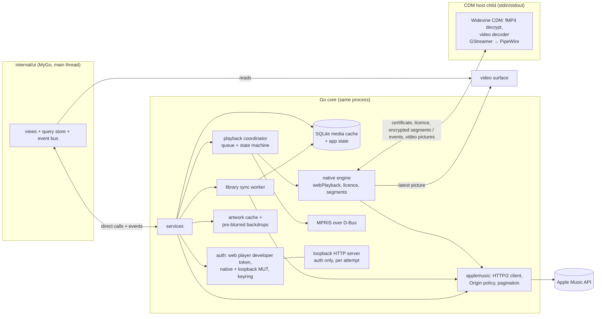
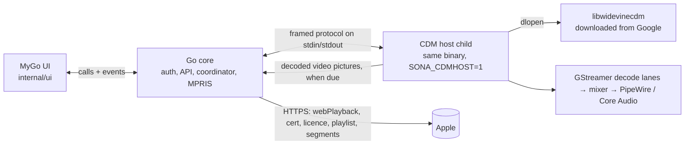

# Sona Architecture

How Sona is built and why: scope, process model, playback and DRM, authentication, module layout, data, performance, platforms and testing. The working rules live in `AGENTS.md` and `CONTRIBUTING.md`; the module contracts in `internal/services/doc.go` and `docs/ui-architecture.md`; authentication in `docs/auth.md`; the Apple endpoints and features Sona covers in `docs/apple-music-reference.md`; the visual direction in `docs/design.md`; the threat model in `docs/security-review.md`.

## Contents

- [1. Product scope](#1-product-scope)
- [2. Stack](#2-stack)
- [3. Process model](#3-process-model)
  - [Apple client and start-up](#apple-client-and-start-up)
  - [Desktop shell](#desktop-shell)
  - [Integrations](#integrations)
  - [Add-ons](#add-ons)
  - [Artwork](#artwork)
  - [Private mode](#private-mode)
  - [Concerts](#concerts)
  - [Artist tracker](#artist-tracker)
  - [Updates](#updates)
  - [Themes](#themes)
  - [Lyrics](#lyrics)
  - [Local broadcasters' station profile](#local-broadcasters-station-profile)
  - [Apple's translations](#apples-translations)
  - [Go's own text](#gos-own-text)
  - [Diagnostics and crashes](#diagnostics-and-crashes)
  - [Settings export and import](#settings-export-and-import)
- [4. Playback and DRM](#4-playback-and-drm)
  - [4.1 Why Sona hosts the CDM](#41-why-sona-hosts-the-cdm)
  - [4.2 Parent and child](#42-parent-and-child)
  - [4.3 CDM download](#43-cdm-download)
  - [4.4 Sandbox](#44-sandbox)
  - [4.5 Stream facts](#45-stream-facts)
  - [4.6 Engine contract](#46-engine-contract)
- [5. Authentication](#5-authentication)
- [6. Module layout](#6-module-layout)
- [7. Data and sync](#7-data-and-sync)
- [8. Performance](#8-performance)
- [9. Platforms](#9-platforms)
- [10. Testing approach](#10-testing-approach)

## 1. Product scope

Sona is a desktop Apple Music client written in Go, with its interface drawn natively by MyGo. It starts instantly from a local cache. It ships for Linux, macOS and Windows (§9).

### Goals

- **Fast**: a cold start renders cached library data before any network call; no UI jank on large libraries.
- **Functional**: reliable sign-in, catalogue and library browsing, full-track playback, media keys and desktop integration.
- **Native on each desktop**: on Linux, MyGo on GTK3, Wayland-native, PipeWire audio, D-Bus MPRIS, XDG paths and Secret Service credentials. macOS and Windows use the same code behind platform seams (§9).
- **Go owns the account**: Go does all Apple Music networking, credentials, sync, caching and platform integration. The UI renders state; it never holds tokens or talks to Apple directly.

The Apple Music web app is a reference for functionality only (`docs/apple-music-reference.md`). Sona matches Apple in capability, and every page is designed fresh under `docs/design.md`.

### Non-goals

- **Decrypting protected media by any other means than the Widevine CDM's own APIs.** Those are `Decrypt` for audio and, for music video pictures, the CDM's own video decoder (`DecryptAndDecodeFrame`, §4.2). Sona hosts Google's CDM, downloaded from Google (§4.3). It never extracts keys, never uses reimplemented CDMs, and never lets decrypted audio or the video bitstream leave the CDM host process. Decoded pictures leave it for display only, in memory.
- **Shipping secrets or the CDM.** No Apple private keys, user tokens or Widevine CDM binary go in the repository, the binary or the packages, and Sona never redistributes or patches the CDM.
- **Features Apple does not allow a client.** Not built:
  - HD and 4K music videos (Apple licenses a software CDM for SD only: `docs/apple-music-reference.md` §4.5).
  - Uploaded videos and music movies.
  - Social graph changes (follow and unfollow need a request signature the web token cannot produce).
  - Taste onboarding, report a concern, and account and billing pages (web-only).

## 2. Stack

| Part | Choice |
| --- | --- |
| Language and UI | Go 1.27.4 and MyGo at main `c0b8f37e1774` (`v0.10.1-0.20261127204953-c0b8f37e1774`, with egoist/mygo#1903; `github.com/egoist/mygo/ui`) |
| Database | SQLite through `github.com/mattn/go-sqlite3` (FTS5 via the `sqlite_fts5` build tag), a libSQL-compatible schema, goose migrations and sqlc queries |
| Platform libraries | `github.com/zalando/go-keyring` (Secret Service, Credential Manager; the macOS Keychain is Security.framework through purego, `internal/auth/store`), `github.com/godbus/dbus/v5`, `golang.org/x/sync` |
| Artwork decoding | The standard library's `image/jpeg` and `image/png` only, with resizing in `internal/artwork`, so no TIFF, BMP or WebP decoder is linked |
| cgo | GStreamer 1.x (`gstreamer-1.0`, `gstreamer-app-1.0`; on Linux also `gstreamer-video`, for the motion artwork decoder) and `dlopen` for the CDM through a C++ shim |
| Development environment | devenv (Nix), described in `docs/development.md` |

One Go process draws the whole interface on the GPU, over GTK3 on Linux, AppKit on macOS and Win32 on Windows. MyGo itself loads GTK3, Pango and the GL libraries by soname (purego) and needs no cgo.

The UI is Go (`internal/ui`): a component kit themed with the `docs/design.md` tokens, a query store that fetches on goroutines and publishes with `Window.Update`, and the services' events on one bus. The layout is in `docs/ui-architecture.md`.

**Why Go and MyGo.** Go gives a simple concurrent backend (sync workers, HTTP/2 client, D-Bus, cgo for the CDM and GStreamer) with fast builds. MyGo lets the same process draw the interface on the GPU with no web engine: no IPC, no generated bindings, the services called directly. DRM playback is solved independently of the UI toolkit (§4).

## 3. Process model



Sona runs as three parts:

- **UI (`internal/ui`, MyGo)**: runs in the main process, on the main thread, and calls the services directly, subscribing to their events. It holds no credentials and makes no requests to `*.apple.com`. Artwork, motion and a playing music video's picture come from `artwork.Cache`, `motion.Cache` and the video surface in memory.
- **Go core**:
  - Start-up, configuration (per-OS directories) and `log/slog` logging with token redaction.
  - The developer-token and Music User Token lifecycle, and the only Apple Music HTTP client.
  - The SQLite cache, the library sync worker and the playback coordinator.
  - MPRIS, single instance and `music://`/`itms://` handling.
  - The desktop shell (main window, mini player, tray) and the desktop integrations (notifications, sleep inhibitor, Discord presence, scrobbling).
  - The artwork cache.
- **CDM host child**: the same executable re-executed with `SONA_CDMHOST=1` (`cdmhost.ChildMain()` runs first in `main`). It loads the downloaded Widevine CDM, decrypts, decodes and plays, and makes no network requests. Decrypted audio never leaves it; a music video's decoded pictures go to the parent for display (§4.2).

The rest of this section describes what the Go core does, one responsibility at a time.

### Apple client and start-up

- **Apple client** (`internal/applemusic`) handles:
  - The `Origin: https://music.apple.com` header policy.
  - Storefront and language: content GETs carry `l=` with the user's language (the Language setting, else the system's) when the storefront offers it (`ContentLanguage`), and caches key on it.
  - Pagination, backoff on 429 and 5xx, and `singleflight` for duplicate requests.
- **Start-up gate**: the shared HTTP client holds every request until the UI calls `SystemService.FirstPaint` (with a fallback timer). The CDM download and the playback host start after it too.

### Desktop shell

The shell lives in `internal/ui/app` and `services/desktop.go`.

- **Main window**: opens at its remembered size and maximised state, on the start page or on the page it was last on when Settings → General → Open on says so. The route is read from settings, so the cold start still reads SQLite and settings only.
- **Closing the window**: keeps Sona playing in the background with its tray icon (Settings → General). Without a tray it quits.
- **Tray**: libayatana-appindicator3 on Linux, a menu bar item on macOS. It shows the current song, the transport, private listening, Show Sona, the mini player and Quit.
- **Mini player**: a second, fixed-size, always-on-top window shown in the main window's place.
- **Start hidden**: `--hidden` (the XDG autostart entry's "Start in the tray") starts with no window, when there is a tray. Autostart is opt-in: an XDG entry on Linux, MyGo's login item on macOS and Windows, where the settings say whether a start at login opens in the tray (`cmd/sona/login_desktop.go`, §9).
- **Bringing the window forward**: MPRIS `Raise`, the tray and a second launch do it. Apple Music links (`music://`, `itms://`, music.apple.com) open their page.
- **Title bar**: the system's inset buttons on macOS. On stacking Linux desktops and Windows, a hidden title bar under Sona's top bar with MyGo's buttons in the desktop's layout (`internal/windowchrome` decides; `docs/platforms.md`, "Title bar and window controls").
- **Session end**: on macOS and Windows the OS ends the process as soon as the quit listeners return, and `Run` never does. An `OnWillQuit` listener (`cmd/sona/sessionend.go`) therefore saves the queue and position, ends the play and delivers its play activity within 3 s. Linux has no such signal: a SIGTERM quits as usual and `Run` returns.

### Integrations

Integrations (`services/integrations.go`) start after first paint:

- One track-change notification, replaced per track: over `org.freedesktop.Notifications` on Linux, MyGo's notifications on macOS and Windows (§9).
- A sleep inhibitor held only while playing: logind's `sleep` lock (portal `Inhibit` fallback) on Linux, MyGo's `Power.KeepAwake` on macOS and Windows (§9).
- Opt-in Discord presence over the local IPC socket (a named pipe on Windows), only when the current user owns it, with Apple's public artwork URL, never `/art/` or tokens. On Linux and macOS it is the bundled `discord` add-on (`internal/addons/own/discord.go`), which hears `status` and `now-playing` like any add-on and is given Discord's IPC sockets as the one sandbox exception; on Windows it stays in Sona's process (`Platform.DiscordInProcess`), whose AppContainer can't be given Discord's pipe alone. Both use `internal/discord` (the IPC client and the presence worker).
- Last.fm and ListenBrainz scrobbling (`internal/scrobble`).

### Add-ons

Add-ons (`internal/addons`, `services/addons.go`, the protocol in `internal/cli`; reference in `docs/addons.md`) extend Sona from outside its code. `AddonsService` lists the folders of the user's add-ons directory, keeps the user's grant of each add-on's permissions and, after first paint, supervises the enabled ones: start, restart with a growing wait, switch off after five stops in a row, stop at quit. Every call into one is off the UI thread, and a hung add-on costs the caller its deadline and nothing else.

An add-on runs in one of two runtimes behind one interface (`addons.Running`), and `cli.Session` serves both the same way over the add-on's standard input and output:

- **Native** (the default): a process of its own, in a process group or job object that ends with Sona's, and in an OS sandbox it can't start without: it reaches its own folder, a private data folder and, with the `network` permission, the network. Where the system can't set the sandbox up the add-on is refused with the reason (`AddonNoSandbox`); only Sona's own bundled add-ons then run anyway, as plain child processes with Sona's rights (`AddonInfo.Unsandboxed`), as the same code did in Sona's process before #302. It is the CDM host's design (§4.4) on Linux (user, mount and PID namespaces, Landlock, seccomp; Sona's own executable is the add-on's init), a Seatbelt profile on macOS and an AppContainer on Windows (`internal/addons/sandbox`; `docs/security-review.md`, "Native add-ons").
- **WebAssembly** (`runtime: "wasm"`, #303): a module run **inside the Go core** on [wazero](https://wazero.io) (pure Go, no cgo). Its standard streams are in-memory pipes. A module has no ambient authority by construction: no file but its data folder (`confinedFS`, which refuses links), no network, no process. Its memory (64 MiB) and CPU (a quarter of a core, with a burst) are capped, but it shares Sona's address space, so a flaw in the runtime is a flaw in Sona (`docs/security-review.md`, "WebAssembly add-ons"). One `WasmHost` serves every module, made on first use; each run gets a runtime of its own, so ending it frees everything. Compiled code is cached by the module's hash in `<cache>/addons-wasm`, a private folder that is dropped if it is not safe to load code from. The module and its compile run on a goroutine of their own, never the UI thread or the frame loop, and the time to say hello begins when the module runs, not while it compiles.

`sona addons dev` runs a module on every OS that Sona runs on, because it reads the file once and runs those bytes; a native add-on needs `/proc/self/fd` (Linux) to run the file that was checked.

### Artwork

`internal/artwork` is the only code that fetches or resizes artwork.

#### Templates, sizes and downloads

- A template (Apple's `{w}x{h}` URL) is addressed by the hash of its text.
- Only two hosts are fetched: Apple's artwork CDN (`*.mzstatic.com`) and, for a playlist photo chosen in Apple's apps, Apple's blob storage (`store-<n>.blobstore.apple.com`, a fixed image only). Redirects elsewhere are refused.
- Such a photo comes as a presigned URL that expires a day after the response that carried it and is signed anew in every response. Its key is the hash of its host and path, so each sync's new signature finds the cached copy, and the newest URL is the one fetched. The signature never reaches an error or the log. Sign-out removes the photo with the library's other playlist artwork (`db.UserArtwork`).
- An artwork key at a size is derived from the nearest cached source at the exact box, and `backdrop.jpg` from the 64 px source.
- Sources are fetched at 64, 256, 512, 1200 or 2048 px (`artwork.Sizes`), the smallest that covers the box; a request between two is scaled down from the larger source. The CDN already holds the first four for most artwork. Any other size is drawn by an origin on its first request (250 ms to 2 s against 10 to 25 ms), which is why 128 and 1024 are not in the list ([Measure artwork fetch times](performance.md#measure-artwork-fetch-times)).
- Downloads send `Accept: image/jpeg,image/png;q=0.9,*/*;q=0.8`. Apple's generated covers (`gen/`) are drawn on a CDN miss by an origin that answers 406 to an `Accept` without `*/*`.

#### Playlist mosaics

A library playlist Apple rendered no cover for gets a mosaic.

- `library.FillCovers` reads each such playlist's tracks from SQLite (one statement per 500 playlists), takes the first four distinct artwork templates in track order and `artwork.Mosaic` turns them into the playlist's template.
- One distinct artwork, or two or three, gives the first one as it is.
- Four or more give a template `mosaic:<t1> <t2> <t3> <t4>`. The cache composes its source from the four tiles' own sources: a 2×2 grid of centred squares, edge to edge, JPEG, cached as `src-<n>x<n>.jpg` of the mosaic's key like any fetched source.
- A mosaic is just a template with its own key, so every size, the backdrop and the dominant colours follow with no other code, and the surfaces need no special case. A change in the chosen four is a new key; the old one is evicted with the least recently used.
- A tile that cannot be fetched fails the whole cover (answered 502, never cached) and is tried again on the next request.
- Sign-out removes every mosaic with the user's other artwork (`Cache.RemoveMosaics`).

#### Chosen covers

A user's choice for a library playlist beats both a mosaic and Apple's cover. The web API cannot set a cover, so the choice is local and per computer (`playlist_covers`, migrations 00010 and 00011). `library.FillCovers` reads the choices first, in the same pass.

| Choice | What it does |
| --- | --- |
| `none` | Gives "" (no cover). |
| `preset` | Stores a design (`artwork.Patterns`, `PDCXS11` to `PDCXS19`, the one chosen in Apple's apps). `artwork.WithPattern` puts it into the playlist's current generated URL at read time, so Apple draws it with the playlist's colours and current name. A playlist Apple generates no cover for keeps its automatic one. |
| `cover:<32 hex>` | An image the user chose from a file. `artwork.SaveCover` crops the centre square, scales to at most 1024 px and stores a JPEG in `<data>/covers/`. This is user data and is never evicted with the cache. |

- Apple's generated cover (`…/gen/1200x1200AM.PDCXS1n.jpg?c1…c4&t=<name>&signature…`) becomes a `{w}x{h}` template in `applemusic.Artwork.Template`, since its CDN fills any size. The design is outside the signature.
- A library playlist outside the library's own lists (a card in For You's Recently Played, which Apple sends with its own artwork or none; a recent search, which stored the artwork it showed when remembered) gets the same cover when the page is built: `Env.playlistCover` takes the choice (`chosenPlaylistCover`, which pins use too), else `library.AutoCover` (Apple's artwork or the mosaic). Both resolve on every read, so a changed choice shows the next time the list is read.
- Sign-out and a playlist's removal delete the cover files. Sign-out also removes every cached generated cover in any design, which carry playlist names (`Cache.RemovePatterns`).

### Private mode

`internal/privatemode`: while on, plays reported to Apple carry `private-enabled`, and nothing is scrobbled, shown on Discord or written to local history. It is on for `SONA_PRIVATE=1`, in development builds, or from the saved setting.

What leaves Sona's own window (the scrobbler, the Discord presence and add-ons) goes through one function, `Mode.Hidden(start, preview)`: a listen that is a preview, or was private at any point since it started, is hidden from all of them alike. A queue of retried scrobbles holds only listens that passed it.

### Concerts

`internal/places` and `ConcertsService` start after first paint. The Concerts page, the artist pages' "Upcoming concerts" and Home's concerts shelf list Apple's concert data. It is Shazam's events, through amp-api with the web player token; the user's own artists need the MUT.

- **Place**: Apple asks for a place as a 4-character geohash. Sona has no location service and does not use MapKit, so the user picks a city from Sona's own list (about 600, with coordinates, searched on the computer), or keeps their storefront's main city.
- **Setting**: the choice is `concerts.city`, kept out of settings exports. Only the geohash of its area goes to Apple, in the concerts requests alone, never in the personal recommendations.
- **Cache**: lists are cached in `discover_cache` (3 hours, per area, filters and day). The one with the user's artists is personal and wiped on sign-out. A list is served stale when Apple can't be reached.
- **Tickets**: the links are Apple's, https only, opened in the browser.

### Artist tracker

`ArtistTrackerService` (`internal/services/artisttracker.go`) is the opt-in tracker of new releases from the artists the user has favourited. It is off until Settings → General turns it on (`artistTracker.enabled`; `artistTracker.desktop` adds desktop notifications for releases, the tracker's and the release reminders', where the platform has notifications). Nothing is asked of Apple while it is off or nobody is signed in, and nothing before the first paint: the loop starts from `Env.OnNetwork`, waits 30 seconds, and only then looks. A check never reports a play: it reads the catalogue, so private listening changes nothing in it.

- **Schedule**: one check about every 24 hours (when the last complete one finished is kept in `artist_tracker_state`, so a restart does not repeat it), and one when the setting is turned on. A failed check is tried again after 15 minutes, doubling up to 6 hours; the client's own 429 and 5xx backoff runs inside each request. Sign-out and shutdown stop it, a check in progress included.
- **Favourite artists**: Apple has no call that lists them (`GET /v1/me/ratings/artists` answers only for the IDs it is given). The candidates are the synced library's artists that have a catalogue ID and the artists favourited in Sona (`favorites`, kind `artists`); `applemusic.Client.Ratings` keeps those rated 1. A favourite that is neither in the library nor favourited in Sona is not found.
- **Releases**: one batched amp-api call per 25 artists (`/v1/catalog/{sf}/artists?ids=…&views=latest-release,full-albums,singles`), 2 seconds apart, so a long list never bursts. The views come newest first and carry the artist's latest release, newest albums and newest singles and EPs; only the album attributes the tracker keeps are asked for (`docs/apple-music-reference.md`, "Artist tracker").
- **Seeding**: an artist not yet in `tracked_artists` is being seeded. What is out is recorded as seen and never shown; a release still to come is listed, already read, so its Remind me is there. Turning the setting on empties `tracked_artists`, so the releases that came out while it was off are not announced either. A release found for the first time that came out more than 90 days ago is recorded silently too (the catalogue growing, not news). An artist that stops being a favourite leaves, with its records.
- **State** (`artist_releases`, `tracked_artists`, `artist_tracker_state`; user data, wiped on sign-out and by `db.WipeUserData`): every release seen, when it was found, read and dismissed. A dismissed or seeded release stays, which is what keeps it from being found again, across checks and restarts. Records older than 180 days go.
- **Surfaces**: `artisttracker:changed` carries the list (`NewReleases`: items, unread count, when it was last checked) to For You's "New from Artists You Love" shelf and the page behind its "See all" (`docs/ui-architecture.md`). A release still to come carries the album's Remind me (`RemindersService`); the tracker has no notification of its own for it.
- **Notification centre**: what a check finds is an entry of the notification centre (`NoticeNewReleases`): the release, or how many when several arrive in one check ([Notification centre](#notification-centre)).
- **Desktop notification**, with `artistTracker.desktop`: the same, one per new release or one summary, shown by the notifier `RemindersService` uses (`clickNotices`): a click raises the window and emits `app:open` for the album (a summary opens the list, `OpenNewReleases`). The text is Go's own (`l10n`).

### Notification centre

`NotificationsService` (`internal/services/notifications.go`, table `notifications`) keeps what happened without the person asking, for the bell in the top bar (`docs/design.md`, "Notification centre"): a release reminder that came due (`RemindersService`), new releases from favourite artists (`ArtistTrackerService`), an add-on switched off after crashing (`AddonsService`). Desktop notifications are the exception, not the rule: releases show there only with `artistTracker.desktop`, and track notifications are Playback's own.

- **Posting**: a service calls `Env.postNotice` with a kind, a key and names (`Subject`, `Artist`, `Variant`, `Count`), an artwork template and an `OpenTarget`; never a sentence, so the UI words it in the language of the day. A notice whose key is already there replaces that entry and is unread again (an add-on switched off twice is one entry).
- **Keeping**: 30 days, and at most the newest 100, pruned on every post. Entries about the account (`account = 1`) go at sign-out; an add-on's stay.
- **The UI's calls**: `List`, `MarkRead` (the panel opened), `Dismiss`, `Clear`; every change is `notifications:changed`.
- **Not stored**: what is under way or wrong now (a sync, an update, the Widevine download, an add-on waiting for approval) is read from those services' own state by each UI module (`module.Activity`).

### Updates

`internal/update` and `internal/services/updates.go`. Unless turned off (`updates.check`), one anonymous `GET` runs after the first paint (fixed User-Agent, no cookies, no identifiers). Development builds never check.

#### Where it updates itself

| Platform | Update path |
| --- | --- |
| macOS (Apple silicon) and Windows (x64) | Sona installs the update in place (below). |
| Linux | The check compares the latest release (its signed `release.json`, below) with `VERSION` and says a version is out. `.deb`, `.rpm`, Arch, Flatpak and Nix update through their package managers, and the AppImage through AppImageUpdate. |

The release's notes come from the same place as the version: the update manifest's `notes` where Sona updates itself (release-please's changelog entry for a release, `cmd/rcnotes` for a prerelease), and on Linux the `notes` of the release's signed `release.json` (the release body cut at `update.InstallNotesMarker`, `<!-- sona-install-notes -->`, which `release.yml` puts before the install instructions, and without the version's heading), so they match the manifest's. A release published before `release.json` (up to `v0.8.0-rc.4`) has its `body` read from the GitHub API and cut the same way. `check()` also drops a leading heading that names the version (`update.WithoutVersionHeading`: release-please's `## [0.8.0](compare-url) (date)`, which the dialog's own title and date repeat); any other heading stays. `UpdateStatus.Notes` carries them; the UI never fetches them. The notification centre's row and Settings → General offer "What's new", which shows them in a dialog (`kit.ReleaseNotes`).

After an update, the first start of the new version opens a What's New dialog with that version's notes (#675). `UpdatesService.initWhatsNew` decides at construction, from settings alone: `settings.updates.whatsNewSeen` is the newest version whose notes were shown or had none, and `whatsNewDue` says the start is an update when the running version is newer than it (or when nothing is recorded on a computer whose first-run setup is done). A fresh install (no setup done, nothing recorded), a downgrade or rollback (older than the one seen) and a development build show nothing; a fresh install records the running version, so the next update is the first one shown. With `updates.whatsNew` off the version is recorded and nothing is fetched. After the first paint (`Env.OnNetwork`) Go reads that version's release by tag (`update.Checker.Version`: `releases/download/v{version}/release.json`, a prerelease too; only a 404 there reads `GET /repos/{repo}/releases/tags/v{version}` instead), cuts and trims its notes as above, and sends `updates:whatsnew` with a `WhatsNew`. A release with none, or no release, is recorded as seen at once; a fetch that fails is logged and skipped, and the next start tries again (when GitHub's limit held it back, once the limit is over, below). The window calls `MarkWhatsNewSeen` when it shows the dialog, never before, and `UpdateSettings` keeps the recorded version whatever copy of the settings a page saves. `CurrentNotes` fetches the running version's notes for Settings → General → Updates → Release notes → Show, which opens the same dialog on request.

The portable Windows zip has two places where it does less, both measured on Windows 11 26200 (#314). Neither loosens the sandbox:

- **A folder whose parent the user can't write.** MyGo unpacks an update beside the install folder, so `UpdaterModule.Enabled` probes the folder that holds it, not the install folder itself. A zip extracted into a folder the user can write, inside one they can't, finds updates but offers "View", not "Install and restart". Settings → General → Updates says why (`UpdatesNotWritable`, worded for Windows: move the Sona folder into a folder you own).
- **A drive root** (a zip extracted to `D:\`, or a `subst` drive). `appcontainer.Grant` never changes a whole drive's access list (`ErrDriveRoot`), so the CDM host child starts unconfined and loads no CDM: previews play, full songs don't. Diagnostics' host sandbox row names the cause (`SandboxGapDriveRoot`: move the Sona folder into a folder) instead of the generic "Windows couldn't set up its AppContainer sandbox".

#### The update feed and install

- The request is `releases/latest/download/update-<target>.json` (`darwin-arm64`, `windows-amd64`). It is MyGo's manifest format: version, notes, date, archive URL and size, and an Ed25519 signature of the archive's SHA-256. `cmd/releasesign` writes it in the publish job.
- MyGo's signature covers only that digest, so the version and platform would be unsigned. The manifest therefore also carries `sha256` (the digest in hex) and `statement_signature`: an Ed25519 signature, by the same key, of `sona-update-v1 NUL target NUL version NUL channel NUL hex(sha256)` (`update.Statement`; the channel is `stable`, or `prerelease` for a version with a pre-release part). MyGo ignores both fields, so installs that predate them go on working.
- `update.Feed.Manifest` verifies the statement before anything is offered: a version, platform or digest the key holder did not sign together is refused (`update.ErrSignature`, `update_signature`), as is a manifest without one. It also refuses a pre-release on the stable feed and, on the test-version feed, a manifest that names another release than the newest tag.
- "Install and restart" has `internal/update.Source` check the statement again, refuse a version that is not newer than the running one (`update.ErrNotNewer`; a build without a release version never updates), then download the gzip-tar archive and check its size, that its digest is the statement's and its signature against the public key embedded at build (`internal/update/update.pub`). Refusals before the download fetch nothing.
- Only then does MyGo's `mygo.Updater` swap the app in and relaunch. It is fed through `SetSource` and given the same key and feed with `-X` at link time.
- An older release's genuine manifest, replayed, passes the statement (it is real) but is never newer, so it is not offered or installed; it can still hide a newer release until the real manifest is back, since nothing in it says how recent it is.
- A build without a key, or an install Sona can't write to, reports updates as off (`UpdateStatus.Disabled`: `unsigned`, `not_writable`) and only links the release.
- Settings → General → Test versions makes the check read the newest tag including prereleases: the newest version in `https://github.com/{repo}/releases.atom` (below), then that tag's manifest.

#### Without GitHub's API

GitHub lets an anonymous caller make 60 API calls an hour per IP address, shared with everything else on the network (nix fetching nixpkgs, an office, a carrier NAT). Sona's update paths therefore make no API call unless they must (#728):

- **The stable manifest** is a plain download (`releases/latest/download/update-<target>.json`), as it always was.
- **The newest tag with Test versions** is read from `releases.atom` (`update.newestTag`): the repository's ten newest releases, prereleases included, newest first, drafts none; each entry's `alternate` link is `https://github.com/{repo}/releases/tag/{tag}`. Sona takes the highest version of the tags that are that repository's releases and versions, whatever the order, and reads that tag's manifest from `releases/download/{tag}/…`. The feed is not signed: it only names where to read, and the signed manifest (or `release.json`) must name that tag's version. It is capped at 4 MiB (`get` refuses a longer answer instead of cutting it) and parsed as XML with `encoding/xml`, which expands no entities.
- **`release.json`** is a release asset that is the same on every platform (`update.ReleaseInfo`): `version`, `published` (RFC 3339), `notes` and `signature`, an Ed25519 signature, by the manifests' key, of `sona-release-v1 NUL version NUL channel NUL published NUL hex(sha256(notes))` (`update.ReleaseStatement`). `cmd/releasesign -release-info` writes it in the publish job from the same body the manifests' notes come from, cut at the install-notes marker and without the version's heading, and `-verify` checks it against the key the installs embed before it is uploaded. `update.Checker` reads `releases/latest/download/release.json` (`Latest`), the newest tag's (`Latest` with Test versions) or `releases/download/v{version}/release.json` (`Version`), verifies the signature (`update.ParseReleaseInfo`; anything else is `update.ErrSignature`, with no fallback to the API) and refuses the latest release's naming a prerelease, or a release's naming another version than its tag.
- **A release without it** (every release up to and including `v0.8.0-rc.4`) answers 404, and only then does the checker ask the API (`/repos/{repo}/releases/latest` or `/tags/{tag}`) as before. A build with no update key can't verify `release.json` and always reads the API.

#### GitHub's limit reached

`update.get` reads a `403` or `429` as GitHub's limit when `x-ratelimit-remaining` is `0` or the answer has `Retry-After`, and returns `*update.RateLimitError` with the reset (the later of `x-ratelimit-reset` and now plus `Retry-After`; an hour when neither is there). Any other refusal is an ordinary failure.

`UpdatesService` then holds every call to GitHub until the reset (clamped to between a minute and an hour from now): Check now, the start-up check, What's New and the release notes get the same `*update.RateLimitError` without a request. The check's status carries `Error` `rate_limited` and `RetryAt` (Unix ms); the Diagnostics bundle says `rateLimitedUntil`. Settings → General → Updates and the failure toasts say "GitHub's limit for this network was reached; Sona will check again after {time}." with the time in the shown language's clock and the computer's time zone (`i18n.RateLimitText`, `i18n.ErrorMessage`). A timer runs the start-up check (when `updates.check` is on) and the What's New fetch the limit held back once the limit is over; it stops with the service.

#### Update archive

The gzip tar MyGo unpacks holds `Sona.app/` alone (macOS) or the install folder's files at the top level (Windows: `sona.exe`, `lib\`, …). Its entries are named from that top level.

- MyGo's extractor (v0.8.3 and v0.9.0 alike) refuses the whole archive at the first entry whose cleaned name is `.`. The `./` entry that `tar -czf OUT .` writes first fails with `invalid path in update archive: "./"`, so `build/windows/update-archive.sh` lists the entries by name instead.
- `update.CheckArchive` applies MyGo's rules (pinned by a test against the extractor's behaviour) and Sona's layout. `package.sh` checks the archive it made (`releasesign -check`), and `cmd/releasesign` refuses to sign one that fails. A bad archive stops the release before a manifest names it.
- The signature covers the archive's bytes, so a bad archive can't be mended on the client. Only a new release (or a re-signed upload of the old one) fixes the installs that were offered it.

#### Rollback guard

Before swapping, Sona stages a copy of the running version and writes `update-pending` in the state folder.

| | macOS | Windows |
| --- | --- | --- |
| Staged copy | `Sona.app.previous.staging` beside the bundle | `previous.staging\` in the install folder |
| How it is made | Hard-linked where the volume allows | Copied: a link to the running executable can't be deleted when a failed install drops the copy, and the installer writes files in place |
| Kept version | `Sona.app.previous` | `previous\` |

- Once MyGo's swap has gone in, the copy becomes the previous version (`Guard.Commit`), replacing the one kept before.
- An install that fails drops the staged copy and leaves the version kept before untouched (`Guard.Abandon`), so a failed attempt never passes for the version it was meant to replace.
- A start that finds a staged copy left by a process that died settles it by which version runs.
- The new version clears the marker at its first paint. A start that finds it already counted 3 times (`update.MaxStarts`) restores the previous version, starts it, and reports the restore in the Diagnostics bundle.
- **The Windows installer** (`build/windows/installer.nsi`) is part of the guard. A setup run over an install that has `previous\` deletes it, `update-previous` and `update-pending`, as well as any `previous.staging\` or `previous.old\`. The version it installs replaces both the running one and the kept one, and restoring the kept one would put older files over newer. Settings → Diagnostics then offers no previous version until the next update. The installer and the uninstaller also refuse to run while Sona runs, since a file in use can't be overwritten and the install would be left a mix of versions. They tell by taking Sona's single-instance lock (`sona.lock` in the state folder, `LockFileEx` without waiting, as `internal/app` does). Interactively they ask the user to quit Sona and offer Retry; a silent run (`/S`) stops with exit code 2 and changes nothing.

#### A failed install

A failed install leaves Sona as it was. MyGo unpacks beside the install, validates every entry while it does, and swaps entries in with an undo, so nothing of the install is touched before the unpack is whole.

- The status carries `installError` (`update_failed`, `update_signature`). The update's row in the notification centre then offers "Try again" and "View release".
- The Diagnostics bundle's Updates section holds the code and the error's text (`installError.detail`), with the log line `update install failed`.
- Installs start only from a click (the notification centre's row, Settings → General). Nothing retries by itself.

#### Playback while the files are swapped (Windows)

MyGo renames the install's entries (`lib\`, the DLLs, `sona.exe`) while Sona runs; a manual restore (below) does the same the other way. The CDM host child (the same executable) has GStreamer's plugins in `lib\gstreamer-1.0` mapped while it lives, which it does for the idle timeout after the last play, and it loads more of them, and the DLLs they import, as it needs them.

- **What a rename survives** (measured on Windows 11 26200, issue #314): the running executable, the DLLs a process loaded, and a folder whose DLLs other processes have loaded, the AppContainer host's 11 to 24 plugins and the UI process's included, all rename. What stops one is a file in the folder that something opened without `FILE_SHARE_DELETE` (an indexer, an antivirus scan, a tool holding it), or a process whose current folder is inside it. Then the rename fails with "Access is denied".
- **Why the host is let go of all the same**: a host that outlives the swap would load the other version's plugins into a process built against this one's, and a play while the files move would start a host from a half-swapped folder.

So once the archive is downloaded and verified (`update.Source.Ready`, just before MyGo unpacks it), and before a manual restore renames anything, `UpdatesService` has the coordinator hold the host (`Coordinator.HoldHost`, `playback.HostHolder`, `native.Engine.HoldHost`):

- The item is paused where it is. The host child is ended now and waited for, and so are the probe children (`cdmhost.WaitIdle`, 10 s at most).
- No host starts until the hold is released. A play meanwhile fails with `native.ErrHostHeld`. Starting playback is the user's act, so a track that is playing stops there, with the download's bar still showing.
- A failed install or restore releases the hold: playback stays paused where it was and the next play starts a new host, as after an idle shutdown. A good one keeps it, because Sona restarts.
- A host that can't be ended is logged and the install or restore goes on (the swap then fails and says so if it can't).
- macOS replaces the bundle after the quit and holds nothing (`Guard.SwapsInPlace`).

#### The sandbox after an update (Windows)

The CDM host's AppContainer reads the install because Sona grants its SID read and execute on the program's folder at run time, before every child starts (`appcontainer.Grant`; the installer grants nothing).

- Files MyGo renames in from the folder it unpacked them in keep the access list they were made with, so they lack the folder's entry (observed on windows-2025). Setting the folder's list again, also after taking the entry off and adding it afresh, does not hand it down.
- The start therefore also checks the program itself and, where it lacks the entry, has the tree inherit the folder's list again. `cdmhost.grantNeeded` says which grant a folder needs. `resetInherited` is `TreeSetNamedSecurityInfo` with `TREE_SEC_INFO_RESET_KEEP_EXPLICIT`, which keeps explicit entries and the folder's own protection and leaves the entry inherited, so `--remove-sandbox` still takes it away by revoking the folder's.
- Tests: plain access lists on Linux in `acl_test.go`, and a real folder in `sandbox_windows_test.go`'s `TestGrantAccessCoversFilesAnUpdateRenamedIn` (the Windows job's "Sandbox tests").
- `docs/security-review.md` has the sandbox's file rules.

#### Files an update drops

MyGo removes the entries of the version it replaces that the new one lacks only where the old install has a `.mygo-files` list. The archives Sona has published carry none, so the first update from such an install replaces what the new archive has and leaves any top-level file that only the old version had (a stale DLL or an icon). The update writes the list, and later updates remove what they drop. `lib\` and `libexec\` are replaced whole, so nothing stale stays inside them. Leftovers are harmless files beside the program, not a mixed tree.

#### Relaunch

An update and a restore end with MyGo's `App.Relaunch`, which repeats the arguments the instance started with unless it is given others. Both are chosen in Settings, with the window open, so Sona starts them again:

- Without `--hidden`: an autostarted instance that relaunched hidden would look as if Sona had quit.
- Without the Apple Music link that opened it: it would take the user back to an album they left.
- Anything else is kept, and `--shown`, which does nothing, stands in when nothing is left to pass (`cmd/sona/selfupdate.go`, `relaunchArgs`).

#### Restoring by choice

Settings → Diagnostics → Updates → Previous version shows the version the last update kept and "Restore…" (`UpdatesService.Previous` and `RestorePrevious`).

- **Where it exists**: only where Sona updates itself (macOS and Windows installs that can write where they are installed) and a previous version is kept, and not while an update installs or a restore runs. Elsewhere (Linux, development builds) the row is absent, not a stub.
- **The version's number**: `CFBundleShortVersionString` in the kept bundle's `Info.plist` on macOS and, on Windows, `update-previous` in the state folder, which `Guard.Commit` writes. A snapshot made by a Sona that wrote none is offered without a number.
- **The restore**: Sona asks first, lets go of the playback host on Windows (above), then runs the guard's `restore` on the running install (both systems allow renaming a running app). It records the restore in `update-rollback.json` with `manual: true`, so the Diagnostics bundle tells "you restored" from "the failed update was rolled back". It drops `update-pending` and has MyGo's `Relaunch` quit Sona through its normal quit (settings and the queue are saved, the single-instance lock is released) and start what is now installed.
- **A failure** leaves Sona running and the row says why (`restore_failed`). On Windows the entries are renamed one by one; one that can't be (a locked file in it) has the guard rename back those it already swapped, so the running version stays whole and `previous\` stays complete for another try, as MyGo's own swap does.
- **After the restart**: the version just left is not offered again in the notification centre (`UpdateStatus.Declined`, read from the manual record when it names this run's version), because the row would otherwise invite the user straight back. Settings → General still says it is available, "Check now" (or installing it) ends the hold, and a newer release is offered as usual.
- **One way**: the version left isn't kept, so going forward again is an ordinary update.

### Themes

`internal/ui/theme` and `services/themes.go`. The interface's colours are theme files, embedded for the built-ins and `<config dir>/themes/*.json` for the user's (at most 100 files of 256 KiB).

- The service only lists and reads the folder, polls it every two seconds after the first paint and emits `themes:changed`.
- The UI parses, validates (`theme.Validate`: contrast floors, the spot colour only for what plays) and applies a file, keeping the last good theme when an edit is refused.
- `settings.json` holds the choice (`themeId`, exported with the other settings). The files stay on the computer.
- Format and rules: `site/src/content/docs/reference/theme-format.md`. How themes fit the design: `docs/design.md`, "Themes".

### Lyrics

`internal/lyrics` and `LyricsService` run after first paint, only when lyrics are shown. Go asks every source switched on in Settings → Playback → Lyrics, in parallel with a 10 s timeout each, and keeps the result with the finest timing (word, then line, then plain text; the order breaks ties).

#### Hosts

Requests leave Sona only for these hosts:

| Source | Host and calls |
| --- | --- |
| Apple Music | `amp-api.music.apple.com`: `syllable-lyrics`, then `lyrics`, through `applemusic.Client` |
| Musixmatch | `apic-appmobile.musixmatch.com`: an anonymous user token from its `token.get` (kept in the keyring or the 0600 `credentials-musixmatch` file and never logged), then `macro.subtitles.get` and `crowd.track.translations.get` |
| LRCLIB | `lrclib.net`: `/api/get`, then `/api/search` |
| NetEase (off by default) | `music.163.com`: `/api/search/get`, `/api/song/lyric` |

Each request sends the song's title, artist, album, length and ISRC, nothing about the account, and a `Sona/<version>` User-Agent. There is no Sona server in between.

#### Pacing and backoff

| Source | Pacing |
| --- | --- |
| Musixmatch | One request per second |
| LRCLIB | 250 ms between requests |
| NetEase | 500 ms between requests |

A source backs off after a rate limit (what it asked, or 1 minute doubling to an hour) or from its second failure in a row (15 s doubling).

#### Cache

Every answer, lyrics or "none", is cached in SQLite (`lyrics_cache`: 30 days, "none" 3 days), so changing the sources' order costs no request. A failed source falls back to its expired entry. The cache is catalogue data: kept on sign-out, emptied by Settings → Storage.

### Local broadcasters' station profile

`internal/tunein` runs while a station Apple serves through TuneIn plays (§4.2 "Local broadcasters"). The parent reads `https://opml.radiotime.com/Describe.ashx?id=s…&render=json` for the station's description, genre, location and website, and for its song when the stream names none.

- It is the one host outside Apple's, the stations' own streams and the other services above.
- The station ID comes from Apple's own play URL. There is no search, no cookie or credential, and the UI and the CDM child never talk to it.
- Details and risks: `docs/security-review.md`.

### Apple's translations

`internal/i18n/applestrings` and `TranslationsService` run after first paint. Sona's UI text in other languages comes first from Apple Music's own web strings, never committed or bundled.

- For the locales the UI asks for (the account's storefront language, the system languages) Go fetches music.apple.com's `/us/home` page, the index script it names and that locale's string bundle. They are plain `GET`s with a browser User-Agent, no credentials, and redirects only within music.apple.com.
- Go converts the strings mapped in `apple-keys.json` and caches them in `<cache>/strings`.
- It asks Apple at most once a day whether a new release changed the bundles. Offline, the cache serves.

### Go's own text

What Go shows outside the UI packages is a typed `l10n.Message` in Go's own gettext catalogue (`internal/i18n/l10n`). That covers the tray menu, the mini player's title, notification buttons, file chooser titles and filters, the sleep inhibitor's reason, and the command line's help, manual page, completions, output and errors.

- It is shown through a `*l10n.Printer` for the Language setting, else the system's languages. The command line reads the setting from `settings.json`. The tray and the mini player's title follow a change at once.
- `cmd/i18ntool extract` writes the English catalogue `locales/en.po` from the source, and a test fails when it is stale. Translations are `locales/<tag>.po`, embedded.
- Services send the UI codes, never text. English stays where programs read the text (MPRIS errors, JSON output), in logs and in the diagnostics bundle.

### Diagnostics and crashes

`internal/diag`: fatal crashes go to a crash file in the state directory and are logged at the next start. Service goroutines start through `Env.Go`, which recovers and logs panics. The bug-report bundle (OS, desktop, account state, settings, crash files, recent log lines) is pasted into public issues, so it is anonymised by what a value is, not by the messages that carry it today (`internal/diag/anonymise.go`):

- **Secrets and people.** Tokens (`logging.Redact`, and any key `logging.SensitiveKey` names), e-mail addresses and the home directory (`~`) are removed from every string of the bundle: sections, crash output and log lines, JSON or not. Another user's home folder becomes `~` too. The Settings section is `config.ForDiagnostics`: it also leaves out what says where the person is or what hardware the computer has (the Concerts city, the sidebar's open folders, the audio output device, add-ons' text settings) and lists the paths it withheld under `_withheld`.
- **Log attributes.** Each JSON log line is parsed. A value under a key `classify` names is replaced by a pseudonym, `id~3fa2ab`: the first bytes of an HMAC of the value under a random key made for that bundle and thrown away with it, so one value has one pseudonym within a bundle and another in the next. The keys are the IDs of content (`id`, `ids`, `song`, `album`, `artist`, `playlist`, `station`, `shelf`, `key`, `item`, `folder`, `catalog*`, `library*`, anything ending in `id`), what the person typed or sees (`title`, `name`, `term`, `query`, `events`, `body`), who they are (`user`, `account`, `email`, `dsid`) and the hardware (`device`, `sink`). Route keys (`route`, `startPage`) keep the page type and mask IDs (`/playlist/{id}`), URL keys and path keys go through the URL and path rules below. Numbers, booleans and nulls are never changed: they are sizes, counts, durations, flags and codes.
- **Every string** (`msg`, `err`, a crash dump, a line an older build wrote) also loses: Apple IDs (`i.`, `l.`, `p.`, `pl.`, `pl.u-`, `mv.`, `ra.`, `sp.`, `r.`, and bare numbers of six or more digits after a word like `id`, `song` or `/albums/`), which become pseudonyms; the query, fragment and user info of any URL, with IDs and slugs in Apple's URLs shown as `{id}` (`https://amp-api.music.apple.com/v1/me/recommendations/{id}`; other hosts keep the host and the first path segment); song and lyrics file paths, and everything below `~/Music`, `~/Documents` and the other personal folders (`~/Music/{path}`).
- **Kept** because a bug report needs them and they identify nobody: the library counts and the storefront in the Diagnostics section, the add-on IDs (catalogue add-ons are public), versions, sizes, durations, counts, flags and error codes.

**Adding a log attribute.** Choose the key by what its value is. If the value can be a title, name, search term, route, URL, Apple ID or device name, or any ID of content, use a key `classify` already pseudonymises (`id`, `title`, `query`, `route`, `url`, `path`, …), or add the new key to `classify`. If it is a count, size, duration, flag, code or version, any other key works, and `keptLogKeys` in `internal/diag/audit_test.go` records the decision. `TestEveryLogAttributeIsAudited` parses every log call under `internal/` and `cmd/` and fails for a literal key that is in neither place.

### Settings export and import

`config.Export` and `ParseExport`: Go asks for the file through the platform's file chooser (xdg-desktop-portal on Linux, MyGo's `Dialog` on macOS and Windows) and reads or writes it itself.

- The document leaves out what belongs to one computer or session (volume, diagnostics, scrobbling accounts, window, autostart, last route, output device, the sidebar's open folders) and never holds secrets.
- Import rejects anything that isn't an export, a newer version or a wrongly typed value. It applies the rest through `Store.Update`, so values are normalised and observers run.

## 4. Playback and DRM

### 4.1 Why Sona hosts the CDM

Stock browser engines have no usable Widevine CDM Sona could embed, and open reimplementations of the CDM need an extracted device key, which is circumvention and a non-goal (§1). Sona's UI has no web engine at all, so the CDM lives only in the host child.

So Sona plays Apple Music the way MusicKit does in Chrome, with Go in Chrome's place:



Precedent: [vibez](https://github.com/simonepelosi/vibez) (MIT, Go TUI) hosts the CDM the same way, in process. The approach depends on the CDM host ABI staying stable and on Apple's licence server continuing to accept Sona's host. If it regresses, 30-second previews (unencrypted) still play.

**Decisions**: Sona hosts Google's own CDM in a sandboxed child and nothing else (no key extraction, no reimplemented or patched CDM, no bundling). The CDM's video decoder is allowed in the child for music videos, with decoded pictures leaving it for display in memory only (§4.2, "Music videos").

### 4.2 Parent and child

#### Parent

`internal/playback/native` implements `playback.Engine` and makes all the HTTP requests:

- `POST …/MZPlay.woa/wa/webPlayback {salableAdamId}` returns the asset `28:ctrp256` or `32:ctrp64`, per Settings → Audio quality. A change applies from the next item; the other bitrate is the fallback.
- The Widevine service certificate (`…/wa/widevineCert`, cached per process).
- The licence (`…/wa/acquireWebPlaybackLicense`, with Apple's `stkn` slot token for renewals).
- The HLS media playlist, the `EXT-X-MAP` init and byte-range segments, with bounded read-ahead and retry on 5xx and 429.

It sends the certificate, licences and raw encrypted segment bytes to the child.

#### Spatial Audio

With Settings → Playback → Sound → Spatial Audio on (`config.Audio.SpatialAudio`, off by default, read for each item prepared and applied to the song playing at once), `native.prepare` still asks webPlayback (it gives the catalogue ID of a library song, and it is the fallback) while it asks the catalogue for the song's audio traits and `extendedAssetUrls.enhancedHls` (`applemusic.Client.SongAssets`; the answer and the parsed master are cached for 15 minutes, a failed lookup is not). A song with the `spatial` or `atmos` trait then plays like this (`internal/playback/native/spatial.go`):

- **Rendition.** `audio-stereo-256-binaural`, or `audio-HE-stereo-64-binaural` at the 64 kbit/s quality. Every segment of its playlist must have a Widevine key and share one init segment.
- **Licences.** One CDM session per distinct key, licensed together while the item is prepared (which starts the host if needed), each with its own slot token and its own renewals (`media.keySessions`, shared with radio streams). Apple's first key (`s1/e1`) lasts 24 hours and the song's (`c24`) 15 minutes, so in practice only the second session asks for a renewal, at 13 minutes. A restarted host loses the sessions, and `license` takes them again.
- **Feeding.** The init segment is loaded once and every segment goes with `FeedStream` and its playlist key's KID, because the init's default KID is zero. A seek feeds from the segment that holds the position, so it works across the key change. Sound Check takes the init's loudness as for stereo.
- **Fallback.** Anything missing before the first sample (no trait, no master or rendition, FairPlay-only keys, a playlist or init error, a refused licence) closes the sessions already made and plays the stereo stream, with a log line saying why (`spatial audio unavailable; playing the stereo stream why=…`; a song with no Spatial Audio mix is only a debug line). A cancelled play and a rejected account (401/403) are not fallbacks.
- **Switching at once.** `Engine.SetSpatial` changes the setting and, in the background (`switchMix`), prepares the playing song again in the other mix and reloads it in the host at its position, paused or playing as it was, the way a seek does (the new media is licensed first, so a failed preparation leaves the audio as it was; the old media's sessions are closed once the host has loaded the new one). It does so only when the song would change: a song with a Spatial Audio mix when the setting goes on, or one playing spatial when it goes off; never for a station, a video, an upload or a preview. A song with no mix to play is left alone. The armed next item is dropped from the host and queued again, prepared in the new mode. The coordinator does nothing: the engine's status events carry the change.
- **Why not spatial.** `playback.Status.SpatialMiss` says why a song Apple lists with a Spatial Audio or Atmos trait plays stereo while the setting is on: `no_mix` (no master or binaural rendition), `apple_only` (the segments have no Widevine key, or the licence server refused one: a `*applemusic.LicenseError`) or `unavailable` (any other failure). It is empty for a song with neither trait or when the catalogue lookup failed (nothing is known), and while the setting is off. Now Playing shows it; `sona status --json` carries it as `spatialMiss`.
- **Status.** `playback.Status.Spatial` (coordinator snapshot, `PlaybackState.Spatial`, `sona status`) says the item being heard plays its binaural rendition, and follows the item at a gapless or crossfaded change. The item ID is the one asked for, so play activity, history and scrobbles report the song as for the stereo stream (they take it from the queue item, not from webPlayback).
- **Track changes.** The host resamples every lane to 44.1 kHz, so the 48 kHz rendition joins 44.1 kHz stereo songs gaplessly or crossfaded like any other.

#### Child

`internal/playback/cdmhost` loads the CDM through a C++ shim (`internal/playback/widevine`, Chromium CDM API header vendored from chromium/cdm, BSD-3).

- It parses fMP4 (`internal/playback/fmp4`: `tenc`, `senc`/`saiz`/`saio`, subsamples), decrypts each sample with the CDM's `Decrypt` (CENC AES-CTR), and pushes clear AAC into GStreamer (`internal/playback/gst`).
- Two decode lanes (`appsrc ! avdec_aac ! audioconvert ! audioresample ! appsink`, each its own pipeline) feed a mixer. The mixer writes one continuous 44.1 kHz float stream to the output pipeline: `appsrc ! tail (equaliser, volume) ! pipewiresink`, with `osxaudiosink` on macOS and `wasapi2sink` on Windows.

#### Gapless and crossfade

Each track's lane segment trims the AAC encoder's priming (2112 samples) and its padding. Apple's init segments carry no `elst` or iTunSMPB, and the playlist duration counts the priming but not the end padding. A track queued with `Host.Next` therefore joins the current one sample-exact, or with an equal-power crossfade (Settings → Playback, 1–12 s, never between consecutive tracks of the same album).

#### Output resilience

The output is rebuilt in place (no reload, position kept) when the device changes or the sink fails.

- **PipeWire**: pipewiresink's "all buffers have been removed" error, raised when PipeWire relinks the stream, is not fatal. The output reconnects in place, and the old sink closes in the background.
- **macOS**: osxaudiosink stays on the device it opened. The child watches Core Audio (the default output device and the device list, `gst/devices_darwin.c`) and rebuilds the output when the device it should play to changes. That is the default it follows (headphones plugged in, AirPods connected), or the chosen device (a Core Audio UID) going away, which plays to the default until it is back.
- **Windows**: wasapi2sink stays on the endpoint it opened: its stream is not moved by Windows when the default changes (observed on Windows 11, #312), so the child names the endpoint itself. Following the default, the output is handed the default console render endpoint's ID (`IMMDeviceEnumerator::GetDefaultAudioEndpoint`). A chosen endpoint (its ID) is handed to wasapi2sink only while it is active (`IMMDevice::GetState`); while it is gone (unplugged, switched off, disabled) the output plays to the default, also at launch, so `wasapisink` is never picked for a missing endpoint. The child registers an `IMMNotificationClient` (`gst/route_windows.c`; the MMDevice API works inside the AppContainer) and rebuilds the output when the default console endpoint changes, or an endpoint is added, removed or changes state, and the device to play to differs: the default moving while it is followed, the chosen endpoint leaving or coming back.
- **Watchdog**: a watchdog rebuilds the output if it stands still for 3 s with audio queued or runs ahead of real time. Running ahead is measured between two known positions of the same output: a rebuilt output (a device change, a sink error) carries on from the end of the audio the old one had queued, ahead of the old one's last position (about half a second with wasapi2sink), and counting that jump would rebuild the output on every check until the rebuild budget (3 in 30 s) ran out.
- **Preroll**: an output that has never played is held in READY rather than PAUSED, because pipewiresink 1.6 deadlocks its PipeWire loop when it prerolls without rendering.

#### Library uploads (`i.` IDs)

webPlayback returns a plain unencrypted file (MP3, AAC or ALAC).

- The parent downloads it into memory and streams the bytes to the child (`LoadFile`/`FeedFile`/`EndOfFile`). The child still makes no requests.
- The child plays it through `gst.FilePipeline`: a random-access byte source over the bytes received (`filehead.c`) `! decodebin !` the shared output tail. A read past the received bytes waits, so an MP4 whose `moov` sits at the end plays once it has arrived.
- Because of the same pipewiresink deadlock, decoded audio is held back from the sink until the first Play, a Pause or Close waits for the first render, and a stream that ends with nothing rendered gets 10 ms of silence first.

#### Local broadcasters (`ra.` stations with `hasDrm: false`)

These are Capital, KISS and TuneIn's stations. The engine looks the station up for its play parameters and asks `/v1/play/assets` without DRM. That answers one clear URL on the broadcaster's servers and no key server, so there is no licence.

**The stream.** The parent plays the stream (`internal/playback/broadcast`): HLS of MPEG-TS or packed AAC segments, a PLS or M3U playlist, or a Shoutcast/Icecast stream, with reconnects and stall detection. It feeds the elementary audio (ADTS AAC or MP3 frames) to the child as a live file: `LoadFile` with size `gst.Live`, no length, no seeking, bytes dropped once decoded, at most 8 MiB held. Pause lets the stream go; Resume joins it live again.

**Where it may connect.** The stream, every playlist it names and every redirect go through one client (`broadcast.NewClient`) whose dialer refuses loopback, private, link-local, carrier-grade NAT, unspecified, multicast and reserved addresses, checked on the address dialled. At most 5 redirects, none from https to http. A playlist's first 16 entries are tried, with a growing pause between them. The environment's proxy is not used. See `docs/security-review.md`, "Local broadcaster streams".

**What is on air.** What the stream names as on air (ICY `StreamTitle`, ID3 tags, `EXTINF` titles) is stamped with the stream time it applies from, counted from the audio frames. It becomes `Status.OnAir` once playback reaches it, and the player bar's live line and the MPRIS title show it.

- An ICY `StreamTitle` "Artist - Title" is split at its first " - " (`OnAir.Artist`, `OnAir.Title`; any other line stays the title).
- Once a song with both is on air, the engine looks it up in the Apple Music catalog (`SearchSongs`, the same `applemusic.Client`; a search reports nothing as a play). It uses the artwork of the first hit whose title (ignoring case, punctuation and a bracketed suffix) and artist both match.
- That artwork is `OnAir.Art`, a template served through the artwork cache like any Apple cover. It is remembered per song and never retried for a miss.

**TuneIn.** For a station Apple serves through TuneIn, the play URL is TuneIn's PLS and its `ti_ad_params` name the station (`aw_0_1st.stationId=s…`, `tunein.StationID`).

- The parent reads `opml.radiotime.com/Describe.ashx?id=s…&render=json` (`internal/tunein`) once for the station's description, genre, location and website (`Status.Info`, Now Playing).
- While the stream itself has named nothing on air, it reads it again every 30 s for the song TuneIn lists. Only stations that feed TuneIn one have it; most do not. The stream's own song always wins and ends the polling.
- A station TuneIn does not know is not asked again. Failures back off 30 s, doubling to 10 min.
- No other station is looked up at TuneIn (no search, no guess), and the playback host and the UI never contact it.
- It runs only while such a station plays (so after the first paint), through the engine's own HTTP client. Private mode does not suppress it: it is a metadata read, like the stream request itself.

**Not a listen.** The queue item is the station and the song on air is metadata only. Nothing reaches Apple's play activity, the history or the scrobblers (which never scrobble live radio, `internal/scrobble/track.go`), and Discord and notifications keep naming the station. Apple's web player doesn't play these stations at all.

#### Music videos (`mv.<id>` queue items)

A video is a track whose audio is the video's audio rendition, fetched, licensed, decrypted with `Decrypt` and played exactly like a song, plus its video rendition.

- **Parent**: it fetches the master playlist (its URL names the account and is never logged) and picks the best SD H.264 variant a software CDM may play (`hls.SelectVideo`; HD needs HDCP and this CDM's decoder has no HEVC, `docs/apple-music-reference.md` §4.5). It licenses the video key in its own session, because Apple's video keys are `SW_SECURE_DECODE`, which `Decrypt` refuses. It sends the encrypted fragments with `LoadVideo`/`FeedVideo`.
- **Child**: it rewrites each sample to Annex B (`internal/playback/avc`, encrypted bytes left in place), then decrypts and decodes it with the CDM's own video decoder (`DecryptAndDecodeFrame`, I420 out) a few pictures ahead. It sends each picture to the parent when the audio being heard reaches it (20 ms early for the trip to the screen), so the picture follows the audio clock through pauses, seeks and output changes.
- **Display**: the parent drops pictures that are not valid I420 of at most 1920×1920 and keeps only the latest on a `video.Surface`, in memory. The UI reads the latest one from the surface and draws it at its next frame (`docs/ui-architecture.md`, "Music videos (`features/video`)").
- **Playback rules**: videos are never joined gaplessly to their neighbours, never reported to Apple as plays, never written to local history and never start AutoPlay.

**Decision:** the maintainer allowed the CDM's video decoder in the sandboxed child and decoded pictures leaving it for display, in memory only, because a child-owned window can't follow the page on Wayland. The hard lines stay: no key extraction, no reimplemented or patched CDM, no bundling, no network requests from the child, never the bitstream or audio out of the child, nothing on disk.

#### Realtime priority

The thread that exchanges buffers with PipeWire's graph (pipewiresink's `pipewire-main-loop`, or a `data-loop.N`) needs realtime scheduling to meet the graph's deadline under CPU load. PipeWire's own module-rt would ask RTKit for it over D-Bus, which the sandboxed child has none of. So the parent asks (`cdmhost/realtime_linux.go`):

1. Once an output plays, the child reports the threads libpipewire created over the pipe. It marks each with `SCHED_RESET_ON_FORK`; nothing else in the child does.
2. The parent skips any thread outside `/proc/<child>/task` (the child shares the parent's PID namespace, so its thread IDs are valid there).
3. It lowers the child's `RLIMIT_RTTIME` (soft and hard) to RTKit's `RTTimeUSecMax`.
4. It calls RTKit's `MakeThreadRealtimeWithPID` on the system bus at PipeWire's client priority (83) capped by `MaxRealtimePriority` (RTKit's default 20). In Flatpak, or without RTKit, it uses the Realtime portal (`org.freedesktop.portal.Realtime`, same methods).
5. Refused, it asks for a raised nice level (`MakeThreadHighPriorityWithPID`, `MinNiceLevel`).

At most 8 threads per child, each asked for once. Failure is not fatal, and Diagnostics → Audio priority shows the outcome (granted, raised, denied or unavailable, and why). macOS asks nothing (Core Audio runs its own I/O thread at realtime priority) and reports it unsupported. Windows asks nothing either but measures the outcome (`cdmhost/realtime_windows.go`, §9 "Playback").

#### Licence renewal

Apple's licences expire after 15 minutes. The CDM asks for a renewal 13 minutes after a licence is installed, and the engine posts it to `acquireWebPlaybackLicense` with `X-Apple-Renewal: true` and the `stkn` slot token. Messages are answered one at a time per host (`native/renewals.go`): one for an unknown session is dropped, and a newer one for a session replaces its waiting one. The parent also kills a child whose message is over 64 KiB ([security-review.md, F24](security-review.md#f24-cdm-message-events-started-unbounded-renewal-goroutines)).

#### Lifecycle

The child starts lazily on the first Play or Preload. It shuts down after the idle timeout (Settings, default 5 minutes) while idle or paused. It is respawned transparently after a crash, resuming at the last position.

### 4.3 CDM download

`internal/playback/cdm` downloads the CDM after first paint from Google's servers, as Firefox's GMP updater does.

- **Trust**: version and SHA-512 come from Mozilla's pinned Firefox GMP manifest. CRX3 signatures by the Widevine component key and Google's publisher key are verified.
- **Install**: into `<data>/widevine/<version>/<platform>/`, behind an atomic `current.json` that records each library's SHA-256.
- **Upkeep**: it checks daily for updates and load-checks a new version in a sandboxed probe child that loads only the CDM. It re-downloads a library that no longer matches its recorded hash, and rolls back after 3 failed host starts.
- **Never used**: browser, system and user-supplied copies. The CDM is never bundled, redistributed or patched.
- **Unsupported**: Linux on arm64 has no CDM in the manifest, so playback there reports `unsupported_platform`.
- **Diagnostics** (`cdmhost.Probe`) reports the CDM path, version, CDM and host interfaces, GStreamer version, decoder, sink, the child's sandbox and the AAC bitrate playing.

### 4.4 Sandbox

Details and residual risks for every platform: `docs/security-review.md`.

#### Linux

The child starts in its own user, network and mount namespace (`cdmhost/sandbox_linux.go`, `sandbox_fs_linux.go`).

- **First stage**: replaces `/run`, `/tmp`, `/var/tmp` and `$XDG_RUNTIME_DIR` with empty tmpfs (binding back only the audio socket and the program's own files), makes the home directory read-only, and hides Sona's config and state, `~/.ssh`, `~/.gnupg` and the keyrings.
- **Session**: the child runs in a session of its own (no controlling terminal), and `/dev/pts` is an empty tmpfs.
- **Landlock**: no writes outside `/dev/null`, `/dev/shm`, `/dev/snd` and the private `/tmp`, no device ioctls elsewhere (ABI 5), no TCP or UDP, `connect()` only to the audio socket, abstract sockets and signals scoped. The child then re-executes itself, so the second stage has no capabilities.
- **Second stage**: installs a seccomp filter. Sockets are allowed only for `AF_UNIX`; ptrace, `process_vm_*`, `pidfd_getfd`, io_uring, bpf, perf events, keyrings, namespace changes and mounts are refused.
- **Self-checks**: the child checks that inet and netlink sockets are refused and refuses to load the CDM without the seccomp filter.
- **Without user namespaces** (Flatpak, user namespaces disabled) or **under Ubuntu's AppArmor restriction** (`kernel.apparmor_restrict_unprivileged_userns=1`, which creates the namespaces without capabilities): it runs with Landlock and seccomp only, and Diagnostics shows why. The `.deb` and `.rpm` ship an AppArmor profile (`build/linux/apparmor/sona`) that lets the installed binary create namespaces with capabilities, so the full sandbox works on Ubuntu. Where it is missing (an AppImage on Ubuntu) and the kernel's Landlock is below ABI 9, nothing refuses `connect()` to path Unix sockets, the session bus included: Diagnostics reports the gap `sockets` and playback keeps working ([security-review.md](security-review.md#f12-on-ubuntu-the-cdm-host-child-could-reach-the-session-bus)).

#### macOS

The child runs under `sandbox-exec` with Sona's profile: no network, no writes outside the temporary folders, and Sona's folder and the keychain out of reach. Without `sandbox-exec`, Diagnostics says "Not sandboxed" and why.

#### Windows

The child runs in an AppContainer (the profile `sona.cdmhost`, no capabilities, so no network of any kind) inside a job object (kills the child with the parent, one process, no UI access). The parent starts it with `CreateProcess` (`cdmhost/appcontainer_windows.go`) with no child processes, image-load mitigations and only its three pipes inherited.

- **Access**: it reads what the parent grants its SID (the program's, GStreamer's, the CDM's and the shim's folders) and writes only its package folder (temp files, GStreamer's plugin registry). Sona's config, data and state and the user's profile are out of reach.
- **Plugins**: its plugin scan loads the package's audio plugins only. The package holds no video plugin, since motion artwork plays through Windows' own Media Foundation (§8, "Motion artwork").
- **Self-checks**: like Linux and unlike macOS, it does not load the CDM unless the sandbox is in place and its self-checks (token, refused outbound connect, unlistable app data folders) hold. Diagnostics then says "Blocked" and why.
- **Removal**: the profile and the grants stay while Sona is installed. The installer's uninstaller runs `sona.exe --remove-sandbox` (`cdmhost.RemoveSandbox`) to delete the profile and take the SID's entries off the folders, the Widevine folder's included (the CDM itself, user data, stays). The portable `.zip`'s user runs the same command.
- Details: `docs/security-review.md`, "Windows sandbox".

### 4.5 Stream facts

- **Widevine stream (`28:ctrp256`)**: HLS v7 with `#EXT-X-KEY:METHOD=ISO-23001-7,URI="data:;base64,…"` (the KID; Sona wraps it in a Widevine PSSH), CENC AES-CTR, the init segment by `EXT-X-MAP` byte range, fragmented MP4 AAC. The CDM decrypts and GStreamer decodes.
- **FairPlay streams (`cbcp` flavours)**: `METHOD=SAMPLE-AES` with `skd://` key URIs. Not usable by Sona.
- **Lossless and Hi-Res**: shown as badges. Apple's licence server refuses the ALAC key to the desktop CDM (`go run ./cmd/playspike -probe-lossless <song>` re-checks it), so these do not play on this path.
- **Spatial Audio (`enhancedHls`)**: for most Atmos songs Apple issues the Widevine keys of the binaural AAC rendition (Apple's headphone render of the Atmos mix, `audio-stereo-256-binaural`: `cbcs`, 48 kHz stereo), and it plays through the same CDM host and AAC lanes (`go run ./cmd/playspike -spatial <song>` plays one rendition alone, `-spatial-flow <songs>` plays songs through the engine). The first segment uses its own key (`s1/e1`), the rest the song's (`c24`), and each key its own sample entry with its own constant IV, which a fragment selects with its sample description index (`fmp4`). The engine plays it when the Spatial Audio setting is on (§4.2, "Spatial Audio"). The Atmos E-AC-3 renditions are licensed with the same key but not decoded. Details: `docs/apple-music-reference.md` §5.9.
- **Music videos**: Widevine HLS (`cbcs`, separate video and audio renditions). A software CDM gets usable keys for SD video only (≤864×486), at level `SW_SECURE_DECODE`, which only the CDM's own video decoder may use. HD needs HDCP (`output-restricted`), and 4K is refused. Sona plays the SD H.264 variant through that decoder (§4.2, `docs/apple-music-reference.md` §4.5).
- **Local broadcasters' streams**: clear. Details: `docs/apple-music-reference.md` §5.1.

  | Broadcaster | Stream |
  | --- | --- |
  | Global | HLS of MPEG-TS (ADTS AAC), no in-stream metadata |
  | Bauer | HLS of packed HE-AAC with an ID3 tag per segment and the same in `EXTINF` (`title="…",artist="…"`) |
  | TuneIn | A PLS of the station ident, a pre-roll advert and an Icecast MP3 stream with ICY metadata |

  Bauer puts the artist in the title and the song in the artist; Sona swaps them back when the metadata links Planet Radio's listen API.

### 4.6 Engine contract

#### The interface

- `playback.Engine` (`internal/playback/playback.go`): `Play(ctx, id, start)`, `Preload(ctx, id)`, `Pause`, `Resume`, `Seek`, `SetVolume`, `Stop`, `Status()`, `Events()`, `Close`.
- Event kinds are `state`, `item`, `error` and `auth`. There are no 1 Hz time events: `Status.Position` is exact at `UpdatedAt` and callers extrapolate.
- The coordinator (`internal/playback/coordinator`) owns the queue, stations and AutoPlay; the engine plays one item.
- `Preload` may run concurrently with other calls and never interrupts playback. `Status()` never blocks. A 401 or 403 matches `applemusic.ErrUnauthorized` and also emits `auth`.
- Implemented by `internal/playback/native` over `internal/playback/cdmhost` on Linux, macOS and Windows (cgo builds), and by `playback.Unsupported` elsewhere.
- Plays are reported to Apple's play-activity service the way MusicKit JS does (`internal/playback/activity`), so they appear in Apple's Recently Played.

#### When loading ends

`Status.State` is `loading` from a `Play`, a restart on a new host, a seek, a Spatial Audio reload or an underrun until the host reports audio playing, and the player bar's spinner turns while it is. Events of a track other than the current one are dropped (each seek, restart and reload takes a new track number). For the current track, three events end it:

- `started`: the host measured the output position advance across two ticks.
- `buffering` off: an underrun is over.
- A `position` past the position loading began at. The host reports a position only while audio is being heard, so this ends a loading whose `started` never came. A position that did not move (a stalled output) leaves it loading, so a real underrun still shows.

A `buffering` on after a pause was asked for is ignored: nothing would end that loading.

#### Commands supersede earlier work

Engine calls are serialised. A command that changes what plays (play, skip, jump, previous, stop, undo) supersedes the playback work before it rather than queueing behind it.

- The context of a `Play` still loading (or a refill being waited for) ends. The engine parks that item paused, also in the host, so its audio cannot start later.
- Commands sent meanwhile pass straight through in the order they came, and the last one's item plays. A skip never waits for the load it skips, however slow that is.
- The engine logs a start that took 5 s or more (`slow start`) with the stage it spent it in (`prepare`: playback info, host and licence; `load`; `first audio`).

#### Controls that apply

`coordinator.Snapshot.Controls` (`services.PlaybackState.controls`) is the one place that says which controls fit what plays. The coordinator derives it per snapshot, and every surface reads it: the player bar, the mini player, queue, shortcuts and palette, the tray, notification buttons, `sona next`/`prev`, MPRIS. The table is in `docs/design.md`.

| What plays | Controls |
| --- | --- |
| A live radio stream (`Item.Live`: a station with no length) | No previous or next item, no timeline, nothing to shuffle or repeat, no AutoPlay and no queue to add to. Only pause and the volume stay. |
| A station of songs (`PlayStation`, not AutoPlay's) | Endless: `next` and `seek` stay. `previous` only restarts the song (a no-op in its first `RestartThreshold`). `shuffle`, `repeat`, `autoPlay` and `queue` are off. |

- The coordinator refuses `Next`, `Previous` and `Seek` on a live item with `ErrLiveStation` (code `live_station`).
- The service refuses `PlayNext`, `Append` and `Insert` on either kind (`ErrLiveStation` or `ErrStation`, code `station`; `Snapshot.Refusal` picks).
- The surfaces show the controls off before anyone gets that far.

**MPRIS** reports it:

- On any station, `Shuffle` reads false and `LoopStatus` None (the modes come back with the next song), and a client that writes either gets a D-Bus error.
- On a live station, `CanGoNext`, `CanGoPrevious` and `CanSeek` are false as well (`Next`, `Previous`, `Seek` and `SetPosition` are then ignored by the server's own `Can*` gating) and `Stop` only pauses.
- On a station of songs, `CanGoPrevious` is true as a restart.
- The tray's Previous and Next are greyed on a live station, and the track notification has no Next button there.

#### AutoPlay

AutoPlay is fetched ahead.

- **When**: once the network opens after the first paint, while signed in (the AutoPlay station needs the Music User Token) and reaching Apple (`Coordinator.SetOnline`), the coordinator creates the AutoPlay station 2 s after the user's queue settles and appends its first batch after the user's songs, so the queue shows it from the start. Offline, AutoPlay starts when the user's queue is about to end.
- **One station per container**: it is created again only when the user's last song comes from another album or playlist (edits within it keep the station), and never once an AutoPlay song plays. A failed fetch waits `RefillRetry` before the next.
- **Position**: AutoPlay slots always follow the user's and don't move. `Move` refuses them and keeps the user's songs before them. `MoveNext` and `MoveToEnd` are `Move` to just after the current song and to the end of the user's songs, read under the coordinator's lock, and leave the history and the current song alone.
- **Off**: turning AutoPlay off or repeat on removes the slots (AutoPlay runs only with repeat off).

## 5. Authentication

Summary; the full design is `docs/auth.md`.

- **Developer token**: the web player token. Go extracts it from `music.apple.com`'s JavaScript bundle and refetches it on expiry or 401. Every API request carries `Origin: https://music.apple.com`; without it Apple returns 401.
- **Music User Token, primary**: native in-app sign-in (`internal/auth/appleid`). Sona's own form collects the Apple Account, password and two-factor code. Go speaks the protocol Apple's sign-in widget uses (SRP-6a, hashcash, 2FA) and exchanges the session for a MUT as `authorize.music.apple.com` does. No browser. Passwords and codes are never stored or logged.
- **Fallbacks**: Apple's redirect flow through a single-use loopback server in the system browser (passkeys, security keys, an existing browser session), and manual token paste.
- **Rejected**: MusicKit popups and webview header rewriting, because Sona has no web view to host them.
- **Storage**: tokens live in the system keyring with an explicit, user-visible 0600 file fallback (`internal/auth/store`). They are never in the database, logs or settings.

## 6. Module layout

```text
Taskfile.yml           packages a Linux release build (build/linux/Taskfile.yml)
build/                 packaging per OS (below); embeds the app icons
cmd/
  sona/                the app (bin/sona): main.go, the dev/production build tags, platform_*.go, engine_*.go
  devloop/ uigallery/  the `dev` script's rebuild-and-restart loop; the component gallery it can run
  uiprobe/ memprobe/   UI performance tables from outside (automation socket); per-process memory runs
  releasesign/         signs the update manifests and checks update archives
  playspike/           DRM path regression check (licence, full track, seek, gap, crash, PSS, probes)
  authspike/           native (-native) or loopback sign-in + MUT validation
  cdmfetch/            downloads and verifies the CDM by hand
  rcnotes/             a prerelease's changelog, from the commit subjects since the previous tag
  issuelabels/         the platform/* and area/* labels an issue form's answers name (issue-labels.yml)
  typecheck/           cross-platform type-check (darwin from Linux)
  pathcase/            fails on tracked paths that differ only by case
  i18ntool/            extracts the catalogue; maps Sona's messages to Apple's string keys; converts Apple's translations
internal/
  config/ logging/     per-OS paths + settings JSON; slog with token redaction
  auth/                Manager state machine, native sign-in; devtoken/ appleid/ mut/ store/
  applemusic/          the only Apple client: catalogue, library, lyrics, ratings, webPlayback, licence
  db/                  migrations/ queries/ dbq/ (mattn/go-sqlite3 + goose + sqlc; dbq is generated)
  library/ catalog/    sync worker + SQLite reads; read-through catalogue cache
  lyrics/              lyrics providers (Apple, Musixmatch, LRCLIB, NetEase), ranking, SQLite cache
  artwork/ motion/     artwork disk cache, variants, pre-blurred backdrops; motion artwork cache
  places/ tunein/      the city list concerts are chosen from; TuneIn station profile
  playback/            the Engine contract and the playback packages (below)
  mpris/ nowplaying/   MPRIS server; macOS and Windows media keys and Now Playing (MyGo's NowPlaying)
  app/                 single instance, `sona <command>`, Apple Music URLs, autostart, file chooser
  cli/                 the command line: commands, help, manual page, completions
  windowchrome/        title bar policy
  desktop/ power/      notifications and suspend inhibitor (notify/, inhibit/); on-battery monitor
  discord/ scrobble/   Discord presence; Last.fm and ListenBrainz
  privatemode/ update/ diag/   private listening; release check and update archives; crash capture and diagnostics bundle
  i18n/                applestrings/ po/ l10n/ (l10n/extract/ is tools only)
  services/            services, DTOs, events, start-up gate (contract: doc.go)
  devinstance/ devwatch/ dotenv/   development builds: names a run per worktree; polls the source tree; .env loading
  fsutil/ procmem/ memprobe/ protowire/   shared file helpers; process memory; the probe builds' memory hook; protobuf wire reader
  ui/                  MyGo UI (docs/ui-architecture.md; below)
docs/                  contributor docs (see the top of this file)
e2e/                   end-to-end smoke, AT-SPI and Orca checks
devenv.nix devenv.yaml devenv.lock   development environment
```

### Packaging in `build/`

| OS | What is there |
| --- | --- |
| Linux | `nfpm` packages, AppImage, Flatpak, the release container; desktop file `dev.coredev.Sona.desktop` |
| macOS | `bundle.sh`: `Sona.app` and the `.dmg` |
| Windows | `package.sh`: `.zip` and installer |

### Playback packages

| Package | Role |
| --- | --- |
| `native/` | Engine (parent) |
| `cdmhost/` | CDM host child |
| `widevine/` | C++ CDM shim |
| `cdm/` | CDM download |
| `video/` `avc/` | Music video pictures for the UI's video surface; H.264 to Annex B |
| `fmp4/` `hls/` `id3/` | fMP4 and CENC parsing; HLS playlists; ID3 tags |
| `gst/` `gstbundle/` | GStreamer lanes, mixer and output; the Windows package's GStreamer paths |
| `broadcast/` | Local broadcasters' streams |
| `coordinator/` `activity/` | Queue and state machine; Apple play-activity reports |
| `equalizer/` `soundcheck/` | EQ bands and presets; Sound Check gain |
| `fakeengine/` | The coordinator's test engine |

### UI packages

| Package | Role |
| --- | --- |
| `ui/app/` | `New(Options)`: the Env, the main window (sidebar, top bar, page column, slots), router, shortcut dispatcher, window-state memory, tray, `services.Windows`; `modules.go` lists the features |
| `ui/module/` `store/` `theme/` | The feature contract; event bus, cached queries, playback mirror; tokens, icons, fonts |
| `ui/kit/` `i18n/` | Components; `T`/`TC`/`ErrorText` over `locales/` |
| `ui/features/<name>/` | One package per feature (album, artist, library, player, miniplayer, settings, onboarding, updates…) |

### Adding a feature

A feature is a Go service (`internal/services/<feature>.go` + `<feature>_dto.go` + one `registry.go` line) and a UI package (`internal/ui/features/<name>` + one `internal/ui/app/modules.go` line).

Services return UI-shaped DTOs:

- Durations in milliseconds.
- Artwork as `/art/…` cache paths, which the UI resolves through `artwork.Cache` without HTTP (plus backdrop and dominant colours).
- IDs as strings.
- Errors as `services.Error` with a code the UI words.

## 7. Data and sync

SQLite, libSQL-compatible, with migrations in `internal/db/migrations` numbered densely and applied strictly in order.

### Tables

- `artists`, `albums`, `tracks`, `playlists`, `playlist_tracks`: Apple catalogue and library IDs stored separately, `artwork_template` (the raw `{w}x{h}` URL), `updated_at`.
- `track_artists`: the artists the catalogue credits a library song to (catalogue artist ID, name, `name_key`, `position` in Apple's order), deleted with the song (`ON DELETE CASCADE`). `tracks.credits_checked` says the catalogue was asked about the song, so an answer of one artist, none or no answer is not asked again. The view `track_credit_keys` is the grouping the Artists list reads: each credit under the library artist that is the credited artist (same catalogue ID **and** same name), else under the catalogue ID; a song with no credits under its library artist.
- `album_artists`: the same for a library album (`albums.credits_checked`, the view `album_credit_keys`). An album credited to several artists is under each of them; a compilation, which Apple credits to no artist, has no rows.
- `name_key` (on `artists`, `track_artists` and `album_artists`): the artist's name folded as `namefold.Fold` does (case, accents, width, apostrophes, spaces), written with the row (`UpsertLibraryArtist`, `UpsertCatalogArtist`, `InsertTrackArtist`, `InsertAlbumArtist`; a new writer must set it) because SQLite cannot fold Unicode. The credit views compare it, so a credit resolves to a library artist only when that artist is the credited one. Apple's library artist for "A & B" carries A's catalogue ID, so the catalogue ID alone would hand A's credits to the combined row.
- `library_items`, `playback_history`, `favorites` (mirrors `/v1/me/ratings`), `pins`.
- `library_music_videos`: the library's music videos (user data, wiped on sign-out): library and catalogue IDs, title, artist, album, length, release date, genre, flags, Apple's 16:9 artwork URL with its width and height, `position` (Apple's order) and `generation` (the run that last saw it). It has no `library_items` rows: its own `generation` removes what a run did not see.
- `sync_state`: domain, offset or cursor, total, last success, last full run, last error.
- `search_fts`: FTS5 over titles, artists and albums.
- `recent_searches`: searched terms and opened results (user data, wiped on sign-out).
- `release_reminders`: pre-release albums to tell the user about on release day, or at the next start after it (user data, wiped on sign-out).
- `notifications`: the notification centre's entries: kind, key, names, artwork template, target, whether read, whether about the account ([Notification centre](#notification-centre)).
- `tracked_artists`, `artist_releases`, `artist_tracker_state`: the artist tracker's seeded artists, the releases it has seen (found, read and dismissed times) and when its last check finished (user data, wiped on sign-out; [Artist tracker](#artist-tracker)).
- `accounts`: storefront, its default and supported content languages, restricted flag, when the MUT was obtained and last validated, and the name on the account's Apple Music profile (`profile_name`, "" for none; `profile_checked_at`) that the For You greeting uses, read at cold start with no request. Never tokens, never the profile handle. The row is deleted at sign-out, and the name with it.
- A catalogue response cache (key, fetched at, expiry).

Sign-out runs `db.WipeUserData`, which keeps only catalogue rows and that cache, and removes the artwork only user data references.

### Sync

The code is in `internal/library`.

- **Full sync**: reads `meta.total` with `limit=1`, then fetches offset pages of 100 in parallel.
- **Incremental sync** (`library.Incremental`) runs at start-up and after edits, with the domains in parallel:
  - Songs and albums newest-added first (`sort=-dateAdded`), up to the first stored item.
  - The artist count.
  - The playlist list (tracks and folders only for playlists whose `lastModifiedDate` moved). The list is read with `include=catalog`: a personal mix (`pl.pm-…`) takes its stamp from its catalogue copy (`applemusic.Playlist.Modified`), because Apple regenerates a mix there and never moves the library copy's stamp (`docs/apple-music-reference.md` §3.3). The stamp is also the playlist's "Updated" date.
  - Opening a personal mix's page checks its catalogue stamp once (at most every 5 minutes) and refetches the mix's tracks if it moved, so a mix is current without waiting for a sync.
  - Ratings only for items stored since the last ratings run.
  - A domain whose local count then differs from Apple's runs fully at once.
- **Music videos** (`library.DomainMusicVideos`) are always read whole (`/v1/me/library/music-videos` in pages of 100, a checkpoint per page), in an incremental run too: a library rarely holds more than a page of them and Apple cannot list them by date. The domain has no say in whether the others run fully (`fullDue` skips it), so a library synced before they were stored takes only the videos on its next sync. `LibraryService.MusicVideos` reads the stored copy once the domain has completed a sync, so the page lists them with no connection; before that it reads Apple, which needs one. Removing one deletes the copy once Apple has accepted the delete.
- **Full run** (removals, metadata edits, ratings changed elsewhere): on "Sync now" and every 72 hours (`library.FullSyncEvery`).
- **When a sync runs**:
  - After first paint, when the last complete sync is more than 6 hours old (`services.SyncStaleAfter`).
  - On sign-in.
  - After an add to the library made in Sona (only the domains it touches; favouriting a song adds it).
  - On "Sync now".
  - Shallow checks while Sona stays open (next section).
  - At the release of a pre-added album (see "Pre-added (unreleased) albums"): the one thing that syncs on a timer while Sona stays open.

### Checks for changes made on other devices

Apple has no change feed and no cheap change signal (`docs/apple-music-reference.md` §3.4: no sort by modification, `ETag` ignored on a conditional request). The one stamp that users edit elsewhere is a playlist's `lastModifiedDate`, which comes with the playlist list, so a check is the playlists part of an incremental sync and nothing more.

- **Periodic**: every 5 minutes (`remoteCheckEvery`) while the main window is shown and focused. The period is a few small requests an hour and shows a change made on a phone within minutes. Hidden or minimised, nothing runs.
- **On focus gained**: when the window gains the focus and keeps it for 2 seconds, since that is when someone comes back from another device.
- **On opening a library playlist**: the page shows the stored copy, then asks Apple for that playlist's attributes (`PlaylistsService.CheckRemote`, one request). If its stamp moved it refetches the tracks, stores them and the page swaps to the new order with no spinner. Not asked again within 30 seconds, and not while edits made here are still on their way (the UI skips it; the service waits for an edit in flight).
- **Cost**: the check reads the playlist list (one request per 100 playlists) and, for each playlist whose stamp moved, its tracks, plus the folder tree if anything changed. Any two checks are at least 2 minutes apart (`remoteCheckGap`), whatever started them.
- **What it will not do**: it never runs before first paint or before the library has had its first complete sync, never signed out or offline, and never while a sync runs (it skips and tries at the next trigger). It runs off the main thread through `Syncer.Sync` with the playlists domains (`startSync`'s quiet mode).
- **What it shows**: no progress and no sync result. It compares the stored playlists before and after and emits `playlists:changed` for the ones that changed (and the tree only when a name, place or count changed), so only those pages and lists refetch.
- **What it misses**: albums, songs, artists and ratings (no stamp: they wait for the next sync), and folder renames and moves that leave every playlist's stamp alone. A personal mix is judged by its catalogue copy's stamp, which the list includes (§3.3 of the reference, #359), so its weekly refresh shows.
- **Logs**: each check logs at debug level: reason, duration, playlists seen and changed.

### Pre-added (unreleased) albums

- The albums walk asks the web host (`amp-api`, `platform=web`) for the included catalogue album's `isSingle,releaseDate,isPrerelease`. It stores `albums.is_prerelease` and `albums.catalog_release_date`.
- A song stores `tracks.no_play_params`, because Apple gives a song not out no `playParams`.
- The incremental run also asks again, by ID, for the albums still ahead (`UpcomingLibraryAlbums`) and for every song without `playParams` (`UnplayableLibrarySongs`, whatever its album's state: the albums and songs domains run side by side, so a song must not wait for its album's flag to still be set). The newest-first walk stops at the first row it has, so this is how the flag clears and the real names arrive once the album, or a song, is out.
- **The release sync** (`internal/services/library_release_sync.go`) is the one exception to "nothing syncs on a timer while Sona stays open", so that the names, covers, catalogue IDs and `playParams` Apple publishes at the release reach the library without a restart or "Sync now". `LibraryService` keeps one timer (`releaseSync`) for the earliest release among the library's albums that are not out (`Library.PendingReleases`; the release is the one the UI shows, `libraryRelease`, a date-only release being the machine's local midnight). Two minutes after it (`releaseSyncDelay`, so Apple has published) it runs the ordinary incremental sync through the entry point the sync after an add uses (`syncSoon`): with a sync already running it waits for it and never overlaps it. If Apple's data still shows the album as not out after that (flagged pre-release, or songs without `playParams`) the sync is repeated 15 minutes, 1 hour and 6 hours later (`releaseSyncBackoff`), and then not again until the next start-up's staleness rule. The stages are fixed offsets from the release, so the next one is the first after the library's last sync (the oldest domain's success, or the timer's own last run) and a restart within them goes on where it was.
  - The timer is set again after every sync (not a shallow check), at start-up when the network opens (after the first paint), when an item leaves the library and on sign-in; it is cancelled at sign-out and shutdown. Signed out, or with no album ahead of its release (or with no full release day), there is none. Private listening (`SONA_PRIVATE`) makes no difference: it is the sync's own rule, which it does not read.
  - Go's timers stand still while the computer sleeps and ignore a clock change, so a wait is cut at one minute (`releaseSyncCheck`, as `RemindersService` does) and the wall clock compared with the cached due time (no database read): a release that passed asleep, or that a clock change moved over, syncs at the first wake after it, and the retries that passed too are covered by that one sync.
- Whether a library song is **out** is one rule, in SQL (`internal/library/release.go`): its own date, else its `playParams`, else its album's date as the catalogue gave it, by the library's clock (`Library.SetClock`; `services` gives it `Deps.Now`). The query applies it, not a stored flag, because it changes with the clock: Songs, its count, an artist's songs, the favourites and the library search (the index holds the placeholders; the query filters them) leave a song not out out, `Library.Album` lists all of an album's songs with `Song.Unreleased` set, and `library.SongUnreleased` answers playback. Migration 00013's indexes let SQLite find the songs not out without reading every song.
- Apple credits the placeholders to an artist named "unknown": the mappers (`shownArtist`) show them no artist.
- The shapes: `docs/apple-music-reference.md` §3.1.

### Artists of a song and an album, stored

- Apple's library song and album name their first artist only, so "A & B" is a library artist of its own. The catalogue copy lists each credited artist (`docs/apple-music-reference.md` §4.4). The library albums walk cannot give it: `include=artists` on it names the library artist (the combined "A & B" one), not the credited ones (checked 2026-11-27).
- After the songs domain, and after the albums domain, `Syncer.syncCredits` (`internal/library/credits.go`) asks the catalogue, with `applemusic.Client.Songs` and `applemusic.Client.Albums` (`include=artists`, 100 IDs per request, Apple's limit for both, four requests at a time), about the library songs and albums not asked about yet that have a catalogue ID and an artist string that may name several (`applemusic.MayNameSeveral`). Never one request per song or album: 250 such songs cost three requests and 250 such albums three more. Only items added since are asked afterwards (`tracks.credits_checked`, `albums.credits_checked`; an item whose artist string changes is asked again). An item without a catalogue ID (an upload) keeps its artist string. The request needs a storefront (`Syncer.Storefront`: the account's, else the locale's, as the catalogue uses); without one nothing is asked. An item whose artist string names one artist (or stops naming several) has its stored credits deleted and is marked checked in the same transaction, with no request, so a sync does not read it again; a changed catalogue ID is asked afresh. A failure is logged and the items stay under their library artist until the next sync (a song's failure does not stop the albums). The cold start reads SQLite only.
- A compilation credited to "Various Artists" has an empty artists relationship, so it has no credit rows: it stays under its library artist and is in no artist's albums. The same holds for an album Apple answers with no artist, one it does not serve, and an upload. A song of the compilation still lists under each artist of its own credits.
- The same answer names each credited artist with their `artwork` and `url` (checked 2026-11-27, `docs/apple-music-reference.md`, "Credited artists carry their picture"), so the pass stores each credited artist that has artwork as a catalogue artist row (`library_id` NULL, `catalog.StoreArtist`), in the transaction that stores the credits and with no extra request. A credit-only artist's picture in the list and on its page is that row's, with no visit to its artist page needed.
- Reads: `Library.ArtistIndex` groups songs and albums by credited artist (counts include a collaboration for each of them), falling back to the library artist for an item with no credits. A credit goes to the library artist of that name (catalogue ID and `name_key` both equal; the oldest if two rows match), otherwise to a credit-only artist keyed by its catalogue ID: a combined "A & B" row, whose catalogue ID is A's, never takes A's credits, even when A has no library row (A is then listed alone, by catalogue ID) or has one inserted after it. An artist with no library row is listed from its credits with the catalogue artist row's `artwork_template` (stored by the credits pass, above, or the artist page's cache), else the newest album credited to them. `Library.Artist`, `ArtistAlbums` and the search index follow the same grouping through the credit-key views alone, so a library artist's page and pin list exactly what the list counts under it (a combined "A & B" has only its uncredited items; it plays none of the songs credited to A and B). A credit-only artist is a catalogue item (`SourceCatalog`, its catalogue ID as `ID`): library actions (delete, pin, library state) do not apply to it, and its page is the catalogue's `/artist/{id}`. A library artist whose songs and albums were all credited elsewhere leaves the list; one with a song or an album left with no credit (an upload, an item with no catalogue copy) stays, under its string.
- Forgetting a song or an album (a delete, or a sync that no longer sees it) forgets its credit rows with it: `track_artists` and `album_artists` are deleted with their row. An artist with nothing credited to them any more leaves the list.
- Migrations 00019 (songs) and 00021 (albums). Neither forces a full sync: the credits pass reads what the songs and albums tables hold, so an upgrade asks about every library item that may name several, once, on the next sync.
- Migrations 00022 and 00023 (a credit goes to the artist of that name): 00022 adds `name_key` and re-creates both views to compare it; 00023 is a Go migration (the folding is Unicode's, `internal/namefold`) that fills `name_key` of the stored artists and credits and marks `credits_checked = 0` for the songs and albums whose credits name an artist held neither by a library artist of that name nor by a catalogue artist row, so the next sync asks the catalogue about them again, in the batched requests the pass makes anyway, and stores those artists' pictures. Views are computed, so no other stored data changes.

### How stale a delete made elsewhere can be

- **A playlist** leaves at the next sync or shallow check: the incremental run reads the whole playlist list and removes what it no longer lists.
- **An album or song** does too, as long as the removal shows in the counts. The incremental run takes the new items first, so a removal leaves the local count above Apple's and the domain runs fully in the same sync.
- **A removal the counts don't show** waits for the next full run (the first sync more than 72 hours after the last full one, or "Sync now"). That covers an artist, which is only counted, and an album or song offset by an add the newest-first walk stops before.
- **So** Recently added, Albums, Songs and Artists are as old as the last sync: at most 6 hours old after launch, with no bound while the app stays open, except that a pre-added album that comes out in that time is synced at its release. Playlists are at most a few minutes old while the window is focused, and current when a playlist opens (the checks above). Apple has no change feed to follow, and "Sync now" refreshes everything on demand.
- **A delete made in Sona** leaves at once, before Apple answers (`Library.DropPlaylist`; `Library.Remove` hides the item locally, `Library.Restore` puts it back if Apple refuses), and the UI's invalidations (`library:changed`).

### Albums and songs

- **Albums with no songs**: a library album with no library song is not stored (pre-added albums excepted, which may hold none yet). `Library.Forget` and `Library.Hide` also forget the albums left with no library songs and the artists left with no library albums or songs, in the same transaction, and a sync that ran both the albums and the songs domains drops any album with no song (`pruneEmpty`), so an album Apple keeps listing after its last song was deleted does not come back. Artists stay as Apple lists them.
- **Album type**: library albums carry no `isSingle` or `isCompilation`, and their `trackCount` is the number of tracks in the library. The albums walk therefore includes each catalog album with `isSingle` only (`include=catalog&fields[albums]=isSingle`).
- **The rule**: `library.IsSingleRelease` stores `albums.is_single` for every library album: the catalog album's flag, else Apple's name suffix " - Single" or " - EP". The suffix is English only, hence the flag first. Apple's catalog does not flag EPs; the suffix does. An album with neither is a standard album.
- **Where it shows**: Library → Albums' type filter (`library.AlbumType`: all, standard albums, singles and EPs) and the library artist page's Singles and EPs shelf. Compilations are not offered: `isCompilation` exists only for albums with a catalog album.
- **Songs**: library songs carry no `dateAdded`, so their "date added" order is Apple's `sort=-dateAdded` rank. Apple has no "list my ratings" call, so sync checks ratings per library ID in batches of 100.

### Storage maintenance

`StorageService` runs after first paint. It prunes the catalogue cache every 6 hours and, when idle, runs `PRAGMA optimize` and a VACUUM when enough of the file is free, once a day. The artwork cache lives under the platform cache directory (`$XDG_CACHE_HOME/sona/art` on Linux) with a size limit in Settings.

## 8. Performance

### Budget

- **Cold start**: the window shows the shell immediately and the first queries hit SQLite only. The network and the CDM host start after the first paint. The stored token is read from the keyring in the background (`auth.Manager.Start`, `docs/auth.md` §5), so a slow or silent keyring holds sign-in, never the window.
- **Target**: an interactive shell in under 500 ms on a warm cache. The `startup: first paint` log line is the measure (`docs/performance.md`, "Measure UI performance").
- **Drawing**: MyGo paints on the GPU. No layout, text shaping or image work per frame: build values once, invalidate narrowly, keep long lists in virtualised `Scroll`s. `MYGO_FRAME_STATS` and the inspector show where a slow frame went (`docs/performance.md`, "Measure UI performance").
- **Effects budget**: backdrops are pre-blurred in Go (tiny blurred JPEGs plus a scrim), never blurred live behind scrolling content. A "reduce effects" setting gives solid surfaces.
- **Network**: one shared `http.Client` (HTTP/2 keep-alive), `singleflight` for duplicate requests, bounded parallel paging.
- **Music videos**: the child decodes and paces. The UI draws the latest picture (I420 to RGBA in Go) only while the view is open and the window is drawn.

### Artwork

- Covers are decoded off the main thread at the exact size shown (from the Go cache's variants) and kept as bitmaps; never resampled per frame.
- They load in parallel (16 downloads over HTTP/2, a decode per CPU). Those on screen load first, the next rows of a long list and shelf are prefetched, and those that left the screen are called off, downloads included.
- The decoded covers are bounded by weight as well as count (96 MiB of pixels and kept JPEG, least recently asked for dropped first), because a cover decoded but not yet drawn twice keeps its CPU pixels.

### Playback

The CDM host starts lazily, the next item is preloaded about 15 s before the end, and the host shuts down after the idle timeout (one child start and licence, under a second, on the next play). Progress is computed from state and timestamps, not streamed time events.

Indicative figures:

| Measure | Value |
| --- | --- |
| Parent memory | 20–25 MiB |
| CDM host while playing | Around 110 MiB PSS (most of it the CDM library) |
| Play to audio, cold | About 0.85 s |
| Seek | About 80 ms |
| Preloaded track change | About 70 ms |

### Motion artwork

Headers and the now-playing cover play while on screen. Cover tiles play only while hovered or focused (one at a time), so a page of tiles at rest decodes nothing. `Capabilities().MotionArtwork` is true on all three platforms. A build with no cgo on Linux, and a system `ui/video` has no engine for, has no decoder, and covers show their stills.

#### Who plays it

| Platform | Player |
| --- | --- |
| Linux | GStreamer decodes in the UI process (`internal/ui/media`, `motion_gst.go`). Hardware decoders are used where its plugins exist, except NVIDIA's NVDEC, whose CUDA context maps about 70 MB for a 486 px loop. libav decodes with two threads, not one per core. MyGo's own Linux player (`ui/video`) has no hooks for either, so Sona keeps its pipeline. |
| macOS | MyGo's `ui/video` plays the motion cache's file (`Open(path)`, never a URL) with AVFoundation (`motion_native.go`): VideoToolbox decoding into IOSurface-backed pictures that Metal wraps without a copy. |
| Windows | The same `ui/video` with Media Foundation: an `IMFMediaEngine` in frame-server mode, decoding with DXVA on a Direct3D 11 device of its own per player, one GPU copy into the window's device. |

On macOS and Windows the player is muted and looping, with no cgo and no GStreamer.

#### System players

- **Opening**: a system's player opens at once and loads in the background. The slot is not ready, and the video does not fade in, until the player is `Ready` (it has its first picture, which it gets only while a `ui.Video` builds it: the cover builds it transparent meanwhile). The still stays if the player's `Err` says it failed, which Diagnostics' "Last video" row shows.
- **Frames**: MyGo's engine players hand their pictures to the build of a `ui.Video` only (`VideoPlayer` has no accessor for the picture, and the `ui.Video` re-arms itself with `After`, a frame built and laid out anew), so on macOS and Windows a motion cover is a build and a layout per video frame (about 30 a second for Apple's loops). That breaks the rule of no build or layout per frame, and Sona cannot avoid it there without MyGo. Linux decodes in Sona's own `media.Clip`, whose frames paint only. A motion slot is closed only by the unmount of its element (the slot is a `ui.Local` that is an `io.Closer`), never for want of a build or a paint: a playing clip is not built, and a paused or covered one is not painted either, so neither can vouch for itself. (A sweep of slots nothing had built for 1.5 s closed such a cover every 2 s; reopening it faded it in again, a build per frame for 300 ms.)
- **Codec**: `ui/video` cannot be asked what the system decodes, so macOS and Windows ask the motion cache for H.264 (`media.Codec` is "avc"; HEVC is never requested there).
- **No decoder**: a system with no video framework (a Windows N edition without the Media Feature Pack) fails at open with `media.ErrNoDecoder`, which ends motion for the session and says so in Diagnostics.
- **Window and loop**: MyGo holds a muted player while the window is not visible, and AVFoundation loops by seeking back at the end. The measured open time and loop gap are in PR #264.
- **Packages hold no video plugin** on either system (§9). The Windows zip omits `d3d11`, `videoparsersbad`, `videoconvertscale` and the DLLs only they import. The macOS bundle omits `videoconvertscale`, `videoparsersbad` and `applemedia`.

#### When it pauses

Videos pause when covered, when the window is hidden, and under reduce-effects, reduced motion or battery power. The power source comes from UPower's devices, not its OnBattery (`internal/power`): an online AC adapter means mains, and peripherals' batteries never count.

#### Apple's Album Motion Guidelines

The guidelines are at help.apple.com/itc/albummotionguide. Apple's two deliverables are "Album Page Motion 3x4" (2048×2732, for iPhone and Android, with a safe area under the phone's own text and gradients) and "Album Page Motion 1x1" (3840×3840, for Mac, iPad and TV: the whole canvas is art).

- **Flavour**: Sona is the second kind of client, so it plays only the square flavours (`applemusic.EditorialVideo.Square`: `motionDetailSquare`, `motionSquareVideo1x1`, an artist's `motionArtistSquare1x1`). It never plays the 3:4 ones, which it would have to crop into its square covers and so cut their safe area.
- **Rendition**: the smallest of Apple's H.264 ladder (360, 486, 768, 960, 1080 px wide) at least as wide as the picture is drawn, under a 4 Mbit/s cap. The cache's buckets are:

  | Bucket | Used for |
  | --- | --- |
  | 360 | Tiles up to 180 DIPs at 2x |
  | 480 | Headers |
  | 720 | Album covers |
  | 960 | The now-playing cover |

- **Continuity with the still**: the still shows until the first frame is decoded (`OpenMotion` decodes it before the cover sees the player). The video then fades in over it from frame 0 in the same box, size, crop and radius. The player loops from the file's own frames, decoding the next pass while the last frames show.
- **Measured** on macOS 2026-11-06 with Apple's 1080p album loops: a rewind and its first frame take about 6 ms against a 33 ms frame, so the loop shows no gap, black frame or fade to the still. Not measured with libav on Linux `[INFERENCE]`.
- **Stops**: reduce effects, reduced motion, the Motion artwork setting and battery power stop playback (the still stays), as Apple warns about flashing.

### Memory

Memory is measured per process (`docs/performance.md`, "Measure memory"). Settings → Diagnostics → Copy diagnostics has a Memory section for the app and the playback host, which are two rows in Activity Monitor.

- **Playback host**: mostly the Widevine CDM. A 60 MiB anonymous mapping directly behind the CDM library's data segment (its zero-fill section) is written through almost in full: about 118 MiB PSS for the host with the CDM, against 40 for a preview, which loads none. Sona does not patch or trim Google's CDM. The host exits after the idle timeout.
- **App**: Go's heap is a fraction. The rest is the renderer, GTK, GStreamer and the cover and motion caches above.
- **Renderer on Linux**: 50 MB of Mesa, plus a GL texture for every image drawn until MyGo's renderer sweeps it, which it does every 120 frames, so an idle window keeps them (measured: 790 MB held 20 s after scrolling a 739-album grid back to the top at 2x).
- **Renderer on macOS**: Metal frees every image texture after 2 s idle and keeps three window-sized frames while animating.
- **Across platforms**: the Linux figures do not carry over to macOS. What does is the Go heap, the bitmap caches, the GStreamer pipelines and the host.

## 9. Platforms

Linux, macOS and Windows all ship releases and play through the CDM host. Every OS-specific part sits behind a seam (`cmd/sona/platform_*.go`, `services.Platform`, `engine_cdm.go`/`engine_other.go`) that reports itself unsupported where a platform lacks it (`errors.ErrUnsupported`, `PlatformService.Capabilities`). The UI hides or explains the control. Build-tag conventions and how to type-check and cross-build: `docs/platforms.md`, "Platform support".

| | Linux | macOS | Windows |
| --- | --- | --- | --- |
| Release | `.deb`, `.rpm`, Arch package, AppImage; Flatpak; AUR `sona-bin` | Unsigned (ad-hoc signed, not notarised) `Sona.app` for Apple silicon in a `.dmg` | Portable `.zip`, per-user installer and the updater's `.tar.gz` for x64 |
| Builds | `release`, `build/linux/release` | `build/darwin/bundle.sh` | `build/windows/package.sh` |
| CDM (Google's) | `libwidevinecdm.so` | `libwidevinecdm.dylib` (`mac_arm64`, `mac_x64`) | `widevinecdm.dll` (`win_x64`) |
| Audio sink | `pipewiresink` | `osxaudiosink` (Core Audio) | `wasapi2sink` |
| Keyring | Secret Service | Keychain | Credential Manager |
| Config paths | XDG | `~/Library/...` | `%APPDATA%`, `%LOCALAPPDATA%` |
| Updates | Package manager or AppImageUpdate | In place (§3, "Updates") | In place (§3, "Updates") |

Other per-OS conventions are the Discord IPC socket and the CDM library name above.

### Linux

- **Packages**: `task package` packages the local build. The Linux release binary is a PIE with full RELRO (`-buildmode=pie`, `-Wl,-z,relro,-z,now`; `build/linux/Taskfile.yml`). The AUR `sona-bin` PKGBUILD is `build/linux/arch/update.sh`, shipped with a 0BSD `LICENSE`; its `depends` are read from the Arch package, which takes them from the `archlinux` override in `nfpm.yaml`. Flatpak is documented in `docs/maintainers/flatpak.md`.
- **Apple Music links**: the desktop file claims `music`, `musics`, `itms` and `itmss`. Settings → General → **Open Apple Music links in Sona** makes Sona their default with `xdg-mime default dev.coredev.Sona.desktop x-scheme-handler/<scheme>` (read with `xdg-mime query default`; `app.XDGLinkHandler`). It says it can't where the desktop file isn't installed (an AppImage that isn't integrated, a source build) or inside a Flatpak.

### macOS

Source builds are a plain `bin/sona`.

- **Playback**: both play through the same CDM host with the macOS CDM Google ships and Core Audio output, sandboxed with `sandbox-exec`. The bundle's GStreamer is the audio engine's alone (`build/darwin/bundle.sh` trims it to the playback plugins and bundles it), motion artwork being played by AVFoundation through MyGo's `ui/video` (§8).
- **Updates**: the app updates itself in place (§3, "Updates").
- **Media keys and Now Playing**: `internal/nowplaying` over MyGo's `NowPlaying` (MPNowPlayingInfoCenter; Windows' SystemMediaTransportControls likewise).

#### Desktop integrations

These are MyGo's too (`cmd/sona/integrations_darwin.go`).

| Integration | How | Needs the app bundle |
| --- | --- | --- |
| Sleep inhibitor | `Power.KeepAwake`, an IOPMAssertion. The display may still sleep, except while Full-Screen Lyrics are open and the music plays: a second assertion with `IdleDisplaySleepDisabled` (`Env.Window.KeepScreenOn`) | No |
| App Nap | `Power.KeepRunning`: off while music plays or loads, whatever the sleep setting says, and the computer free to sleep (`keeprunning_darwin.go`) | No |
| Power source for motion artwork | `Power.IsOnBattery`, read on a timer and after wake (`internal/power.Poller`) | No |
| File chooser for settings export and import | `Dialog` | No |
| Track and reminder notifications | UNUserNotificationCenter: a title, a text and a click that opens Sona, no artwork and no Next button | Yes |
| Start Sona when you log in | SMAppService; "Start in the tray" is read from the settings when macOS reports the launch as a login item | Yes |

The integrations that need the bundle must run from a folder macOS lists. A bare `bin/sona` reports them unavailable and says why (`Capabilities.NeedsAppBundle`).

#### Apple Music links

- `Sona.app` declares `music`, `musics`, `itms` and `itmss` (`Info.plist.in`), but macOS keeps Music.app as their handler until the user picks another app.
- Settings → General → **Open Apple Music links in Sona** asks for it (`services.Platform.LinkHandler`: NSWorkspace's `URLForApplicationToOpenURL:` to read, `setDefaultApplicationAtURL:toOpenURLsWithScheme:completionHandler:` to set, `cmd/sona/linkhandler_darwin.go`). macOS may ask the user to confirm.
- A source build, and the development bundle (`devbundle.sh` removes the URL types), can't be chosen, and the row says so.
- `https://music.apple.com` links belong to Apple's own apps and the browser and can't be claimed. Copy one and use File → Open Link from Clipboard… (the menu bar), or `sona open`.

### Windows

#### What a package holds

Each of the `.zip`, the installer and the update archive holds:

- `sona.exe`, linked against the official GStreamer 1.28 MinGW package, and `sona_cdm_shim.dll`.
- The GStreamer DLLs that `sona.exe`, the plugins and the scanner import (found with a walk over their import tables).
- `lib\gstreamer-1.0\` with only the plugins playback uses (audio: motion artwork needs none, Media Foundation plays it).
- `libexec\gstreamer-1.0\gst-plugin-scanner.exe` and `licenses\`.
- Never the CDM: `package.sh` and `smoke.sh` fail if a `widevinecdm*` file is anywhere in a package.

#### GStreamer paths

`internal/playback/gstbundle` (imported by `cmd/sona` and `cmd/playspike`) runs at start when `lib\gstreamer-1.0` is beside the executable. It:

- Points `GST_PLUGIN_SYSTEM_PATH_1_0` at that folder.
- Empties `GST_PLUGIN_PATH_1_0`, so only the bundle's plugins load, never another installation's.
- Points `GST_PLUGIN_SCANNER` and `GST_REGISTRY_1_0` (`%LOCALAPPDATA%\Sona\gstreamer-1.0`) at the rest.

The CDM host child inherits all of it.

#### Playback

- Playback goes through the same CDM host child with the Windows CDM Google ships (`win_x64`, `widevinecdm.dll`) and GStreamer's WASAPI output. `wasapi2sink` is handed the default console endpoint and the output is rebuilt when the default changes; a chosen endpoint plays while it is active and falls back to the default while it is gone ("Output resilience"). The output list comes from Core Audio in the UI process (`IMMDeviceEnumerator`: the active render endpoints, whose IDs are wasapi2's `device.id`, and the default console endpoint), so the UI process loads no GStreamer plugin.
- **Audio priority (MMCSS).** The sink's render thread (`GstWasapi2Rbuf`) registers itself with the Multimedia Class Scheduler's "Pro Audio" task (`AvSetMmThreadCharacteristicsW`) before it opens the device, and ignores a failure. The AppContainer allows it: the capability-less token registers (`TestAppContainerConfinesChild`), and on a Windows 11 PC (build 26200) the playing host's render threads ran at base priority 24 (issue #313). Sona measures rather than assumes it (`cdmhost/realtime_windows.go`):
  1. Once an output plays, the child reports its threads named `GstWasapi2Rbuf`, with the outcome of one registration of its own (register, then revert, once per child): the Win32 error wasapi2 drops.
  2. The parent reads those threads' base priority from a Toolhelp snapshot, which also proves they are the child's.
  3. A thread at 16 or above is MMCSS's: a thread of a normal-priority-class process tops out at 15 without it, and "Pro Audio" gives 23–26. Diagnostics → Audio priority then reads "Realtime · priority 24 (MMCSS)". Below 16 it says "Normal", as refused by MMCSS when the child's own registration failed (its error in the log); otherwise the log gives the thread's priority.
  - What is measured is the priority at the moment the output starts playing, not over time (MMCSS may lower a task that overruns its share). Another sink (`wasapisink`, `directsoundsink`) is not looked at, and the row stays at "Requested when audio starts".
- Google's CDM is built with the MSVC C++ ABI, which cgo's MinGW cannot speak. The shim (`internal/playback/widevine/shim.cc`) is therefore built with MSVC into `sona_cdm_shim.dll` (`build/windows/build-shim.sh`, static CRT) beside `sona.exe`. `shim_windows.c` gives cgo the same C API as thunks over its exports.
- Apple's licence server licenses this host (checked on windows-2025 with `windows-playback.yml`, weekly and on dispatch).
- The UI, media keys and Now Playing run, and so does motion artwork, played by Media Foundation through MyGo's `ui/video` in the UI process with no GStreamer involved (§8, "Motion artwork"). The windows job of `ci.yml` plays a generated clip through it, since a package has nothing of it to smoke-test.

#### Desktop integrations

These are MyGo's (`cmd/sona/integrations_windows.go`). Where a type is the same as macOS's, the file is shared with a `darwin || windows` build tag.

| Integration | How |
| --- | --- |
| Track and reminder notifications | Notification-area balloons, which Windows 10 and later show as toasts (`notify_desktop.go`): a title, a text and a click that brings Sona forward, no artwork and no Next button. They come from the tray icon, or a temporary icon with the application's when there is no tray. |
| Start Sona when you log in | A value named `Sona` in the user's `Run` key with the executable's path and MyGo's start-at-login argument (`login_desktop.go`, shared with macOS). Task Manager's Startup apps turns it off in `StartupApproved`, which the row reads at the next start. A moved portable copy reads as off and its old entry is removed at its next start. The uninstaller deletes the installation's entry. |
| Discord status | Sona's own client (`internal/discord/ipc_windows.go`, not MyGo's): the named pipes `\\.\pipe\discord-ipc-0` to `-9`, each used only when its server process runs as the current user (`docs/security-review.md`, F4). |
| Stay awake while playing | `Power.KeepAwake`: a power request with `SystemRequired` that `powercfg /requests` lists under SYSTEM while music plays (`inhibit_desktop.go`, shared with macOS). The display may still sleep, except while Full-Screen Lyrics are open and the music plays: the shell holds a second request with `DisplayRequired` then (`Env.Window.KeepScreenOn`, `internal/ui/app/app.go`). |
| Power source for motion artwork | `Power.IsOnBattery` (the AC line of `GetSystemPowerStatus`), polled and read again on resume and screen unlock (`power_desktop.go`, `internal/power.Poller`). |
| File chooser for settings export and import | `Dialog`: the shell's IFileOpenDialog and IFileSaveDialog, owned by the main window while it shows (`files_desktop.go`, shared with macOS). Filters are by extension (`*.json`). |
| Open Apple Music links in Sona | The user's classes `HKCU\Software\Classes\<scheme>` for `music`, `musics`, `itms` and `itmss`, whose open command runs `sona.exe` with the link: the installer writes them for its folder, and **Make Sona the default** rewrites them for the running copy (MyGo's `RegisterURLScheme`; a moved portable folder needs it again). A link starts Sona with the URL as an argument, or a second launch hands it to the running one over the single-instance socket. Sona isn't the default while the user's choice in Windows' settings (`UserChoice`, which no app may write) names another app, or Windows resolves the scheme to a packaged app such as Apple Music: the row names that app and the user changes it in Settings → Apps → Default apps (`app.WindowsLinkHandler`, `linkhandler_windows.go`). The uninstaller deletes the classes that run its folder. |
| Throttling while hidden | Not handled: MyGo's `Power.KeepRunning` does nothing on Windows yet (power throttling and EcoQoS stay on), so `Platform.KeepRunning` is nil there. Audio plays in the CDM host child. |

#### Uninstalling

Uninstalling keeps the user's data (settings, library, sign-in, the downloaded CDM) but not the sandboxes the CDM host and the add-ons ran in (§4.4). The uninstaller runs `sona.exe --remove-sandbox` before it deletes the files. That deletes the CDM host's AppContainer profile and takes its SID's entries off the program, GStreamer and Widevine folders, and does the same for each add-on's profile (`sona.addon.<id>`; the add-ons are Sona's own, the installed ones and any that left a data folder, found on disk: `sandbox.ProfileIDs`), which the add-on's data does not stop. The portable `.zip` has no uninstaller, so its user runs `sona.exe --remove-sandbox` before deleting the folder (`site/src/content/docs/reference/cli.md`).

## 10. Testing approach

The commands and the detail are in `docs/testing.md`. This section records what each kind of test is for.

### Go tests

- `httptest` fixtures for every Apple endpoint family: pagination, 401 retry, 429 and `Retry-After`, `singleflight`, map-format resolution.
- Real-CDM tests (init, challenge, junk licence, timers) against a CDM downloaded into a test cache (`internal/playback/cdm/cdmtest`). They skip only when offline, and `SONA_CDM_REQUIRE=1` fails instead.
- fMP4 and HLS parsers with hand-built boxes.
- The coordinator (queue, stations, AutoPlay, preload, activity) against a fake `Engine` under `-race` and `testing/synctest`.
- The database and library against temporary files; MPRIS and single instance against a private `dbus-daemon`.
- All tests run under `go test -race` in `dbus-run-session`.

### Timing

CI runners are shared and run everything under `-race`, and so does a workstation running `tests` beside other work. Tests therefore wait for what they check (an event, a channel, a post to the main thread, a fake clock, `testing/synctest`), not for a sleep, and a deadline in a test only guards against a hang (30 s), never limits speed. `docs/testing.md`, "Timing in tests", has the rules. A performance test checks what makes the code slow rather than its wall time: the large-library test (`internal/library`) checks each UI query's statement count, the rows it reads and its plan (`EXPLAIN QUERY PLAN`: no table scanned once per row of another). `BenchmarkSongsPage` and `BenchmarkSearch` measure the time.

### DRM path regression

`go run ./cmd/playspike` (licence, full track, seek, preloaded change, crash restart, PSS, `-activity`), in private mode, after CDM, playback or Apple changes.

### Live contract tests

`internal/applemusic/live_test.go` is opt-in: `SONA_LIVE=1` with `MUSIC_USER_TOKEN`. It makes one real call per endpoint family, asserting the decoded shapes Sona relies on. Nothing is played. `.github/workflows/live.yml` runs it on a schedule and opens an issue on failure.

### UI

`ui.Tester` renders views headless (no window). Behaviour (focus, keys, selection, drag slots) is asserted, and image snapshots land in `testdata/` for review. Query and event logic is plain Go tests. Accessibility rules and how to check them: `site/src/content/docs/contributing/accessibility.md`.

### Cross-platform

Every package, tests included, type-checks for `windows/amd64` and `darwin/arm64` (`go vet`, `go run ./cmd/typecheck`).

### Packaging

- `task package` builds the `.deb`, `.rpm`, Arch package (nfpm; GTK3, the tray's `libayatana-appindicator3` and GStreamer as dependencies) and the AppImage of the local build.
- `build/linux/release/release.sh` builds them on Ubuntu 24.04 and smoke-tests them: `.deb` on Ubuntu, `.rpm` and the AppImage on Fedora, Arch package on Arch. The smoke checks `sona --version`, first paint under Xvfb, the GStreamer plugins, and no WebKitGTK or GTK4 linked. On Arch it also runs `namcap` on the PKGBUILD and the built package and fails on anything but the run-time dependencies namcap can't see (`smoke.sh`, `namcap_allowed`).
- `build/darwin/smoke.sh` and `build/windows/smoke.sh` do the same for the macOS app and the Windows zip and installer. The Windows one also checks that a silent setup refuses to run while the zip's Sona runs (exit code 2, nothing installed) and that an install over a folder with `previous\` drops it, `update-previous` and `update-pending`. It silently uninstalls the installer, checks that the sandbox's AppContainer profile is gone, and runs the zip's `sona.exe --remove-sandbox`.

### Manual release checks

`docs/maintainers/release.md` (desktop matrix and results).

### CI

CI is `.github/workflows/ci.yml`. Maintainer detail: `docs/maintainers/ci-workflows.md`.

| Job | What it does |
| --- | --- |
| Go vet and test (-race) | Go vet and `go test -race` with real-CDM tests, the cross-platform type-checks and the path-case check |
| UI tests (goldens) | `go test ./internal/ui/...` on the CPU renderer, the golden images included, diffs uploaded on failure |
| E2E (headless sway) | The probe build driven through MyGo's automation plugin on a synthetic fixture profile in a headless sway session, plus the AT-SPI landmark check (`e2e/`) |
| Orca walk, UI probe (headless sway) | The Orca screen-reader walk and the UI performance probe, in headless sway |
| macOS build and test | Build, vet and `go test -race` on macOS |
| Windows build | After a merge to main and on dispatch: build, `go vet` with cgo on, the Discord pipe tests, CDM tests, the Media Foundation motion tests, and two previews played with `playspike -preview` |

The Windows previews need Apple's catalogue over the network. The job runs that step again, up to four attempts with a growing wait, when `playspike -preview` exits with status 75 (the network failed: `networkError`), and fails on any other status.

#### Releases

Releases come from release-please (`release-please.yml`). Merging its release PR (opened by the bot-cecil App, so CI runs on it) bumps `VERSION` and `CHANGELOG.md`, tags `vX.Y.Z` and calls `release.yml`. That workflow:

1. Builds and smoke-tests the Linux packages, the macOS `.dmg` and the Windows installer and zip.
2. Signs the update manifests and attests provenance.
3. Publishes everything with one `SHA256SUMS`.

See `docs/maintainers/release.md`, "Releasing".
