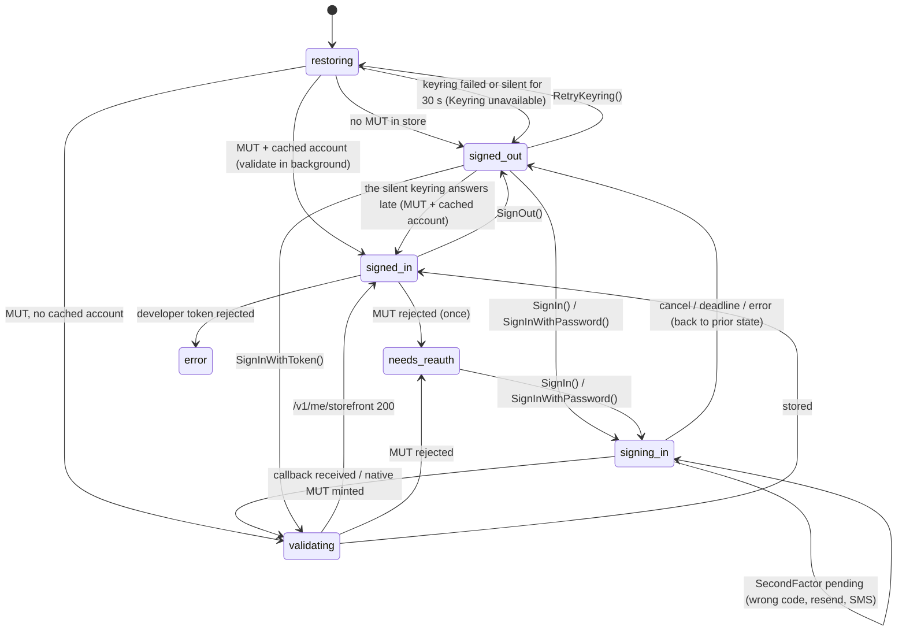

# Sona Authentication Design

Status: decided (web player developer token; native in-app sign-in as the primary MUT flow, loopback and token paste as fallbacks) and implemented in `internal/auth/devtoken`, `internal/auth/appleid`, `internal/auth/mut`, `internal/auth/store`, `internal/auth` (`Manager`), and `cmd/authspike`. Items marked **[verified]** were observed against live Apple endpoints. Items marked **[unverified]** still need an interactive Apple ID login.

## 1. What Must Be Obtained

| Credential | Format | Lifetime | Who needs it |
| --- | --- | --- | --- |
| Developer token | ES256 JWT | signed: ≤ 6 months (`exp - iat ≤ 15777000`); web player: ~70 days **[verified]** | every Apple Music API call; MusicKit JS `configure()` |
| Music User Token (MUT) | opaque string | months; revocable by Apple/user `[INFERENCE]` | every `/v1/me/*` call; MusicKit playback |
| Storefront | 2-letter code | stable per account | catalog paths `/v1/catalog/{sf}/...` |

Request headers for personalized calls: `Authorization: Bearer <devToken>` and `Media-User-Token: <mut>`.

## 2. Why The MusicKit Popup Model Doesn't Fit

Clients built on MusicKit JS inside a browser shell (Electron, for example) usually sign in like this:

- The developer token comes from a server of their own or from Apple's web player bundle.
- The MUT comes from `MusicKit.getInstance().authorize()`. That opens a popup named `apple-music-service-view` to `authorize.music.apple.com/woa`, and the popup returns the token to `window.opener` over JSON-RPC `postMessage`.
- The shell explicitly allows that popup and rewrites `Origin`/`Referer` on every `*.apple.com` request.
- Persistence is MusicKit's own `localStorage` (`music.ampwebplay.media-user-token`), with no keychain.

That model depends on three things an embedded web view (WebKitGTK, the shell Sona first considered) does not reliably give. Sona has no web view at all: its UI is native (`internal/ui`) and all Apple traffic is Go's:

1. `window.open` producing a related webview with a working `window.opener`.
2. Request header rewriting (WebKitGTK has no UI-process API for this).
3. Tokens living in the webview's storage instead of the backend.

Sona's design removes all three dependencies.

## 3. Developer Token: Web Player Token (decided)

Sona uses the token Apple's own web player ships. This is a deliberate choice: it costs nothing and needs no token server. It is also ToS-gray and can break whenever Apple changes the bundle. If that happens, the fallbacks are a self-signed `.p8` token (Apple Developer Program) or a token endpoint Sona operates; both fit the same interface.

Implementation: `internal/auth/devtoken/webplayer.go` (`WebPlayer.Token`, `Invalidate`, `ParseClaims`).

- **[verified]** `https://music.apple.com/us/browse` references one entry bundle, `/assets/index~<hash>.js`. That bundle assigns the JWT to a minified variable that it passes as `developerToken:` into MusicKit configure.
- Extraction: fetch the HTML, take `/assets/index~*.js`, regex `"(eyJ[A-Za-z0-9_-]+\.[A-Za-z0-9_-]+\.[A-Za-z0-9_-]+)"`, and accept only claims with `iss == "AMPWebPlay"`.
- **[verified]** Claims: `{"iss":"AMPWebPlay","iat":1792780534,"exp":1798828534,"root_https_origin":["apple.com"]}`, header `kid: WebPlayKid` (70-day lifetime).
- **[verified]** On both `api.music.apple.com` and `amp-api.music.apple.com`, `GET /v1/catalog/{sf}/search` returns **401 without** `Origin` and **200 with** `Origin: https://music.apple.com` + `Referer: https://music.apple.com/`. `internal/applemusic` always sets both.
- Refresh: cached in memory, refetched when fewer than 7 days remain or after a 401 (`Client.Get` invalidates and retries once).
- The playback engine needs no origin spoofing, because its page is served at `https://music.apple.com/sona-engine/` (§6).

### 3.1 MUT Compatibility

**[verified]** The MUT the user supplied in `.env` is accepted by `/v1/me/storefront` with the web player token, and MusicKit in the engine reports `authorized: true` with it. A MUT minted through Sona's own flow is requested with this same token.

## 4. MUT Acquisition: Loopback Redirect Flow And Native Sign-In

### 4.1 Evidence That The Flow Exists **[verified from Apple's shipped JS]**

- `authorize.music.apple.com/assets/index.*.js`, query handler: `a` (base64 third-party info) goes to `sessionStorage.ai`. The ReferrerUrl stored in `sessionStorage.ac` is `document.referrer`, **replaced by the `referrer` query param when both share an origin** (`p&&c.origin===p.origin&&(o=c.href)`).
- On successful sign-in with **no opener**, the page stores `sessionStorage.ap = btoa(JSON.stringify({cid, itre, musicUserToken}))`. It then runs `window.location.assign(`${ReferrerUrl}#${ap}`)`.
- MusicKit JS v3 consumes exactly this format in `_processLocationHash`, using the regex `^#([a-zA-Z0-9+/]{200,}={0,2})$`. It parses `{itre, musicUserToken, cid}` and calls `history.replaceState` to strip the hash. So the redirect flow is an official code path, not a scrape.
- MusicKit builds the URL as `https://authorize.music.apple.com/woa?a=<btoa(thirdPartyInfo)>&referrer=<location.href>&app=music&p=subscribe`. `thirdPartyInfo = {thirdPartyIconURL, thirdPartyName, thirdPartyParameters, thirdPartyToken: <devToken>}`.
- **[verified]** With the web player token and `referrer=http://127.0.0.1:<port>/auth/<nonce>/callback`, reached from Sona's loopback start page in headless Chrome, the authorize page reaches the real Apple ID sign-in (`<title>Sign In - Apple</title>`, a top-level redirect to `idmsa.apple.com/IDMSWebAuth/auth`, `appReturnUrl=…/commerce/account/validateMusicKitToken`).
- **[verified]** Apple's authorize page stored `sessionStorage.ac = "http://127.0.0.1:<port>/auth/<nonce>/callback"` (with `document.referrer` = the start URL), so after sign-in it redirects to Sona's callback.
- **[verified]** Simulating Apple's final hop (navigating to `callback#<btoa({cid,itre,musicUserToken})>` with a real MUT) runs the callback page JS, posts to `/complete`, and `authspike` prints `signed in: storefront=<id> (<name>)`.
- **[verified]** Apple's own post-sign-in redirect to the loopback referrer: an interactive sign-in in the system browser completes the flow.

### 4.2 Sequence

```mermaid
sequenceDiagram
  participant UI as Native UI
  participant Go as Go AuthService
  participant LB as Loopback server (127.0.0.1:random)
  participant B as System browser
  participant AZ as authorize.music.apple.com
  participant ID as idmsa.apple.com
  participant API as api.music.apple.com

  UI->>Go: SignIn()
  Go->>Go: devToken = webplayer.Token()
  Go->>LB: start, nonce N (128-bit), 10 min deadline
  Go->>B: open http://127.0.0.1:P/auth/N/start?t=T (single-use ticket T)
  B->>LB: GET /auth/N/start?t=T
  LB-->>B: Set-Cookie sona_signin=K (HttpOnly, SameSite=Strict, Path=/auth/N/); page: Referrer-Policy unsafe-url, location.replace(authorizeURL)
  B->>AZ: GET /woa?a=b64(info)&referrer=http://127.0.0.1:P/auth/N/callback&app=music&p=subscribe
  AZ->>ID: Apple ID sign-in (+2FA)
  ID-->>AZ: validateMusicKitToken
  AZ-->>B: location.assign(callback + "#" + b64({cid,itre,musicUserToken}))
  B->>LB: GET /auth/N/callback (cross-site navigation: no cookie; fragment stays client-side)
  LB-->>B: page JS reads location.hash, history.replaceState, POST /auth/N/complete
  B->>LB: POST /auth/N/complete {fragment} + cookie K (same-origin fetch)
  LB->>Go: decode, single-use consume N
  Go->>API: GET /v1/me/storefront (Bearer + Media-User-Token)
  API-->>Go: 200 {data:[{id:"<storefront>"}]}
  Go->>Go: store MUT (keyring), storefront (DB)
  Go-->>UI: event auth:changed {state: signed_in}
  LB-->>B: "You can close this window"
```

### 4.3 Surfaces

1. **Native form (primary)**: Sona's own account/password/code form; Go speaks Apple's sign-in protocol directly. See §4.7.
2. **System browser (fallback)**: `AuthService` opens the start URL through `Deps.OpenURL`, which `cmd/sona` sets to `mygo.Shell.OpenExternal` (the XDG portal / `xdg-open` on Linux, `open` on macOS, the shell on Windows). The user gets their real browser's password manager, passkeys, existing Apple session, and 2FA UX. Use it for accounts the native form cannot serve (security keys only, account repair prompts). On macOS the line above the button says "passkey (Touch ID or your Mac's password)": the browser offers the account's iCloud Keychain passkey on Apple's page and asks for Touch ID, or the Mac's password on a Mac without a sensor, as on music.apple.com. Sona can't ask for the passkey itself, and `ASWebAuthenticationSession` ([docs](https://developer.apple.com/documentation/authenticationservices/aswebauthenticationsession)) wouldn't add anything: on macOS it runs in the user's browser and takes an `http://` start URL, so it could host the loopback flow, but it gives no passkey capability over opening the browser. An `apple.com` passkey requested by an app or a web view needs a `webcredentials` associated domain for apple.com ([Supporting passkeys](https://developer.apple.com/documentation/authenticationservices/supporting-passkeys)), which only Apple can grant. Unverified on a Mac: that the passkey is offered on that page.
3. **Embedded web view** (never built; the native form replaced it): the same start URL in a dedicated web view window. Sona has no web view, so this stays a rejected option.
4. **Manual token paste (escape hatch)**: the user copies the `media-user-token` cookie from `music.apple.com` in any signed-in browser. `SignInWithToken` validates it with `/v1/me/storefront` before storing. **[verified]** with the token in `.env`.

### 4.4 Referrer Robustness

- WebKit/Safari ITP and some browser privacy modes trim cross-site referrers to the origin. The flow still works because the `referrer` param is honoured whenever its origin equals `document.referrer`'s origin, and the loopback origin is unique per attempt (random port).
- If the referrer is stripped entirely (`no-referrer` policies or extensions), Apple has nowhere to redirect. Detection: the start page was hit but no callback arrives within the deadline. The UI then offers the other surface or token paste.
- The start page sets both the `Referrer-Policy: unsafe-url` header and `<meta name="referrer" content="unsafe-url">`.

### 4.5 Loopback Server Security

- Bind `127.0.0.1` only, on a random port. One server instance per sign-in attempt, shut down on completion, cancel, deadline or a replayed start link.
- Paths are prefixed with a 128-bit random nonce. Unknown paths return 404. Each nonce is consumed once.
- The nonce is in the URL handed to the browser, so other local users can read it from `/proc/<pid>/cmdline` (security review F7). Two controls keep that from being enough:
  - **Socket owner (Linux).** The listener drops every connection whose client socket (looked up in `/proc/net/tcp` and `tcp6`) another uid owns, or that it cannot find.
  - **Start links and the cookie.** Each start link carries a random ticket and works once (`mut.Session.StartURL`). Loading it sets `sona_signin`, 256 random bits never put in a URL: host-only, `Path=/auth/<nonce>/`, `HttpOnly`, `SameSite=Strict`, `Max-Age` = the rest of the attempt (no `Secure`/`__Host-`, which need https). `POST /complete` requires it (constant-time compare, 403 otherwise) and deletes it on success. A ticket loaded twice ends the attempt with `mut.ErrStartReused`. The UI's "Open the page again" and "Copy link" get a new link from `AuthService.SignInLink`.
  - `Strict` is enough: Apple's redirect to `/callback` is a cross-site navigation and carries no cookie, but `/callback` receives nothing (the token stays in the fragment). The cookie is needed only on the callback page's same-origin `fetch` to `/complete`, where it is sent. Checked in headless Chromium 155 with a stand-in authorize page (F7).
- When the attempt ends (success, failure, timeout, cancel, replayed link) every start link and `/complete` answer 410.
- Reject requests whose `Host` is not `127.0.0.1:<port>` (DNS rebinding defense).
- `POST /complete` requires `Origin: http://127.0.0.1:<port>`, the start cookie and `Content-Type: application/json`, with a body cap of 16 KiB.
- Every response sets `Cache-Control: no-store` and a CSP of `default-src 'none'; script-src 'nonce-…'; connect-src 'self'`.
- Never log the fragment, the MUT, the dev token or the cookie. `slog` uses a redacting `LogValuer` on token types.

### 4.6 Failure Modes Handled

| Situation | Signal | Sona behaviour |
| --- | --- | --- |
| No Apple Music subscription | authorize routes to `ErrorNoSubscription` (seen in Apple JS); no callback | UI: "Apple Music subscription required"; offer retry |
| Unsupported country | route `error-unsupported-country` | same, with storefront message |
| User closes the browser tab | deadline with no callback | state back to `signed_out`, toast |
| Restricted account | `itre == "1"` in fragment | store the flag; hide explicit content |
| Fragment decodes but `/v1/me/storefront` is 401/403 | validation failure | discard the MUT; report the error and offer retry |
| Second `SignIn` while one is pending | existing attempt | cancel the old attempt (close its server), start a new one |
| A start link loaded a second time | `mut.ErrStartReused` | the attempt ends; back to the prior state with "the sign-in link was opened twice; start the sign-in again" |
| `POST /complete` without the start cookie | 403 | the attempt keeps waiting for the browser that started it |

### 4.7 Native Sign-In (`internal/auth/appleid`)

Sona collects the Apple Account name, password and two-factor code in its own UI. Go replays the exact requests Apple's sign-in widget and the Apple Music authorize page make, so no browser or webview is involved. The password is used for one SRP exchange, never stored, never logged; each attempt has its own cookie jar, discarded when it ends.

Sources (Apple's shipped JavaScript, read from the prettified bundles):

| Step | Apple source |
| --- | --- |
| `/woa` → `activate.apple.com/mkauth?jwtToken=<dev>&LogoURL=` | `authorize.music.apple.com/assets/index.db65ee7b.js` (`Ia`, `Fe`) |
| mkauth → `idmsa.apple.com/IDMSWebAuth/auth?oauth_token=…` (boot args: `widgetKey`, `oauth_token`, `appReturnUrl=…/validateMusicKitToken?Pod=..&liteSessionId=..`, `appId` 165; hidden `callBackForm` with `oAuthToken`, `scnt`) | observed response |
| Widget frame `/appleauth/auth/authorize/signin?frame_id&client_id=<widgetKey>&redirect_uri=https://idmsa.apple.com&response_type=code&response_mode=web_message&state&authVersion=latest` (first-party OAuth because `enableTiburonInd`) issues `scnt`, `X-Apple-ID-Session-Id`, `X-Apple-Auth-Attributes`, `X-Apple-HC-Challenge`/`-Bits` | `authService.latest.min.js`, `oauth2WidgetLoginBoot.js` |
| `POST /appleauth/auth/signin/init {a, accountName, protocols:["s2k","s2k_fo"]}` → `{iteration, salt, protocol, b, c}` | `app-message.js` (`vn`, worker `initData` handler) |
| `POST /appleauth/auth/signin/complete?isRememberMeEnabled=false {accountName, rememberMe, m1, c, m2}` + `X-APPLE-HC`; 200 signed in, 409 two-factor | `app-message.js` (`bn.prototype.signIn`) |
| SRP-6a: RFC 5054 2048-bit group, SHA-256, `k=H(N‖PAD(g))`, `x=H(s‖H(":"‖P))` (empty identity), `P=PBKDF2-SHA256(SHA256(pw) or hex(SHA256(pw)) for s2k_fo, s, i, 32)`, `u=H(PAD(A)‖PAD(B))`, `K=H(PAD(S))`, `M1=H(H(N)⊕H(PAD(g)) ‖ H(lower(account)) ‖ s ‖ A ‖ B ‖ K)`, `M2=H(A‖M1‖K)` | `webSRPClientWorker.js` |
| Hashcash `1:<bits>:<UTC yyyymmddhhmmss>:<challenge>::<n>`, SHA-1 with ≥ bits leading zero bits | `generateHashcash.js`, `app-message.js` (`separator:"::"`) |
| 2FA options: `GET /appleauth` + (409 `Location` or `/auth`) with `Accept: text/html`; the first `<script class="boot_args">` gives `direct.hasTrustedDevices` and `direct.twoSV.phoneNumberVerification` (`trustedPhoneNumbers`, `phoneNumber`, `securityCode.length`; `bridgeInitiateData` overrides `twoSV`, `trustedDeviceVerification.phoneNumberVerification` is the fallback). The widget routes `hasTrustedDevices` to `verifyDevice`, else to the phone sections | `app-message.js` (`Io`, `te.prototype.next`), `home-c702d19e62c250fcaaa7.js` (hsa2 reducer, `F`) |
| 2FA codes: `POST …/verify/trusteddevice/securitycode {securityCode:{code}}`, `PUT …/verify/trusteddevice/securitycode` (resend), `PUT …/verify/phone {phoneNumber:{id},mode}`, `POST …/verify/phone/securitycode`, `GET …/2sv/trust` | `home-c702d19e62c250fcaaa7.js` |
| Widget success → `POST https://idmsa.apple.com/auth` (`callBackForm`) → `validateMusicKitToken` → 302 to `authorize.music.apple.com/?liteSessionId&pod&appleId&…` | `oauth2WidgetLoginBoot.js` (`onAuthSuccess`) |
| `GET https://p<pod>-buy.itunes.apple.com/commerce/account/getMusicUserToken?liteSessionId&jwtToken=<dev>` → `{musicUserToken, itre}` (the consent page's Approve button, no cookies) | `index.db65ee7b.js` (`Xr`, `tn`) |

Every `/appleauth` request carries the widget's headers: `X-Apple-Widget-Key`, `X-Apple-OAuth-{Client-Id,Client-Type=firstPartyAuth,Redirect-URI,Response-Mode,Response-Type,State}`, `X-Apple-Frame-Id`, `X-Apple-App-Id`, `X-Apple-Locale`, `X-Apple-Alt-TokenCookie-Flg`, `X-Apple-Requestor-OAuthToken`, and the rolling `scnt` / `X-Apple-ID-Session-Id` / `X-Apple-Auth-Attributes` from the previous response. Sona does not send the browser fingerprint `X-Apple-I-FD-Client-Info` [INFERENCE: Apple may weigh its absence as risk and ask for 2FA more often].

Verification:

- **[verified]** `internal/auth/appleid/testdata/srp_vectors.json` was produced by running Apple's `webSRPClientWorker.js` under Node with a fixed private value; the Go client reproduces A, M1 and M2 byte for byte for both `s2k` and `s2k_fo` (including a zero-led salt, mixed-case account and non-ASCII password).
- **[verified]** Live: mkauth → IDMSWebAuth → widget frame → `signin/init` 200 → `signin/complete` (with hashcash) 401 `-20101` for a nonexistent account, i.e. Apple accepted the request framing and rejected only the credentials.
- **[verified]** Native sign-in completes to `getMusicUserToken` and a stored MUT through an SMS code, and through a trusted-device code (`hasTrustedDevices` read from the HTML boot data, the form asking only for the device code, then `verify/trusteddevice/securitycode`). The browser fallback completes too.
- **[unverified]** The no-device paths (texted `phoneNumber`, phone list without auto-send, text/call switch, `nonFTEU`) against a live account; covered only by `appleidtest`. Needs an Apple Account with no trusted device.
- `appleidtest` is a fake that checks SRP with a real server-side computation, the hashcash stamp and header rotation; `auth` and `appleid` tests run the whole flow against it.

Manager API (`internal/auth/native.go`): `SignInWithPassword(account, password)` returns `nil` (signed in) or the `*appleid.SecondFactor`. `SubmitSecurityCode(code, phoneID, mode)` (phoneID 0 = trusted device), `SendCodeToPhone(phoneID, mode)` and `ResendSecurityCode()` act on the pending attempt. While waiting, the state is `signing_in` with `Status.SecondFactor` set.

Two-factor routing: Apple prompts the trusted devices server-side when the password is accepted; Apple's own widget sends no request that triggers or withholds that prompt, it only reads the options and shows the device-code screen [INFERENCE from the widget code and the observed prompt; not isolated per request]. Read the options from the HTML boot data, not `GET /appleauth/auth` as JSON: its `trustedDeviceCount`/`noTrustedDevices` miss the devices.

Sona offers every route the account has. The code step always shows a three-way switcher: **Apple device**, **Text message**, **Phone call**. Apple device is disabled (with "No Apple device is signed in to this account…") when `hasTrustedDevices` is false; text and call are disabled when the account lists no phone. Picking text or call with one number asks Apple at once; with several, the number picker opens with that method preselected. Picking Apple device again returns to the device code with no request (Apple already prompted the devices).

| Boot data | `SecondFactor` | Opens on |
| --- | --- | --- |
| `hasTrustedDevices` | `TrustedDevices`, `Phones` from `trustedPhoneNumbers`, `SentToPhone` 0 | device code; text/call one click away |
| no devices, `phoneNumberVerification.phoneNumber` set | `SentToPhone` = that phone (Apple already texted it) | code entry for that number |
| no devices, `trustedPhoneNumbers` only | `Phones`, `SentToPhone` 0 | number picker. [INFERENCE] Apple may already have texted a single number; choosing it sends one more code, which is harmless |
| No phones and no devices, or security keys only | `ErrUnsupported2FA` | browser sign-in |

`appleid.Session` checks the route before any request: device codes and `ResendDeviceCode` need trusted devices; `SendCodeToPhone` and phone codes need a listed phone and mode `sms` or `voice`. Anything else returns `ErrOutOfOrder` and the attempt stays open. When `phoneNumberVerification.enableNonFTEU` is set, a texted code is submitted with `phoneNumber.nonFTEU: true`, as the widget does (`home.js` "phone/verify"). Apple's SMS-consent interstitial and SMS speed bump (`smsSpeedbumpEnabled`) are not reproduced.

| Situation | Signal | Sona behaviour |
| --- | --- | --- |
| Wrong password / unknown account | `signin/complete` 401 `-20101` | attempt ends, prior state returns, Apple's message in `LastError` |
| Wrong code | 400 `-21669` | attempt stays open, `LastError` "Incorrect verification code." |
| Too many codes / send failure | Apple service error | attempt stays open, Apple's message in `LastError` |
| Locked account | 403 or `-20209`/`-20283`/`-24761` | attempt ends; offer browser sign-in |
| Account repair or terms (`412`) | `ErrActionRequired` | attempt ends; point to account.apple.com or browser sign-in |
| Security keys only (`twoSV.fsaVerification`) or no 2FA route | `ErrUnsupported2FA` | attempt ends; offer browser sign-in |
| No subscription / unsupported country | authorize redirect `isAppleMusicSubscriber=false`, `ERROR_NO_DSID`, `/error/no-subscription`, `supported=0` | attempt ends with the matching message |
| No code before `SignInTimeout` | deadline | `signed_out` (or prior state), "sign-in timed out" |
| `CancelSignIn`, `SignOut`, or a new attempt | — | pending session dropped; later code submissions return `ErrOutOfOrder` |

## 5. Lifecycle And State Machine

Implemented by `auth.Manager` (`internal/auth/manager.go`). Every transition is published through `Manager.OnChange` (the `auth:changed` payload is `auth.Status`).



- Off the first-paint path: `Start` returns at once and reads the store in the background (`main` calls it after the services have subscribed). Until the store answers the state is `restoring`; past 1 s `Status.Keyring` is `waiting` and the UI says Sona is signing in and waiting for the keyring (the status banner, the account dialog), so an unlock prompt or a Secret Service that never answers holds nothing but sign-in. Past 30 s (`Config.KeyringTimeout`), or when the store fails, the state is `signed_out` with `Keyring` `unavailable` and a "Try again" (`RetryKeyring`, which opens the store afresh and so probes the keyring again). An answer that still comes later applies as if it had come in time, unless a sign-in, sign-out or retry came first. A keyring that never answers is never taken as unavailable for the file fallback (§7).
- Offline-first: `Start` reads only the store and the cached account, so cold start never waits for the network. Network and 5xx errors during validation keep the MUT, set `Status.Offline`, and retry with exponential backoff (2 s to 5 min). Offline never means `needs_reauth`.
- A failed sign-in attempt returns to the state before it. A second `SignIn` (or `SignInWithToken`) cancels the pending attempt and closes its loopback server.

401/403 triage: Apple returns 401 for a bad dev token and 401/403 for a bad MUT, so the status alone cannot tell them apart. **[verified]** A bogus MUT on `/v1/me/storefront` returns `403 {"code":"40300","detail":"Invalid authentication"}`.

1. On 401 from any endpoint: `WebPlayer.Invalidate()`, refetch the dev token, retry once (`applemusic.Client.Do`).
2. Request paths pass a 401/403 that survived that retry to `Manager.ReportUnauthorized`. The manager re-checks `/v1/me/storefront`; if that still fails, it probes `/v1/storefronts/{sf}` without the MUT. Catalog OK means the MUT is bad (`needs_reauth`); catalog 401/403 means the developer token is rejected (`error`, "developer token rejected"); network errors change nothing.
3. Never loop. Each request retries at most once, one probe runs at a time with a cooldown between probes, and `needs_reauth` is entered once: later reports are ignored until a new sign-in. In `needs_reauth`, `UserToken()` returns "" so catalog requests keep working.

The UI renders from SQLite in `restoring`/`validating` and while `Status.Offline` is set; `restoring` is neither signed in nor signed out, so pages show their skeletons rather than a sign-in prompt.

## 6. Credentials And Playback **[verified]**

- Playback runs in Sona's own engine (`internal/playback/native`, `docs/architecture.md` §4). Credentials never leave the Go parent process: every playback request (`webPlayback`, `widevineCert`, `acquireWebPlaybackLicense`, radio `play/assets` and licence, play-activity reports) goes through `applemusic.Client`, which adds the developer token, `Media-User-Token` and `Origin: https://music.apple.com` per request, reading the MUT from `Manager.UserToken()`.
- The CDM host child process receives only certificates, licence responses and encrypted media bytes over its stdin/stdout pipe; it never sees a token and makes no network requests.
- A 401/403 from a playback request surfaces as `applemusic.ErrUnauthorized`: the engine emits `auth`, the coordinator pauses with `AuthRequired`, and the services layer passes the error to `Manager.ReportUnauthorized` (§5 triage).
- Sign-out stops playback, clears the queue and wipes user data (`db.WipeUserData`); there is no engine profile to wipe. Undelivered play-activity events are stored without credentials (tokens are added at send time).

## 7. Storage

- `internal/auth/store`: `github.com/zalando/go-keyring`, service `sona`, key `mut`, value JSON `{token, obtained_at, restricted}`. The dev token is not stored, because it is refetched from the web player. `store.Open` probes the Secret Service by reading the real entry.
- The manager uses the store only off the caller's path (`internal/auth/vault.go`): `Config.Open` (normally `store.Open`) and every `Get`/`Set`/`Delete` run one at a time, in order, each on its own goroutine, and callers wait at most `Config.KeyringTimeout` (30 s). A read or write the caller stopped waiting for still runs, and later ones queue behind it, so writes reach the keyring in order however late it answers. A sign-in whose write times out, or that is cancelled while it waits, fails with `ErrKeyringTimeout` (error code `keyring`) and queues a write that puts back the token the manager still has, so a late write can't leave the abandoned sign-in stored. A sign-out whose delete times out reports it; the delete runs once the keyring answers. go-keyring's calls have no deadline: a Secret Service that is activatable but never starts costs two D-Bus activation timeouts before go-keyring reports an error (about 4 minutes with dbus-daemon's default of 2 minutes), and an unlock prompt nobody answers waits forever.
- Secret Service unavailable (no gnome-keyring/kwallet, or an unlock prompt dismissed): fall back to `$XDG_CONFIG_HOME/sona/credentials.json`, mode 0600 (written atomically), owned by the user. `Store.Backend()` reports `file (unencrypted)`, Settings and Diagnostics show an explicit "credentials stored unencrypted" warning (the account menu and dialog say so before a sign-in too, with "Try again" to probe the keyring again), and `Open` logs a warning. Never fall back silently, and never because the keyring is slow: only an error from the Secret Service selects the file. Once the Secret Service is reachable again, the file is moved into it and deleted.
- Other secrets use the same store through `store.OpenSecret(configDir, key)`: one keyring entry per key under service `sona` (`lastfm`: the Last.fm session key; `listenbrainz`: the ListenBrainz user token; `musixmatch`: Musixmatch's anonymous user token, for lyrics, replaced by itself when Musixmatch stops accepting it), the same Secret Service probe, and a 0600 fallback file `credentials-<key>` that moves into the keyring once it is reachable. Settings → Connections shows the "stored unencrypted" warning for the scrobblers' secrets.
- Apple sign-out does not disconnect the scrobblers: they are separate accounts the user connected on this desktop, and nothing in them is Apple user data. Disconnecting a scrobbler in Settings → Connections deletes its keyring entry (and fallback file) and its unsent listens.
- SQLite stores metadata only (`auth.AccountStore`): storefront id/name, language, `itre`, obtained/validated timestamps.
- `SignOut()` clears the in-memory token, deletes the keyring entry and the fallback file, deletes the account metadata, then runs the `OnSignOut` hooks in registration order (engine sign-out, engine storage, optional user data). Every step runs even if one fails; failures are returned and shown in `Status.LastError`. The library cache stays unless the user also chooses "clear library".

## 8. Open checks

`go run ./cmd/authspike` runs either flow from the terminal (`-native` for the native sign-in; `-save .env` writes the MUT for local testing). Still to confirm against Apple:

- The native no-device two-factor paths (§4.7).
- Revocation: sign out in the Apple Account settings and record the 401/403 shape Sona then sees.
