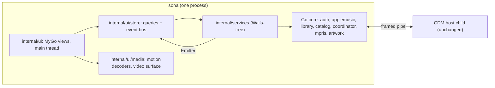
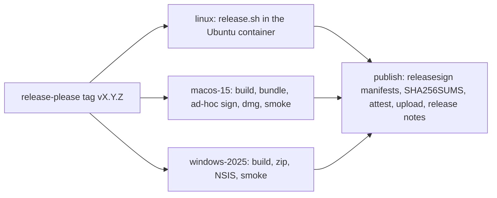

# Moving Sona's UI from Wails + React to MyGo native UI

Status: plan, not started. Evidence: the spike on branch `chore/mygo-spike` (`spike/mygo/`). The React app's last state is tagged `v0.2.0`; that tag is the reference for everything ported.

## 1. Goal

One Go process draws Sona's whole interface with MyGo v0.7.x native UI (`github.com/egoist/mygo/ui`) on Linux, macOS and Windows. React, Vite, Wails, WebKitGTK, Node and pnpm leave the repository. The end product does everything the current app does. Where the move makes something possible that WebKit blocked, it does that too (queue rows dropped on playlists, every lyric word swept). Nothing in the Go core changes behaviour: auth, Apple client, sync, the coordinator, the CDM host child, MPRIS, the keyring, artwork and SQLite.

**Done means:**

- Every row of the parity matrix (§9) is checked on Linux, with screenshots in light and dark.
- macOS and Windows build in CI and pass the smoke run.
- `check` and `tests` are green.
- The release pipeline produces .deb, .rpm, Arch, AppImage, Flatpak and the macOS and Windows builds, and their smoke tests pass.
- Performance is at or better than the baseline captured before the move (§8).
- `docs/migration-report.md` records the hitches, the noticeable changes and the new development flow.

**Non-goals:**

- New features beyond those found along the way.
- Redesigning pages: they keep `docs/design.md`.
- Changing Apple traffic, DRM or the sandbox.

## 2. What the spike already settled

| Question | Answer | Evidence |
|---|---|---|
| Can the UI reuse Sona's Go packages directly? | Yes: `library`, `artwork`, `db`, `coordinator`, `lyrics` and `applemusic`, in-process, no IPC | `spike/mygo/*.go` |
| Performance vs WebKit | Scrolling Albums: 0% dropped frames against 63%. Now Playing: 15–20% CPU against 39–46%. Memory: 200 MiB against 465–540. First paint: 0.27 s against 1.22 s | earlier reports, measured on the maintainer's desktop |
| H.264/HEVC motion artwork | MyGo has no decoder. A GStreamer `ui.VideoDecoder` works (`motion_linux.go`), at 8–11% of a core per video | spike |
| GTK3 (MyGo, purego) and GStreamer (cgo) in one process | Works, as long as both use the same GLib build (devenv's nixpkgs pin) | spike `-motion`, Now Playing |
| Cross-OS builds | windows/amd64, windows/arm64, darwin/arm64 and darwin/amd64 build. The maintainer has run macOS and saw the performance gain | spike, maintainer |
| Drag and drop | `ListState.Reorder` drags a private value that only the list accepts. An own `Drag` value plus `IgnoreInput` on the dragged row works for the queue and the sidebar | `queue.go` |
| Pixel-precise programmatic scrolling | `List` keeps its place by row, not by offset. Grids use `Scroll` + `TrackScroll` with their own row virtualisation | `main.go` `content` |
| Text gradients (lyric sweep) | MyGo has no gradient fill for text. A text layout painted with clipping, with a soft edge in 8 steps, runs on every frame | `lyricsweep.go` |

## 3. Target architecture

### 3.1 Package layout

| Package | Holds | Replaces |
|---|---|---|
| `cmd/sona` | Start-up as now, then `mygo.App.Run`. Windows, tray and the shell come from `internal/ui/app` | Wails `application.New`, `artMiddleware` |
| `internal/ui/app` | The main window, the mini player window, the tray, the title bar (`internal/windowchrome` decides), the router, route memory, shortcuts, the first-paint signal | `frontend/src/app/*`, `internal/shell/*` |
| `internal/ui/theme` | Tokens from `docs/design.md` (light and dark, colours, type scale, radii, spacing, motion), fonts, Lucide icons (ISC, embedded SVG), the reduce-effects and reduced-motion switches | `shared/styles/index.css`, Tailwind config |
| `internal/ui/kit` | Sona's components (§3.3) | `shared/ui/*` (shadcn), `shared/components/*`, `shared/tracks/*`, `shared/actions/*`, `shared/selection/*`, `shared/dnd/*` |
| `internal/ui/store` | `Query[T]` (key, fetch on a goroutine, stale time, results published with `Window.Update`), the invalidation plans, the playback mirror, the event bus implementing `services.Emitter` | TanStack Query, zustand stores, `bridge.ts`, Go events |
| `internal/ui/i18n` | `T`, `Plural` and `Format` over the same catalogue Lingui uses today, with ICU MessageFormat through MyGo's `i18n.ParseMessage` and CLDR number and date formats. Apple's translations come through `internal/i18n/applestrings`, unchanged: `apple-keys.json` and `apple-keys-rejected.json` stay keyed by the same English msgids | Lingui, `Intl.*` |
| `internal/ui/media` | `motion_{gst,mf,none}.go` decoders, I420 → RGBA for music video pictures, the `Bitmap` cache | `MotionCover`, `TileMotion`, `video-frames.ts`, `video-render.ts` |
| `internal/ui/features/<name>` | One package per frontend module, the same names: album, artist, auth, cdm, commands, concerts, discover, equalizer, home, library, miniplayer, motion, onboarding, player, playlist, private, radio, reminders, search, settings, song, updates, video | `frontend/src/features/*` |
| `internal/ui/probe` | Frame stats, the scroll and motion probes, automation (MyGo's `plugins/automation` behind the `probe` build tag) | `cmd/uiprobe` + `probe.js`, the `-tags mcp` build |
| `cmd/uigallery` | Every kit component in every state, light and dark, for development and screenshots | Storybook-like check, new |
| `cmd/devloop` | The development watcher (§6) | `wails3 dev` + Vite |

A feature package keeps the frontend's module contract: it registers routes, sidebar entries, shortcuts, command-palette actions, shell slots (asides, overlays, bottom bars, layers) and invalidations in `internal/ui/app/modules.go`, one line per feature. That is the native version of `frontend/src/app/modules.ts`. AGENTS.md's "Adding Features" rule becomes: a Go service + `internal/ui/features/<name>` + one line in each registry.

### 3.2 Services without Wails

- **Registry:** `registry.go` keeps its list of features. `svc` returns the typed service, not `application.Service`.
- **Events:** `RegisterEvent` calls go. Event names and DTO types stay, and `Emitter` is implemented by `store.Bus`. The UI subscribes with typed handlers (`store.On[PlaybackState](bus, services.EventPlaybackState, fn)`), which run on the main thread through `Window.Update`.
- **Errors:** `MarshalError`'s `{code, message}` becomes `services.Error` read directly. `codeMessages` (frontend `shared/lib/errors.ts`) moves to `internal/ui/i18n` as `ErrorText(code)`.
- **Clipboard and open URL:** from `mygo.Clipboard` and the shell module. `DesktopService.OpenDeveloperTools` opens MyGo's inspector.
- **DTOs:** stay as the UI's types. They already carry Go-served `/art/` URLs, which the UI resolves through `artwork.Cache` keys instead of HTTP; the `/art/` handler goes away.
- **`/motion/` and `/video/frame`:** become direct calls to `motion.Cache` and `video.Surface`. No loopback HTTP server is needed: WebKitGTK's custom-scheme media limitation is gone along with WebKit.

### 3.3 Component kit

| Kit component | Built on | Notes |
|---|---|---|
| Button (default, ghost, outline, play; icon sizes xs, sm, md), Badge, ExplicitMark, Separator, Skeleton | `ButtonBase`, `Box` | `button.tsx` variants; 120 ms colour ease |
| Input, SearchField, Combobox, Switch, Select, Segmented, Slider, Tabs | MyGo widgets with the theme applied | MyGo's Select, Segmented and Slider already matched in the spike |
| Dialog, ConfirmDialog, Popover, Tooltip, Toast (Sonner look), DropdownMenu / ContextMenu | `DialogBase`, `PopoverBase`, `TooltipBase`, `ToastBase`, `PopoverMenu` | Escape and focus return, as `docs/accessibility.md` asks |
| Artwork (exact-size decode, rounding, edge, placeholder glyph), PersonAvatar (initials, tones), Backdrop (pre-blurred JPEG + scrim) | `Image`, `Bitmap.ReleasePixels` | Artwork decoding off the main thread (spike `artWorker`) |
| MotionCover, TileMotion (dwell 400 ms, one hovered tile at a time) | `ui.Video` + `media` decoders | Pauses when not `InView`, when an overlay covers it, when the window is hidden, and under reduce-effects, reduced motion or battery power |
| CoverGrid, CoverRow, CoverShelf, Shelf | `Scroll` + own virtualisation (the spike's), selection, keyboard grid navigation | `role=grid` via `Role`/`Label` |
| TrackList (sortable columns, multi-select, double-click to play, drag) | MyGo `Table` where it fits, otherwise `List` | `TrackList.tsx` behaviours one by one |
| ActionMenu + action registry (`shared/actions/registry.ts`), bulk actions, selection model | Go port of the registry | Same action IDs, so shortcuts and the command palette share them |
| Drag engine (`shared/dnd/drag.ts`: 6 px threshold, edge scroll, ghost card, targets describing the drop) | `Drag`/`DragOver`/`Drop` + custom ghost via `DragOptions.Preview` | Fixes the spike's translucent row covering targets |
| Equaliser bars, ProgressBar, RatingButtons, PlayButtons, LibraryButton, EmptyState, ErrorBlock, DetailStates, PageHeader, CollectionHeader, Notes, ArtistLinks | `Draw`, `RichText` | |

## 4. What MyGo lacks, and how it is filled

| Gap | Fill | Where | OS |
|---|---|---|---|
| H.264/HEVC decoding | GStreamer `ui.VideoDecoder` (spike code), with hardware decoders allowed | `media/motion_gst.go` (cgo) | Linux, macOS |
| Same, on Windows | Media Foundation `IMFSourceReader` → RGBA through `syscall`/COM (no cgo), as a separate task. Until it lands, `Capabilities().MotionArtwork = false` and stills are shown (AGENTS.md: report, never pretend) | `media/motion_mf_windows.go` | Windows |
| Music video pictures (I420 from the CDM child) | I420 → RGBA in Go: an SD frame is about 0.5 ms with a planar loop. If profiling says so, a MyGo shader with three plane images. `Bitmap.Update` per frame | `media/video.go` | Linux, macOS |
| Gradient text (lyric sweep, title fades) | Clipped `Painter.TextLayout` passes (spike `lyricsweep.go`) | kit `GradientText` | all |
| `mask-image` fades (lyrics, shelves) | A gradient overlay in the ground colour, or `Painter.Clip` + an alpha ramp | kit | all |
| Pixel-offset `List` scrolling | Own virtualised `Scroll` for grids and the lyric sheet; `List` only where row-based places are fine (queue, tracklists) | kit | all |
| A list's reorder drag only reaching that list | Own drag value + slot computation (spike `queue.go`) | kit drag | all |
| Drag ghost covering targets | `DragData` with `DragOptions.Preview` drawn as Sona's card, or an own ghost painted in an overlay layer | kit drag | all |
| WOFF2 font | Ship Schibsted Grotesk as TTF (OFL, from Google Fonts), embedded and registered at start | theme | all |
| `IntersectionObserver`, `ResizeObserver`, `matchMedia` | `Element.InView`, `Bounds()`, `Window.OnResize`, `ui.Preferences()` (reduced motion, accent) | kit | all |
| `BroadcastChannel` (lyrics offsets between windows), `localStorage` (lyrics prefs, playlist folders open, sidebar collapsed) | One `store` shared by both windows (same process). The persisted keys move into `config.Settings` as new fields, with a migration that reads nothing (they were per-WebView storage) | store, config | all |
| `Intl.*` (dates, lists, collation, durations, numbers) | MyGo `i18n.FormatDate`/`FormatNumber`/plural, plus `golang.org/x/text/collate` for `Collator` | ui/i18n | all |
| Web inspector, `uiprobe` over MCP `js_eval` | MyGo inspector, `MYGO_FRAME_STATS`, automation plugin; uiprobe rewritten as `sona -probe` (spike `-probe`) plus an automation client | ui/probe | all |
| WebDriver-free UI tests | `ui.Tester` (headless, `tt.Image()` snapshots) | `*_test.go` | all |
| MyGo's own Now Playing / MPRIS | Kept unlinked: Sona's MPRIS stays the only player on D-Bus (AGENTS.md). Verify that `linkNowPlaying` is never pulled in. On macOS and Windows, MyGo's Now Playing becomes the platform seam's media controls (a gain: Sona has none there today) | app | macOS, Windows gain |

## 5. Toolchain and dependencies

- **Go:** 1.26.10 → 1.27.3. The pinned nixpkgs already has `go_1_27` 1.27.3; `devenv.nix` sets `languages.go.package = pkgs.go_1_27`, and `go.mod` gets `go 1.27.3`.
- **Linux runtime:** `gtk3`, `libepoxy`, `libayatana-appindicator` (tray), `at-spi2-core`, `libglvnd`, `libsecret`, and `libx11`/`libxtst` (X11 placement). Dropped: `gtk4`, `webkitgtk_6_0`, `libsoup_3` (if nothing else needs it: check `glib-networking` users), `nodejs_24`, `pnpm`.
- **Loading the libraries:** MyGo loads them by soname with purego, so on NixOS devenv exports `LD_LIBRARY_PATH` built from the same pinned packages as GStreamer (one GLib in the process). The Nix package (`tests/vm/sona.nix`) wraps the binary with `makeWrapper --prefix LD_LIBRARY_PATH`. Distro packages depend on `libgtk-3-0` etc. and need nothing more.
- **cgo:** stays for sqlite, GStreamer, the CDM shim and the GStreamer motion decoder. The GTK4 cgo shims in `internal/shell` (`contextkey`, `mousenav`, `title`, `titlebar`, `fontdpi`) and `cmd/sona/webkit_linux.go` are deleted. Mouse back/forward, the font DPI and title-bar drag come from MyGo.
- **macOS:** Wails' Objective-C goes. MyGo needs no cgo there, but the CDM host and GStreamer keep it, so builds still need devenv's clang. `cmd/typecheck` keeps working.
- **Windows:** pure Go; `GOOS=windows CGO_ENABLED=0 go vet ./...` keeps working.

## 6. Development flow and hot reload

Go cannot swap code in a running process, and `mygo dev -web` (WebAssembly in a browser) cannot build Sona's cgo core. So the aim is the fastest possible rebuild-and-restart, landing back exactly where you were, plus instant reload of everything that isn't code.

1. **`dev` (devenv script) runs `cmd/devloop`.** It watches `*.go`, the tokens file, icons and `.po` files under `internal/` and `cmd/`. On a change it runs `go build -tags dev` into `bin/sona-dev`; while that runs the old app keeps running. Once the build succeeds, it quits the app and starts the new one. A failed build keeps the old app and prints the error, as `mygo dev` does. Keys: `r` rebuild, `q` quit.
   - Target: under 3 s from save to window on a warm cache. The spike's incremental UI rebuild was 3–6 s with the whole module; a dev build skips `-race` and stripping. Measure in phase 0; if over target, split rarely-touched cgo packages so their objects stay cached.
2. **State survives restarts.** Dev builds write `$XDG_STATE_HOME/sona/dev-restore.json` on quit and read it at start: route and search params, scroll offsets per route, open overlays and asides, the Now Playing pane, the selection, window size and position. On restart you land on the same screen at the same scroll position. The queue and playback position are already restored by the coordinator.
3. **Live tokens and catalogues.** In dev builds, `theme` loads `internal/ui/theme/tokens.json` (the embedded copy in production) and watches it; a change applies on the next frame with no rebuild. Colours, spacing, radii, type and motion timings can be tuned live. `.po` files reload the same way.
4. **`cmd/uigallery`** shows every kit component and page skeleton in light and dark, with knobs. It runs under the same devloop, so building a component doesn't need the app's data or sign-in.
5. **Inspector and frame stats:** `SONA_INSPECTOR=1` opens MyGo's inspector beside the content (element boxes, styles, frame times); `MYGO_FRAME_STATS=8` logs slow frames.
6. **Headless:** `ui.Tester` tests render views without a window; `go test ./internal/ui/...` takes seconds, and snapshot images land in `testdata/` for review.
7. **Runtime isolation per worktree:** a different `SONA_DEV_INSTANCE` per worktree (state file, single-instance lock) replaces `WAILS_VITE_PORT` in AGENTS.md.

## 7. Commands and pipelines to update

| Item | Change |
|---|---|
| `devenv.nix` | Go 1.27; GTK3 runtime + `LD_LIBRARY_PATH`; drop Node, pnpm, WebKit and GTK4. Scripts: `dev` → `go run ./cmd/devloop`; `build` → `go build -tags production,sqlite_fts5 -ldflags "-X main.version=$(cat VERSION)" -o bin/sona ./cmd/sona`; `gen` → sqlc only; `fmt` → gofumpt only; `check` → vet, Windows/macOS type-checks, golangci-lint, `go tool mygo vet ./internal/ui/...` (build lifetimes), `i18ntool extract -check`, path case; `tests` → `go test -race` (incl. `ui.Tester`) under `dbus-run-session`. New: `gallery` |
| `build/Taskfile.yml`, `build/linux/Taskfile.yml`, `build/darwin/Taskfile.yml`, `build/config.yml` | Remove the wails3 tasks and `config.yml`. Taskfile keeps `package` (nfpm, AppImage, macOS .app) calling plain `go build` |
| `.github/workflows/ci.yml` | Drop the frontend job and the `frontend/dist` stub; Linux job installs `libgtk-3-dev` etc.; add a job for `ui.Tester` snapshot diffs; macOS job builds `bin/sona` with devenv as now; Windows job builds `sona.exe` without a frontend step. `pr-title.yml` unchanged |
| `.github/workflows/release.yml`, `release-please.yml` | Three build jobs from the release tag: the Linux packages as now (no Node), macOS arm64 and Windows amd64 (§14). Then one publish job: every artefact, update manifests, `SHA256SUMS`, provenance attestations. Release notes from release-please's `CHANGELOG.md` section, with the first-run steps for unsigned builds |
| `build/linux/release/Containerfile` | `libgtk-3-dev libayatana-appindicator3-dev`, drop `libgtk-4-dev libwebkitgtk-6.0-dev libsoup-3.0-dev`, Node and pnpm |
| `build/linux/release/release.sh`, `smoke.sh` | No frontend build; smoke checks `sona --version` and the `startup: first paint` log line under Xvfb with `MYGO_GPU=0`; drop the WebKit sandbox and WebVTT checks; keep the GStreamer plugin checks (motion now decodes through Sona's own pipeline: `decodebin`, `avdec_h264`, `videoconvert`) |
| `build/linux/nfpm/nfpm.yaml`, `build/linux/arch/update.sh` | Depend on `libgtk-3-0`/`gtk3`, `libayatana-appindicator3-1`/`libayatana-appindicator`, GStreamer; drop GTK4 and WebKitGTK |
| `build/linux/appimage.sh` | Bundle GTK3 + GStreamer only; much smaller. Drop WebKit's helper processes |
| `build/linux/flatpak/dev.coredev.Sona.yml` | GNOME runtime (has GTK3); drop WebKit modules |
| `tests/vm/sona.nix`, `tests/vm/*` | Drop `fetchPnpmDeps`/`pnpmConfigHook`; `makeWrapper` for `LD_LIBRARY_PATH`; VM checks drive the UI through the automation socket instead of WebKit's MCP; screenshots as now |
| `cmd/uiprobe` | Rewritten against `internal/ui/probe` (in-app probe + automation client); same tables, so before/after compare |
| `renovate` config | Drop the npm manager; keep Go modules (MyGo pinned, with a manual review rule: `verdict/review`) |
| Repo | Delete `frontend/`, `frontend/bindings`, `build/config.yml`, `internal/shell`'s GTK4 shims, `cmd/sona/webkit_*`, `cmd/sona/devmode_*` (replaced by `-tags dev`), `.prettierrc`, eslint config; `.gitignore` update |
| Docs | `AGENTS.md` (stack, commands, generated code, worktree runtime isolation, gate list), `CONTRIBUTING.md` (devenv scripts, platforms, measuring UI performance, debugging, title bar checks), `docs/architecture.md` §2, §3, §6, §8 (the WebKit-specific performance rules become MyGo's: GPU, no layout per frame, decode at exact size), §9, §10, `docs/frontend-architecture.md` → `docs/ui-architecture.md`, `docs/design.md` (token source = `tokens.json`), `docs/accessibility.md` (ATK/NSAccessibility/UIA checks), `internal/services/doc.go`, PR template (Tests line) |

## 8. Baseline before the move

Captured from the `v0.2.0` binary (built in a reference worktree, §10) by one task, before any feature PR merges. These numbers and screenshots are what the new UI is checked against.

- **Performance:** `uiprobe` tables for empty, Home, New and Albums, with `-motion` scenarios; first paint over 5 starts; PSS; idle CPU.
- **Screenshots:** every route in light and dark at 1132×1253 and at 940×600 (the minimum window), through the MCP build, so every page has a reference image. That is about 40 routes × 2 themes × 2 sizes, plus overlays (Now Playing panes, room lyrics, queue, command palette, dialogs, onboarding steps, mini player).
- **Behaviour inventory:** an exhaustive list of each module's behaviours, from code and tests, as the parity matrix's rows (§9). The earlier scouting covers about half; the task completes it.

## 9. Parity matrix (rows to be completed in phase 0)

One row per behaviour. Columns: module, behaviour, React source (`file:line`), native owner (package), status, evidence (test name, screenshot path). The starting rows by module, from the frontend inventory (43,263 non-test lines in 25 modules + `shared` + `app`; 110 test files):

| Module | Lines | Main behaviours |
|---|---|---|
| shared (kit) | 9,158 | §3.3 components, the action registry, selection, drag, art sizing, item state, library actions, toasts, errors |
| player | 6,006 | Player bar, queue panel and Up next, Now Playing (motion cover, backdrop, tabs), synced lyrics (word sweep, verses, rest, offset nudge, translation and pronunciation, click to seek, room/full-screen lyrics), music video view, shortcuts, sleep timer, AutoPlay, availability |
| settings | 5,166 | Every section: General, Playback, Appearance, Connections, Shortcuts (recorder), Storage, Diagnostics (bug report), Developer tools, Updates, Motion diagnostics, find-in-settings |
| playlist | 2,693 | Sidebar tree (folders, pins, sections, collapse), drops, dialogs (new, rename, folder, delete, collaboration), playlist page |
| library | 2,532 | Albums, Songs, Artists (combobox filter), Playlists, Recently added, Favourite songs, History, Music videos, sync indicator, gates |
| auth | 1,866 | Native sign-in with password and 2FA, loopback flow, token paste, account dialog and menu, keyring retry |
| discover, home, search, album, artist, concerts, radio | 1,200–1,800 each | Pages as listed in the inventory (lead rotation, shelves, charts, search field with hints, recent searches, scope switch, album palette, artist views, concert dates/location dialog, radio schedule, on air) |
| onboarding | 1,741 | First-run setup steps, Widevine status, desktop step, connections |
| equalizer, commands, miniplayer, song, video, private, cdm, reminders, motion, updates | 57–685 each | As in each module |
| app | 1,389 | Router, deep links (`music://`, `itms://`), route memory, shortcuts, mini window document, providers, bridge |

## 10. Execution: phases, subagents, gates

**Model and roles:**

- **Implementation:** each task is a `task` subagent with `model: sonnet`.
- **Integration owner:** the lead session (this one). It owns the shared contracts, the registries (`modules.go`, `registry.go`), `go.mod`, `devenv.nix` and merges between waves.
- **Review:** after every wave a `reviewer` subagent checks the diffs against the parity matrix and AGENTS.md rules.
- **Rules for every task:** one owner per package; no edits outside its target; no build or tests mid-task (run once at the end); report screenshots and test output.

**How it lands: replace in place, one PR per step, straight on `main`.** There is no long-lived branch and nothing runs alongside the old UI. The first cutover PR removes React, Wails and WebKit and puts a MyGo shell in their place. Every later PR ports one more piece onto `main`.

- **Reference:** a read-only worktree of the tag, `git worktree add ../sona-go-react-ref v0.2.0`. Subagents read the React sources there (`frontend/src/...`) and run the old app from it for baseline screenshots and behaviour checks. Nothing is copied back wholesale.
- **Every PR:**
  - Its own worktree and branch (`<type>/<slug>`, AGENTS.md) and a Conventional Commits title.
  - The PR template filled in: Evidence with light and dark screenshots beside the reference.
  - Its docs updated in the same PR.
  - `check` and `tests` green.
  - A `reviewer` subagent pass before it leaves draft.
  - Then CI, and `@bot-clarence merge`, as for any PR. One PR merges at a time; open siblings rebase after each merge (the lead does the rebases).
- **`main` between PRs:** always builds, passes CI and runs; it is simply incomplete. Only ported modules register routes, sidebar entries and shortcuts, so nothing unported shows: no placeholders, no fake controls (AGENTS.md "never a stub that pretends to work").
- **Releases are frozen** from the cutover until phase 5. Put `@bot-clarence hold` on the release-please PR. Testing builds come from `release.yml`'s `workflow_dispatch` prereleases once phase 4's release PRs land. Renovate keeps running.
- **Registries:** each feature PR adds its own line to `internal/ui/app/modules.go` (and `registry.go` if a service changes); rebases resolve the one-line conflicts.
- **Migration report:** each PR appends its hitches and numbers to `docs/migration-report.md`, so the report grows with the work.

### Phase 0: cutover (3 PRs, in order)

| PR | Title | Content |
|---|---|---|
| 0.1 | `refactor(services): services without Wails` | `internal/services` stops importing Wails: the registry returns typed services, events go through `Emitter`, errors stay `services.Error`. `cmd/sona` wraps them for Wails for one more PR, so `v0.2.0`'s app still runs on `main`. Tests unchanged and green |
| 0.2 | `refactor!: MyGo native UI replaces Wails and React` | **The cutover.** Go 1.27.3 and GTK3 in devenv (§5); MyGo in `go.mod`; `frontend/`, `frontend/bindings`, Wails, the GTK4 and WebKit shims and `build/config.yml` deleted. The foundation packages (`internal/ui/{app,theme,store,i18n,kit}` with `Button` and `Artwork` as references) and `local://ui-contracts.md`. The catalogue moves to `internal/ui/i18n/locales/` with every msgid byte for byte, `apple-keys.json` and `i18ntool`'s paths with it. `cmd/sona` starts on MyGo with the shell, sidebar, player bar on the real coordinator, and Albums (from the spike). The §7 rows for `devenv.nix`, `ci.yml`, `cmd/typecheck`, renovate and the repo deletions land here, so `main` stays green. Gate: a preview plays (`SONA_PREVIEW=1`, private mode) |
| 0.3 | `feat(dev): dev loop, gallery and headless harness` | `cmd/devloop` with state restore and live tokens (§6), `cmd/uigallery`, the `headless` devenv script, `internal/ui/uitest`, the `ui` and `a11y-headless` CI jobs (§15), `sona -probe` and the rewritten `uiprobe`. Gate: restart under 3 s, measured |

The baseline capture (§8) runs as one subagent task alongside PR 0.1, from the reference worktree.

### Phase 1: kit (4 PRs, in parallel worktrees)

| PR | Target |
|---|---|
| `feat(ui): kit controls` | Buttons, inputs, switch, select, segmented, slider, tabs, badges, skeletons, tooltips |
| `feat(ui): kit overlays` | Dialog, confirm, popover, menus and context menus, toasts, the action registry and ActionMenu, the command palette base |
| `feat(ui): kit collections` | CoverGrid, rows, shelves, TrackList, selection model, keyboard navigation, the drag engine with Sona's ghost card |
| `feat(ui): kit media` | Artwork, avatar, backdrop, MotionCover/TileMotion with the gst decoder (Linux, macOS), music-video surface with I420→RGBA, GradientText (lyric sweep), the motion policy |

Each PR's acceptance: components in `cmd/uigallery` in both themes, `ui.Tester` tests for behaviour (focus, keys, selection, drag slots), golden images, screenshots beside the reference.

### Phase 2: features (one PR per feature, in parallel worktrees)

| PR (`feat(<scope>): native …`) | Packages |
|---|---|
| player-bar-queue | player bar, queue panel, shortcuts, sleep, availability |
| now-playing | Now Playing, lyrics, room lyrics |
| video | video, the music-video view |
| library | library |
| playlists | playlist (sidebar tree, drops, dialogs, page) |
| album-artist-song | album, artist, song |
| browse | home, discover, radio |
| search-concerts | search, concerts |
| settings | settings |
| account | auth, onboarding, cdm, private, updates, reminders, motion |
| tools | equalizer, commands (palette, shortcut help), miniplayer |

Each PR gets its rows of the parity matrix, the React files to read in the reference worktree, the baseline screenshots and the contracts. Acceptance: every row checked with evidence; `ui.Tester` tests porting the module's Vitest tests (§15); golden images; screenshots in light and dark beside the reference; strings through `internal/ui/i18n` only, msgids unchanged. The first PRs to start are those that unblock the most: player-bar-queue, library, playlists.

### Phase 3: integration (4 PRs)

1. `feat(shell): native windows and desktop integration` (lead): mini player window, tray, title bar per desktop, deep links, route memory, MPRIS interplay, single instance, `--hidden` start, close to background.
2. `fix(a11y): native accessibility pass`: Orca on a desktop session, AT-SPI tree checks, keyboard-only walk of every page, live announcements, the `docs/accessibility.md` checklist.
3. `feat(i18n): native catalogue checks` (Apple's translations first):
   - Every English msgid unchanged, so all `apple-keys.json` mappings (152 today) and the rejected list keep working with no review.
   - `i18ntool extract` reads the Go UI code; `extract -check` and `go test ./internal/i18n/applestrings` stay the gates.
   - The mapped count equals `v0.2.0`'s.
   - The `en-XA` pseudo-locale run; an RTL smoke.
4. `feat(config): settings that lived in the web view`: the `config.Settings` fields for what was in localStorage, defaults equal to `v0.2.0`'s.

### Phase 4: packaging, releases, updates (4 PRs, in parallel worktrees)

| PR | Target |
|---|---|
| `build(linux): packages for the native UI` | Containerfile, `release.sh`, `smoke.sh`, nfpm, Arch, AppImage, Flatpak, `tests/vm` |
| `ci(release): macOS and Windows builds` | §14.1–14.3: the macOS `.app` with GStreamer bundled, `.dmg` and update archive; the Windows portable `.zip` and per-user installer; `release.yml` jobs, smoke tests, `SHA256SUMS`, attestations, release notes, `docs/release-checklist.md`. Also the Media Foundation motion decoder (§4), or its `Capabilities` report (may be its own PR) |
| `feat(updates): self-updates on macOS and Windows` | §14.4. Starts once the release PR has fixed the archive layout |
| `docs: native UI throughout` | Consolidation pass over every document in §7. Each PR already updated its own docs; this catches what spans several |

### Phase 5: verification and the first native release

- **Parity matrix:** all rows checked; reviewer audit.
- **Performance:** the new uiprobe tables against the baseline, and the motion scenarios.
- **Release dry run:** `release` builds and smoke-tests every Linux package; VM tests (`nix-build tests/vm -A all`). A `v0.3.0-rc.1` prerelease from `workflow_dispatch` runs the whole `release.yml` on all three platforms and publishes the artefacts.
- **Update run:** install the rc on macOS and Windows, publish `rc.2`, and see each one find it, install it, relaunch and keep its settings, sign-in and queue.
- **Rollback run:** publish a build that exits before first paint and see the rollback guard restore the previous version.
- **Maintainer runs:** the Mac and Windows builds on real machines, plus a desktop session on Linux.
- **Report:** the last PR, `docs: migration report`, completes `docs/migration-report.md` (hitches, noticeable changes, dev flow, numbers). Then `@bot-clarence unhold` on the release PR: the first native release.

## 11. Changes users and developers will notice (expected; confirmed in the report)

- **Linux uses GTK3, not GTK4:** client-side decorations and the window menu come from MyGo's GTK3 shell. On Wayland, window position and always-on-top (mini player) are ignored by some compositors, as with GTK4 today (to verify per desktop in phase 3).
- **Scrollbars float over content** instead of taking a 12 px gutter.
- **Text is shaped by Pango, Core Text and DirectWrite,** not WebKit. Hinting may look slightly different, closer to each platform's native apps.
- **No web inspector.** MyGo's inspector, frame stats and `ui.Tester` replace it; WebKit diagnostics settings (DMA-BUF, compositing toggles) leave Settings → Diagnostics.
- **Faster and lighter:** about 4× fewer dropped frames on grids, motion artwork at a quarter of the CPU, a fifth of the memory, and the window up about 1 s sooner.
- **More animation, not less:** every lyric word sweeps, and line fades run at display rate.
- **New capability:** queue rows drop onto playlists. On macOS and Windows, media keys and Now Playing work through MyGo's media-controls module, if wired in phase 3 (Sona has none there today).
- **Tray:** needs `libayatana-appindicator3` on Linux; packages depend on it.
- **Releases on every platform:** each release adds an unsigned macOS (Apple silicon) `.dmg` and Windows `.zip`/installer beside the Linux packages. macOS and Windows installs update themselves in place ("Install and restart"); Linux packages keep updating through their package managers.

## 12. Risks and mitigations

| Risk | Mitigation |
|---|---|
| MyGo is young (v0.7.4, breaking point releases) | Pin an exact version; Renovate marks bumps for review; read upstream changelogs per bump; fix upstream (MIT) when we hit bugs, with a fork tag only as a stop-gap |
| GTK3 behaviour on some desktops (KDE, GNOME 49) | VM tests for GNOME and Plasma in phase 5; the title-bar matrix from CONTRIBUTING.md |
| Two GLibs in one process | One nixpkgs pin for GTK3 and GStreamer in devenv and the Nix package; distro packages share the system GLib |
| Accessibility regressions | Phase 3 a11y task with Orca on a real desktop; ATK roles verified with `Atspi` scripts |
| Restart-based dev loop slower than Vite HMR | State restore + live tokens + gallery + `ui.Tester`; the restart time is measured in phase 0 and is a gate (under 3 s) |
| `main` incomplete between PRs | Releases frozen (Clarence `hold`) until phase 5; unported modules register nothing, so no half-working pages show; `v0.2.0` stays installable and its source is one worktree away |
| Parallel PRs conflicting | One owner per package; shared registries touched by one line per PR; the lead rebases after each merge |
| Windows motion decoder scope | Separate task; capability report until done, so nothing pretends |
| Unsigned macOS and Windows builds blocked or warned | Release notes give the first-run steps (§14.1, §14.2); the maintainer accepted unsigned builds for testing. Signing is a later, separate change (an Apple Developer ID; an Authenticode certificate) that needs no code change: only the signing step and secrets |
| GStreamer from two sources on macOS (devenv's nixpkgs in development, the official framework in releases) | Same GStreamer minor version in both; the release smoke test plays a preview and decodes a motion video from the bundled framework; devenv stays the only development toolchain |
| Losing the update signing key | Key backed up offline by the maintainer. MyGo checks one built-in key, so rotation is one release signed with the old key that carries the new public key; installs pick the new key up by updating to it. Losing the key without a backup leaves macOS and Windows installs to update by hand (download the next release) |
| Too large to review | One PR per step (§10), each with a reviewer report and its parity rows as the review index |

## 13. The migration report (end output)

`docs/migration-report.md`, written as the phases run:

- **Hitches:** each one with its symptom, cause, fix or workaround, and an upstream issue link where it was MyGo's.
- **Noticeable changes:** §11 confirmed or corrected, with screenshots.
- **Development flow:** the commands, the dev loop, state restore, live tokens, the gallery, the inspector, tests, measuring performance, and the new "adding a page" recipe.
- **Numbers:** the before/after table.

## 14. All-platform releases and updates (phase 4)

Today's releases are Linux only (`release.yml`: .deb, .rpm, Arch, AppImage), by choice for 0.2. The macOS and Windows jobs in `ci.yml` only build. What stood in the way:

- **macOS:** the binary links GStreamer and GLib from devenv's `/nix/store`, so it runs only on a Mac with that store; and there was no `.app` bundle.
- **Windows:** Wails needs WebView2 and the frontend build.

The move removes the Windows part and makes the macOS part one packaging step.

### 14.1 macOS (Apple silicon), unsigned

- **Target:** `darwin/arm64` only. devenv's nixpkgs has dropped Intel Macs, and the CDM manifest's `mac_x64` is not worth a second toolchain.
- **Build on `macos-15`:** plain Go 1.27.3 and Xcode's clang, not devenv, linked against the **official GStreamer framework** (gstreamer.freedesktop.org's macOS runtime and development packages, the same 1.28 minor as devenv's). The framework is relocatable by design; the nix closure is not.
- **Bundle `Sona.app`:**
  - `Contents/MacOS/sona`.
  - `Contents/Frameworks/GStreamer.framework`, trimmed to the plugins Sona uses: core, base, good (`osxaudiosink`), bad, libav, and `decodebin`/`videoconvert` for motion.
  - `Contents/Resources` for the icon.
  - `Info.plist`: `CFBundleIdentifier` `dev.coredev.Sona`; `music` and `itms` URL schemes; `LSMinimumSystemVersion` from devenv's `darwinMinVersion`.
  - `install_name_tool` points the binary at `@executable_path/../Frameworks`; at start, Sona sets `GST_PLUGIN_SYSTEM_PATH_1_0`, `GST_PLUGIN_SCANNER` and `GST_REGISTRY` inside the bundle, as the GStreamer deploy guide describes.
- **Sandbox:** the CDM host child is the same executable under `sandbox-exec`. Its profile denies Sona's folder and the credential stores and allows other reads (`seatbelt.go`), so the bundle's framework stays readable; the smoke test proves it.
- **Signing:**
  - Apple silicon refuses unsigned code, so the bundle is signed ad hoc (`codesign --force --deep -s -`) after the `install_name_tool` edits.
  - No hardened runtime, so the Google-signed Widevine `.dylib` loads as it does in development builds.
  - The keychain is unaffected by a changing ad-hoc signature: `go-keyring` goes through `/usr/bin/security` (checked: `keyring_darwin.go`), so its items don't belong to Sona's code signature and an update doesn't re-prompt.
- **Artefacts:**
  - `Sona-<version>-macos-arm64.dmg` (`hdiutil create`, with an Applications link).
  - `sona-<version>-darwin-arm64.tar.gz`, the bundle as the updater installs it.
  - `update-darwin-arm64.json` (§14.4).
- **First run (release notes):** macOS 15+ blocks unnotarised apps on the first open: System Settings → Privacy & Security → "Open Anyway", or `xattr -dr com.apple.quarantine /Applications/Sona.app`.
- **Smoke test in the job:** the runner has a window server.
  - `sona --version` against `VERSION`.
  - A run with `SONA_PRIVATE=1 SONA_PREVIEW=1` that reaches `startup: first paint`, then decodes one motion artwork fixture and plays a preview through `playspike -preview`, all from the bundle's framework.
  - `otool -L` shows no `/nix/store` and no `/opt/homebrew` paths.

### 14.2 Windows (x64), unsigned

- **Build on `windows-2025`:** Go 1.27.3 plus MinGW-w64 gcc for `go-sqlite3` (as `ci.yml` does now). MyGo is pure Go there, and no frontend or WebView2 is needed.
- **Playback:** unsupported, as today (`playback.Unsupported`); the release notes and Settings say so. Motion artwork comes from the Media Foundation decoder task (§4) or shows stills with the capability reported.
- **Artefacts:**
  - `Sona-<version>-windows-x64.zip`, portable: extract anywhere the user can write and it updates itself.
  - `Sona-<version>-windows-x64-setup.exe`: a per-user NSIS installer into `%LOCALAPPDATA%\Programs\Sona`, with Start-menu shortcut, `music:`/`itms:` URL registration and uninstaller; no admin rights. `makensis` comes from the runner's Chocolatey.
  - `update-windows-amd64.json`.
- **First run (release notes):** SmartScreen warns about an unknown publisher: "More info" → "Run anyway".
- **Smoke test in the job:** `sona.exe --version`; a run reaching `startup: first paint` (the runner has a desktop session); install and uninstall the setup silently (`/S`), then check the installed files and the URL keys.
- **Not in this change:** Windows on Arm (`windows/arm64`), which builds but has no MinGW for cgo on the runner. Revisit if `go-sqlite3` moves to a pure-Go driver.

### 14.3 The release workflow

- One `SHA256SUMS` over everything; `actions/attest-build-provenance` for every artefact, as for Linux now.
- The publish job signs the update manifests last (§14.4), so an install never sees a manifest whose archive isn't there yet.
- `workflow_dispatch` with a `prerelease` input builds an `-rc.N` tag marked as a GitHub prerelease, which only installs with the beta switch on see (§14.4). That gives the maintainer test builds without a public release.
- `docs/release-checklist.md` gains the macOS and Windows install, first-run and update checks.

### 14.4 Updates

- **Unchanged rules:** a development build never checks. The setting `updates.check` still gates the check after first paint. The check stays one anonymous request (now to `releases/latest/download/update-<target>.json`), so `docs/architecture.md`'s "no identifiers" holds.
- **Who updates what:**

  | Install | Updates by |
  |---|---|
  | macOS `.app` in `/Applications` or `~/Applications` | `mygo.Updater`: notice → "Install and restart" with progress |
  | Windows per-user install or extracted `.zip` | `mygo.Updater`, the same flow |
  | .deb, .rpm, Arch, Flatpak, Nix | Their package managers (`mygo.Updater.Enabled()` is false there); the notice says a version is out and links the release, as now |
  | AppImage | AppImageUpdate, as now (`update.AppImage()`) |

- **Wiring:**
  - `UpdatesService` keeps its API and events. `Check` asks `mygo.Updater` where it is enabled and `internal/update` elsewhere; `Install` (new) downloads with progress events and relaunches.
  - The feed and public key reach MyGo through `-ldflags -X github.com/egoist/mygo.packageUpdateFeed=… -X …packageUpdateKey=…`, as `mygo build` sets them, because Sona builds with its own toolchain.
- **Signing:**
  - The key comes from `go tool mygo keygen` (Ed25519). The private key goes in the release environment's secrets (`release-secrets.yml`'s environment) and in the maintainer's password manager; the public key lives in the repository.
  - `cmd/releasesign` writes `update-<target>.json`: version, notes, date, URL, size, and an Ed25519 signature of the archive's SHA-256. That is the format MyGo's updater checks (`internal/update.Manifest`), reimplemented because the package is internal to MyGo. A test against a MyGo-signed fixture pins compatibility, so a MyGo bump that changes the format fails CI.
  - Delta updates (bsdiff) come later; full archives first.
- **Prereleases:** Settings → Updates gains "Test versions", which calls `mygo.Updater.SetPrereleases`, so the maintainer's `-rc` builds update to the next rc.
- **Rollback guard:** MyGo's updater swaps the app and relaunches; its documentation describes no rollback beyond falling back from a failed delta to the full archive.
  - Sona keeps the replaced version beside the new one: `Sona.app.previous` on macOS, `previous\` on Windows.
  - It writes `update-pending` in the state folder before relaunching. The new version clears it at first paint.
  - A start that finds `update-pending` already counted 3 times restores the previous version and reports it in Diagnostics. This is the same rule as the CDM's 3 failed starts.

### 14.5 Acceptance

- A tagged rc publishes every artefact in §14.1 and §14.2, with `SHA256SUMS` and attestations; every smoke test passes in CI.
- On the maintainer's Mac and Windows machines:
  - The first-run steps work.
  - Sign-in works; preview playback works on macOS.
  - An update to the next rc installs, relaunches and keeps settings, sign-in and queue.
  - A deliberately broken rc rolls back.

## 15. Tests: replicate every harness, headless first

Every check that exists today keeps an equivalent that runs without a person and, where possible, without a display. The move must not lose a headless check; where one changes shape, the table names its replacement. The baseline task (§8) lists every test file and harness with its count, and phase 5 compares the counts.

| Today | Replacement | Headless? |
|---|---|---|
| Go tests (`go test -race ./...` under `dbus-run-session`, real-CDM tests, sandbox tests, the large-library plan tests, benchmarks) | Unchanged. Services lose their Wails wrapper but keep every test; `commands_test.go`'s Wails wiring becomes a `store.Bus` test | yes |
| Vitest unit tests for logic (position extrapolation, invalidation plans, sign-in reducer, lyrics timing, link routing, action registry, item-state batching, ranks, dates, palettes, art sizing) | Ported one-for-one to Go `_test.go` next to the code they test (`internal/ui/...`). Same cases, same names where they read well. The TS fixtures become Go testdata | yes |
| Vitest + Testing Library component tests (`*.test.tsx`: render, query by role and name, click, type, keys, focus, announcements) | `ui.Tester`: renders a view without a window, finds elements by role and label (the accessible tree MyGo builds), sends pointer and key events, steps frames and a fake clock, reads focus and announcements (`c.Announce`). Each `.test.tsx` gets a `_test.go` with the same behaviours (AGENTS.md test rules: behaviour, not wiring). `shared/testing/{capabilities,query-cache,timers}.ts` become `internal/ui/uitest` helpers: fake services, a seeded `store`, a fake clock | yes |
| `shortcuts.live.test.tsx` (shortcut dispatch against a live module registry) | A `ui.Tester` test over the real `modules.go` registry with fake services | yes |
| Visual checks (screenshots in light and dark, by hand in the Wails window) | Golden images from `tt.Image()` per page, kit component and state, both themes, at 1132×1253 and 940×600, in `testdata/golden/`. `go test -update` rewrites them, and CI fails on a pixel diff above a small threshold. Rendered with MyGo's CPU renderer (`MYGO_GPU=0`), so they are stable across machines | yes |
| `cmd/uiprobe` (scroll frame times, motion CPU, first paint over N starts) against `-tags mcp` in headless sway | `sona -probe` (the spike's probe, built in under `-tags probe`) plus `uiprobe` driving it through MyGo's automation socket (`MYGO_AUTOMATION`). Same tables and flags (`-pages`, `-motion`, `-firstpaint`). Runs in the same headless sway (`WLR_BACKENDS=headless`; MyGo draws with llvmpipe there, as the spike's headless captures did) and on a desktop | yes (sway) |
| Accessibility checks (python `gi.repository.Atspi` tree and live-region events in headless sway, `wtype` for keys, `docs/accessibility.md` "How to check") | Same scripts against MyGo's ATK tree (GTK3 bridges it to AT-SPI). The role and name assertions move into `ui.Tester` tests where they don't need AT-SPI; a headless sway job keeps an AT-SPI smoke (tree read, one live announcement, focus order of the shell). Orca speech stays a desktop check | yes, except Orca |
| Title-bar and window checks (headless sway, headless GNOME Shell, `GDK_DEBUG=no-portals`, from CONTRIBUTING.md "Title bar" and the release checklist) | Same recipes with the MyGo build; the results tables in `docs/release-checklist.md` are measured again | yes |
| NixOS VM tests (`tests/vm`: GNOME and Plasma sessions, first paint, tray, notifications, MPRIS, AppImage) | Kept. The VM driver takes screenshots as now, and drives the UI through the automation socket instead of the MCP server (`vmcheck.py`). The Nix package wraps `LD_LIBRARY_PATH` (§5) | yes (QEMU) |
| Release smoke tests (`smoke.sh`: Ubuntu, Fedora, Arch and AppImage under Xvfb, first paint) | Kept, with `MYGO_GPU=0` under Xvfb (GTK3 on X11), plus the macOS and Windows job smokes (§14) | yes |
| `playspike`, `authspike`, live contract tests (`SONA_LIVE=1`) | Unchanged (no UI) | yes |
| `i18n:check`, `i18ntool extract -check`, `go test ./internal/i18n/applestrings` | `i18ntool extract -check` over the Go UI code, and the applestrings test (§10 phase 3) | yes |

**Rules:**

- **Ported with its code:** a feature task in phase 2 ports its module's tests in the same change. A module is not done while a React test has no Go counterpart or a written reason, recorded in the parity matrix.
- **Headless harness:** a `devenv` script `headless` starts sway headless with private XDG dirs, `dbus-run-session`, an AT-SPI bus and a `wtype` keep-alive, then runs a command in it (`headless -- go run ./cmd/uiprobe …`). It replaces the manual recipe in `docs/accessibility.md`.
- **CI jobs:** `ui` (Tester and golden images, every PR), `a11y-headless` (AT-SPI smoke, every PR), `uiprobe` (after merges, numbers posted as a job summary and compared with the baseline's). `tests` runs the first two locally.
